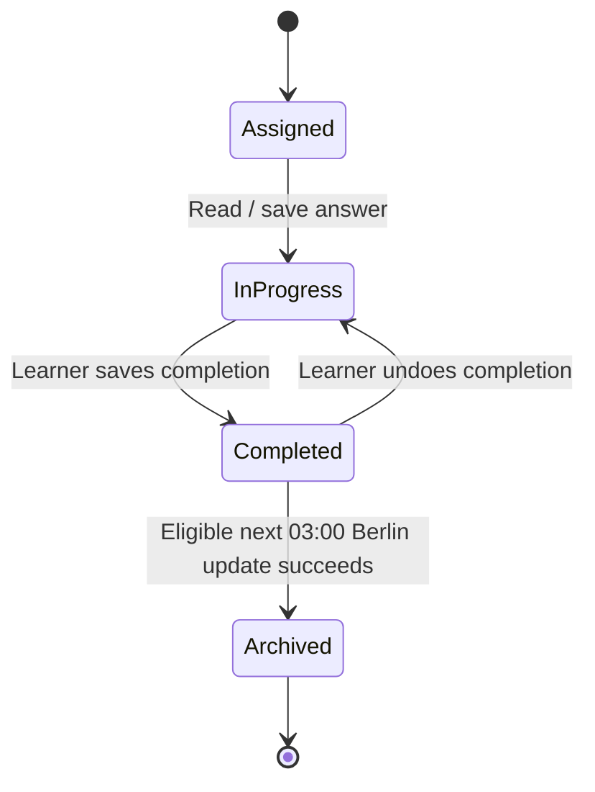

# Learning Hub — design and content specification

## Product direction

A calm working surface for shared learning: show what to study now, what has been done, and the next concrete output. Gray provides the reading surface; pink identifies the primary action and selected state. Keep the five learning tracks available to everyone.

This export implements the gray/pink theme on the existing interface. The simplified navigation and dedicated lesson reader below describe the next product iteration; they are not claimed as already shipped.

## Notebook interface (Sổ Học) — branch `design/notebook-ui`

Decided 09/10/2026: the interface is a study desk of composition notebooks. Each topic is one notebook; opening it shows the table of contents on the left page and the current lesson on ruled paper on the right. Proposal and audit: https://claude.ai/artifact/CspvHRUdbjj1FFuAze8Umc

- **Ownership (target):** each learner has their own shelf; family can view each other's notebooks but not edit them; Bột's notebook is written by parents; anyone may open a new topic and its first lesson arrives with the next morning run. Until per-learner data (P1.1) and topic creation exist, the shelf shows the five shared tracks and "Mở sổ mới" is shown as not yet available.
- **Destinations:** Bàn học (`/`), a notebook (`/?so=<track>` with tabs `bai`, `muc-luc` on phones, `muc-tieu`, `ghi-chu`, `tai-lieu`; a lesson is `&bai=<id>`), Ghi chú (`/?trang=ghi-chu`), Quản trị (`/?trang=quan-tri`, admin only). Old `/?lesson=<id>` links still open the matching notebook page.
- **Landhaus study (room metaphor):** the top bar is an oak plank ceiling with a beam; walls are lime plaster. Phòng học (home) is the room: a greeting by a black steel garden window, the aged-oak desk with drawers that holds only what needs attention: a post-it for each lesson not yet completed (one colour per notebook, track name always written on it, a "Mới" mark when assigned today and not yet answered) and a taped post-it for each journal entry due for review, with "Đã ôn" on it; finished tracks are listed in one line under the notes, and a white-painted bookcase with oak crown, shelves and counter and white bead-board doors where the notebooks stand. Opening a notebook lays it open on the oak desk. Wood and plaster textures are SVG noise tiles in `public/textures/` (`oak.svg`, `oak-v.svg`, `plaster.svg`); colours come from the `wall`, `oak`, `cabinet`, `postit-*` and `iron` tokens, with darker evening values in dark mode. Oak is deliberately dark and aged, so text on wood is light (`oak-ink`).
- **Buttons as bricks:** the main action is a fired brick (`brick` utility, `--color-brick`), other actions are sandstone blocks (`stone`), both with a mortar joint; text links stay pink. There is no brick wall.
- **Top bar:** the Learning Hub mark is a Landhaus cottage whose chimney is a pencil (`HouseLogo`, same drawing as `public/favicon.svg`). Minutes studied today sit in the top bar as a small ruler (x/target phút) that grows every few seconds while a notebook is open; the hourglass turns over while time is counted. Hovering or focusing it shows a post-it with minutes per notebook; pressing it opens a post-it to change the daily target (default 60 minutes, 5–720). Study time is counted automatically while a notebook is open, the tab is visible and there was input in the last 10 minutes; there is no manual "Buổi học" entry. Time and target are stored per account and Berlin day in D1 (`study_time`, `learner_settings`, `/api/study`); the browser reports every 30 seconds and when the notebook closes or the tab is hidden, and shows unconfirmed seconds until the server accepts them.
- **Motion that imitates real actions:** the cursor is a pencil (`public/cursors/`), lifted with a pink tip over anything pressable. Taking a notebook from the bookcase is a view transition: its cover flies to the notebook header while the book rises onto the desk, then the marble cover swings open around the spine. Moving to another lesson turns the page to the left; going back to the room puts the book down. Post-its are pressed onto the desk one after another and peel at the corner on hover; drawers slide out and cupboard doors swing ajar on hover; the "ĐÃ HỌC" stamp presses down only right after the learner marks completion; new journal entries appear as if written; link underlines are drawn in pencil. Reading pages have no ambient motion (only the garden window sways on the room page). Everything is disabled with `prefers-reduced-motion`; browsers without view transitions simply switch pages.
- **Paper realism:** marble covers with cloth spine and name label, ruled paper on a 28px rhythm with a double pink margin, dates written in the margin, sticky notes for diagrams and deliverables, an "ĐÃ HỌC" stamp only after the learner saves completion. Body text stays a print face at 16px; the handwriting face is for labels, margin dates, section headings and hints only.
- **Saving:** assigned lessons save through `/api/daily` and show "Đã lưu …" only after the server answers. Notes, journal and milestones save immediately; a failed save stays visible with retry/reload. Drafts persist while moving between notebooks and warn before leaving the site.

## Information architecture

Aim for three main destinations:

1. **Dashboard / Hôm nay:** current assignments, actual progress and time, unfinished work, review due, most recent verified content check.
2. **Học / Learn:** curriculum by track, current lesson reader and history. Each lesson has its own address so it can be resumed and shared within the authenticated workspace.
3. **Tài liệu / Library:** Docs links and short notes. Project milestones, reflection and review appear within their relevant track or dashboard rather than becoming many competing top-level pages.

Preserve existing notes, projects and journal during consolidation. The exported interface still exposes those destinations until a deliberate migration is implemented.

## Dashboard

The first screen should answer: What am I studying? Where did I stop? What do I need to do next?

- Show current lesson per track, concise title/objective, time estimate and continue action.
- Completion uses saved state, never synthetic percentages. Time studied is measured (time with a notebook open and in use), not the nominal length of a lesson.
- Distinguish `Đang học`, `Đã xong — chờ bài tiếp`, `Chưa có bài`, and update failure.
- Display one most-recent check timestamp and its result; do not imply content was replaced if no track advanced.
- Keep each account's daily target visible (default 60 minutes, changeable from the top bar) without requiring one long session.
- No duplicate “daily lesson” and “extra starter lesson” blocks in the future simplified dashboard.

## Lesson reader

Recommended order:

1. Objective and prerequisite recall.
2. Short concept explanation with terms in VI/EN/DE.
3. A functional diagram or worked example.
4. Recall questions before showing the rubric.
5. A practical exercise and a verifiable deliverable.
6. Saved answer, reflection and what remains unclear.
7. Source links with read scope/date; expert/source uncertainty where relevant.
8. Save draft, complete, and later review.

Prepared content and rubrics render locally; interactions update answers and state. AI is optional for immediate interaction. The scheduled assistant can supply personalized feedback at the next run. An “Ask in ChatGPT/Claude” flow must disclose that it opens another service; do not label a custom tutor as the native ChatGPT Study tool.

A lesson has a stable ID, track, assignment date, content version, saved response, completion timestamp and revision/update timestamp. Feedback is linked to the exact answer/version evaluated. Editing Docs should not silently rewrite a lesson already being studied.

## Content tracks

| Track | Prerequisites and progression | Practical outputs |
|---|---|---|
| Deutsch | A2 grammar and workplace situations → B1/B2 speaking/writing → longer-term C2 | Emails, recorded explanations, corrected error log |
| AI & Engineering | Service design, reproducible deployment, evaluation → multiagent evidence critique and expert-in-loop SWARM | Architecture, deployment checklist, retrospective evaluation |
| Medical Systems Biology | Cancer biology/pathology → sequencing/QC → variants/PGx → clinical evidence and MTB | Evidence tables, molecular interpretation exercises |
| Cardio | Cardiac/mitral structure, mechanisms of primary MR, existing techniques → feasibility, protocol, sponsor discussion | Concept diagrams, PICO, endpoints, draft protocol |
| Bột | Age/context observations → feeding/sleep/movement/language → interaction and confidence | Short observations, activities, review of what worked |

Use conceptual foundations as the curriculum. New research enriches a lesson when relevant; daily novelty does not determine the order. Older papers newly discovered are not “new publications”.

## Gray/pink palette

| Token | Value | Role |
|---|---|---|
| `--paper` | `#F4F4F6` | Page background |
| `--surface` | `#FFFFFF` | Reading cards and inputs |
| Sidebar | `#EDEDF1` | Quiet navigation |
| `--ink` | `#303139` | Main text |
| `--muted` | `#686974` | Supporting text |
| `--line` | `#DEDEE4` | Borders |
| `--accent` | `#9B4268` | Primary action, links, selected state |
| `--accent-hover` | `#833657` | Hover/emphasis |
| `--rose-soft` | `#F5E2EB` | Selected backgrounds and gentle highlights |

Notebook and room tokens (Tailwind `@theme` in `app/globals.css`, with dark values): `wall` #F1EDE6, `oak` #7C5A3C, `oak-dark` #523822, `cabinet` #F2EFE8, `brick` #8E4636, `stone` #D9C6A2, `iron` #1F1F22, `paper` #FEFDFA, `rule` #CBD4E3, `margin` #E6A9C3, `cover` #1B1B20, `spine` #26262C, `label` #FFFFFF with fixed dark label text. The marble texture is `public/textures/marble.svg`.

Track accents remain within gray/mauve/pink. Do not rely on color alone: retain track names, completion labels and icons. Dark rose buttons use white text; light pink uses dark text. No animated decoration during reading.

## Typography, layout and accessibility

Keep Be Vietnam Pro for interface/body and Newsreader for headings, plus Patrick Hand (has Vietnamese glyphs) for handwritten accents; system/Georgia fallbacks work without network fonts. Body 16px, supporting reading text 14px, metadata typically 12–13px. Limit reading width to around 65–75 characters when the dedicated reader is implemented.

Desktop keeps compact navigation and room for the reading surface. Mobile places the active lesson first and stacks actions without clipping; no horizontal page scrolling. Functional diagrams may scroll within their own region if needed. Use semantic headings, labeled inputs, focus indicators, keyboard-accessible controls and a clear save confirmation. Keep drafts after failed saves and warn before leaving unsaved answers.

## State and automated updates

A completed assignment remains visible while awaiting the next verified replacement. Unfinished assignments remain across dates. Each track advances independently. The writer checks the latest completion, expected ID, cutoff and day; an assistant prompt alone is not the guard.

## Docs synchronization contract — planned

Docs is the editable source for long text; D1 is the authority for progress/answers. Prefer explicit field ownership over mirroring everything in both directions:

- Docs → Hub: import a new content revision/draft with document ID and revision.
- Hub → Docs: append session summaries/feedback to an agreed section or separate document.
- A progress marker inside Docs does not directly complete a Hub lesson.
- Detect concurrent changes, retain versions and request resolution instead of overwriting.

Current code links Docs only. OAuth consent, unattended write permissions and conflict handling must be implemented and tested before calling this two-way sync.

## Operating model

Start with free managed infrastructure; benchmark before upgrades. AI research can run in a cloud scheduled task covered by an existing subscription. The task reads current progress through authorized tools and writes validated proposals. Hub remains usable if a task fails or the laptop is off; old lessons remain available.

Git stores source. D1 stores state. Docs stores documents. Backups store private copies. These have separate permissions and migration lifecycles.
