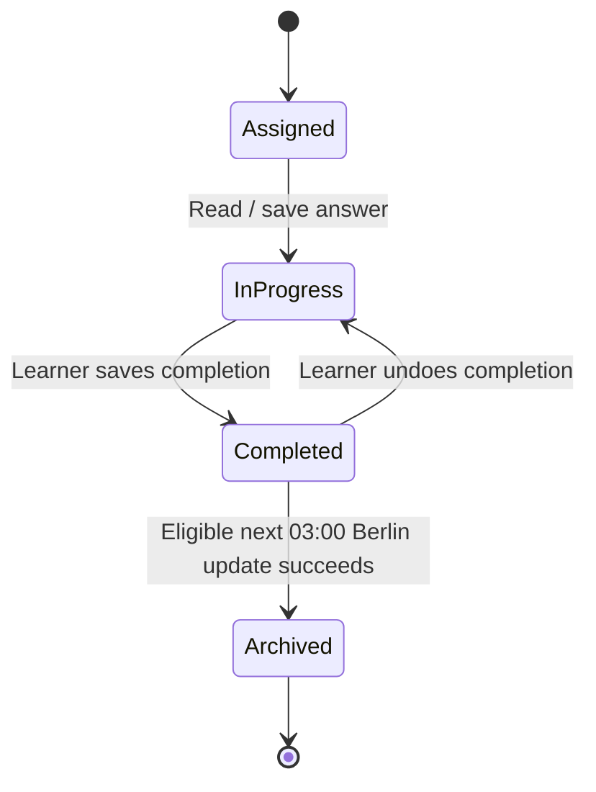

# Learning Hub — design and content specification

## Product direction

A calm working surface for learning: show what to study now, what has been done, and the next concrete output. Paper and plaster provide the reading surface; pink marks the pen, the margin and links; brick marks the main action.

Shipped on `learn.unhuman.cc` on 10/10/2026 (`main`, `bd4cddc`). What exists today is listed in [docs/FEATURES.md](docs/FEATURES.md); the sections below are the design rules.

## Notebook interface (Sổ Học)

Decided 09/10/2026: the interface is a study desk of composition notebooks. Each topic is one notebook; opening it shows the table of contents on the left page and the current lesson on ruled paper on the right. Proposal and audit: https://claude.ai/artifact/CspvHRUdbjj1FFuAze8Umc

- **Ownership (target):** each learner has their own shelf; family can view each other's notebooks but not edit them; Bột's notebook is written by parents; anyone may open a new topic and its first lesson arrives with the next morning run. Until per-learner data (P1.1) and topic creation exist, the shelf shows the five shared tracks and "Mở sổ mới" is shown as not yet available.
- **Destinations:** Bàn học (`/`), a notebook (`/?so=<track>` with tabs `bai`, `muc-luc` on phones, `muc-tieu`, `tai-lieu`; a lesson is `&bai=<id>`), Quản trị (`/?trang=quan-tri`, admin only). Old `/?lesson=<id>` links still open the matching notebook page.
- **Landhaus study (room metaphor):** the top bar is an oak plank ceiling with a beam; walls are lime plaster. Phòng học (home) is the room: a greeting with a tear-off calendar leaf, the Lübeck window (below) on the wall above the aged-oak desk with drawers that holds only what needs attention: a post-it for each lesson not yet completed (one colour per notebook, track name always written on it, a "Mới" mark when assigned today and not yet answered); finished tracks are listed in one line under the notes, and a white-painted bookcase with oak crown, shelves and counter and white bead-board doors where the notebooks stand. Opening a notebook lays it open on the oak desk. Wood and plaster textures are SVG noise tiles in `public/textures/` (`oak.svg`, `oak-v.svg`, `plaster.svg`); colours come from the `wall`, `oak`, `cabinet`, `postit-*` and `iron` tokens, with darker evening values in dark mode. Oak is deliberately dark and aged, so text on wood is light (`oak-ink`).
- **Buttons as bricks:** the main action is a fired brick (`brick` utility, `--color-brick`), other actions are sandstone blocks (`stone`), both with a mortar joint; text links stay pink. There is no brick wall.
- **Top bar:** the Learning Hub mark is a Landhaus cottage whose chimney is a pencil (`HouseLogo`, same drawing as `public/favicon.svg`). Minutes studied today sit in the top bar as a small ruler (x/target phút) that grows every few seconds while a notebook is open; the hourglass turns over while time is counted. Hovering or focusing it shows a post-it with minutes per notebook; pressing it opens a post-it to change the daily target (default 60 minutes, 5–720). Study time is counted automatically while a notebook is open, the tab is visible and there was input in the last 10 minutes; there is no manual "Buổi học" entry. Time and target are stored per account and Berlin day in D1 (`study_time`, `learner_settings`, `/api/study`); the browser reports every 30 seconds and when the notebook closes or the tab is hidden, and shows unconfirmed seconds until the server accepts them.
- **Lübeck window (`app/hub/lubeck/`):** one pane of glass in a black steel frame, no glazing bars, looking onto old Lübeck in layers: far skyline of spires, old-town gables and St. Mary's, then Holstentor, the Salzspeicher, quay and stone bridge on the Trave, all mirrored in the water; a bough crosses the top-left corner and one plant stands on the sill. Hardcoded illustration colours (it does not follow the theme). Sky colour, sun, stars and lit windows follow sunrise and sunset computed for Lübeck (`lib/lubeck/sky.ts`) and the device clock read as Europe/Berlin. Cloud, rain, snow, fog and the moon (phase, rise, set) come from `/api/ambient`; when a service is away the window uses the season's usual weather and a computed moon, never a blank sky. Far layers lean toward the sky colour (haze), everything warms at the golden hour, and after dusk a lamp pool lights the desk. Each month changes four things and nothing else: the town's decoration (Fasching bunting, Easter eggs, Maibaum, Travemünder Woche sails, summer stalls, Erntedank, 3 October flags, St. Martin lanterns, Weihnachtsmarkt; fireworks on New Year's night), the sill plant, one small object on the desk and one on the bookcase counter (`items.ts`). Keep those objects small; drawers and cupboard doors stay. Swans and ducks cross the river; all motion is slow and stops under reduced motion. The window is decoration: `aria-hidden`, no text, never required to use the Hub.
- **Written on the page (notebook and lesson):** everything inside a `RuledPage` sits on the 28px rule: body text `leading-7`, headings two lines, gaps in whole lines; no bordered cards inside paper. Answers are written on the lines (borderless inputs in the hand font), choices are ticked in a pen circle, hints and small links are pencilled asides (`app/hub/paper-bits.tsx`: `pencil`, `pencilLink`). Marking looks like a teacher's: a rubber `ResultStamp` and remarks in `RedPen`; skills are three pencil `Dots`. One brick button per screen (open the lesson, or "Xong bài"); checking one answer is a sandstone button; the three lesson requests are paper flags on the page edge. The desk's quick look is a loose sheet of squared paper (`bg-graph`) under a clip, with study time as coloured squares; details stay in the notebook. Labelled desk drawers open "Bài đã học" and "Cài đặt". Learners never see skill keys, ISO dates or grader internals.
- **Motion that imitates real actions:** the cursor is a pencil (`public/cursors/`), lifted with a pink tip over anything pressable. Taking a notebook from the bookcase is a view transition: its cover flies to the notebook header while the book rises onto the desk, then the marble cover swings open around the spine. Moving to another lesson turns the page to the left; going back to the room puts the book down. Post-its are pressed onto the desk one after another and peel at the corner on hover; drawers slide out and cupboard doors swing ajar on hover; the "ĐÃ HỌC" stamp presses down only right after the learner marks completion; link underlines are drawn in pencil. Reading pages have no ambient motion (only the garden window sways on the room page). Everything is disabled with `prefers-reduced-motion`; browsers without view transitions simply switch pages.
- **Paper realism:** marble covers with cloth spine and name label, ruled paper on a 28px rhythm with a double pink margin, dates written in the margin, sticky notes for diagrams and deliverables, an "ĐÃ HỌC" stamp only after the learner saves completion. Body text stays a print face at 16px; the handwriting face is for labels, margin dates, section headings and hints only.
- **Saving:** assigned lessons save through `/api/daily` and show "Đã lưu …" only after the server answers. Documents and milestones save immediately; a failed save stays visible with retry/reload. Drafts persist while moving between notebooks and warn before leaving the site.

## Information architecture

Three destinations, as shipped:

1. **Phòng học:** the desk (open lessons and a compact progress card) and the bookcase (one notebook per topic).
2. **Cuốn sổ:** table of contents, lesson reader with history, goals and documents of that topic. Each lesson has its own address so it can be resumed and shared within the signed-in workspace.
3. **Quản trị** (admin only): approvals, update log, backups.

Legacy notes and journal entries remain in the workspace export.

## Dashboard

Use one compact card with paperclip tabs for the learner’s notebooks. Show 14 Berlin days of measured study time, the count of correct first answers without help against all eligible graded first answers, and up to three skill states. Day selection reveals that day’s values. Show up to three unresolved error patterns by count, with suspected signals clearly labeled. Keep full skill detail and lesson history inside the notebook.

The first screen should answer: What am I studying? Where did I stop? What do I need to do next?

- Show current lesson per track, concise title/objective, time estimate and continue action.
- Completion uses saved state, never synthetic percentages. Time studied is measured (time with a notebook open and in use), not the nominal length of a lesson.
- Distinguish `Đang học`, `Đã xong — chờ bài tiếp`, `Chưa có bài`, and update failure.
- Display one most-recent check timestamp and its result; do not imply content was replaced if no track advanced.
- Keep each account's daily target visible (default 60 minutes, changeable from the top bar) without requiring one long session.
- No duplicate “daily lesson” and “extra starter lesson” blocks in the future simplified dashboard.

## Lesson reader

Recommended order:

1. Objective and prerequisite recall.
2. Short concept explanation with terms in VI/EN/DE.
3. A functional diagram or worked example.
4. Recall questions before showing the rubric.
5. A practical exercise and a verifiable deliverable.
6. Saved answer, reflection and what remains unclear.
7. Source links with read scope/date; expert/source uncertainty where relevant.
8. Save draft, complete, and later review.

Prepared content and rubrics render locally; interactions update answers and state. AI is optional for immediate interaction. The scheduled assistant can supply personalized feedback at the next run. An “Ask in ChatGPT/Claude” flow must disclose that it opens another service; do not label a custom tutor as the native ChatGPT Study tool.

A lesson has a stable ID, track, assignment date, content version, saved response, completion timestamp and revision/update timestamp. Feedback is linked to the exact answer/version evaluated. Editing Docs should not silently rewrite a lesson already being studied.

## Content tracks

| Track | Prerequisites and progression | Practical outputs |
|---|---|---|
| Deutsch | A2 grammar and workplace situations → B1/B2 speaking/writing → longer-term C2 | Emails, recorded explanations, corrected error log |
| AI & Engineering | Service design, reproducible deployment, evaluation → multiagent evidence critique and expert-in-loop SWARM | Architecture, deployment checklist, retrospective evaluation |
| Medical Systems Biology | Cancer biology/pathology → sequencing/QC → variants/PGx → clinical evidence and MTB | Evidence tables, molecular interpretation exercises |
| Cardio | Cardiac/mitral structure, mechanisms of primary MR, existing techniques → feasibility, protocol, sponsor discussion | Concept diagrams, PICO, endpoints, draft protocol |
| Bột | Age/context observations → feeding/sleep/movement/language → interaction and confidence | Short observations, activities, review of what worked |

Use conceptual foundations as the curriculum. New research enriches a lesson when relevant; daily novelty does not determine the order. Older papers newly discovered are not “new publications”.

## Gray/pink palette

| Token | Value | Role |
|---|---|---|
| `--paper` | `#F4F4F6` | Page background |
| `--surface` | `#FFFFFF` | Reading cards and inputs |
| Sidebar | `#EDEDF1` | Quiet navigation |
| `--ink` | `#303139` | Main text |
| `--muted` | `#686974` | Supporting text |
| `--line` | `#DEDEE4` | Borders |
| `--accent` | `#9B4268` | Primary action, links, selected state |
| `--accent-hover` | `#833657` | Hover/emphasis |
| `--rose-soft` | `#F5E2EB` | Selected backgrounds and gentle highlights |

Notebook and room tokens (Tailwind `@theme` in `app/globals.css`, with dark values): `wall` #F1EDE6, `oak` #7C5A3C, `oak-dark` #523822, `cabinet` #F2EFE8, `brick` #8E4636, `stone` #D9C6A2, `iron` #1F1F22, `paper` #FEFDFA, `rule` #CBD4E3, `margin` #E6A9C3, `cover` #1B1B20, `spine` #26262C, `label` #FFFFFF with fixed dark label text. The marble texture is `public/textures/marble.svg`.

Track accents remain within gray/mauve/pink. Do not rely on color alone: retain track names, completion labels and icons. Dark rose buttons use white text; light pink uses dark text. No animated decoration during reading.

## Typography, layout and accessibility

Keep Be Vietnam Pro for interface/body and Newsreader for headings, plus Patrick Hand (has Vietnamese glyphs) for handwritten accents; system/Georgia fallbacks work without network fonts. Body 16px, supporting reading text 14px, metadata typically 12–13px. Limit reading width to around 65–75 characters when the dedicated reader is implemented.

Desktop keeps compact navigation and room for the reading surface. Mobile places the active lesson first and stacks actions without clipping; no horizontal page scrolling. Functional diagrams may scroll within their own region if needed. Use semantic headings, labeled inputs, focus indicators, keyboard-accessible controls and a clear save confirmation. Keep drafts after failed saves and warn before leaving unsaved answers.

## State and automated updates

A completed assignment remains visible while awaiting the next verified replacement. Unfinished assignments remain across dates. Each track advances independently. The writer checks the latest completion, expected ID, cutoff and day; an assistant prompt alone is not the guard.

## Docs synchronization contract — planned

Docs is the editable source for long text; D1 is the authority for progress/answers. Prefer explicit field ownership over mirroring everything in both directions:

- Docs → Hub: import a new content revision/draft with document ID and revision.
- Hub → Docs: append session summaries/feedback to an agreed section or separate document.
- A progress marker inside Docs does not directly complete a Hub lesson.
- Detect concurrent changes, retain versions and request resolution instead of overwriting.

Current code links Docs only. OAuth consent, unattended write permissions and conflict handling must be implemented and tested before calling this two-way sync.

## Operating model

Start with free managed infrastructure; benchmark before upgrades. AI research can run in a cloud scheduled task covered by an existing subscription. The task reads current progress through authorized tools and writes validated proposals. Hub remains usable if a task fails or the laptop is off; old lessons remain available.

Git stores source. D1 stores state. Docs stores documents. Backups store private copies. These have separate permissions and migration lifecycles.

## Cuốn sổ mở và trang bài

Sổ chủ đề nằm trên bàn gỗ. Ba thẻ Mục lục, Hôm nay, Tiến độ dẫn đến từng trang. Bánh răng mở Cài đặt và nút Đóng sổ đưa về bàn học. Sổ nền giữ đường dẫn cũ và có thẻ riêng cho tài liệu.

Giấy kẻ và giấy ô li giữ màu kem ở cả hai chế độ. Chữ trên giấy dùng token riêng, còn gỗ và tường đổi màu theo ánh sáng. Một trang bài trên điện thoại, hai trang cạnh nhau từ 1024px. Khối câu giữ nguyên khi chia trang. Trang khuất nằm ngoài luồng Tab và trình đọc màn hình. Phím mũi tên, nút mép trang và vuốt ngang đều lật được. Khi giảm chuyển động, trang đổi ngay.

Lời chào lấy giờ Berlin. Câu khích lệ dựa trên việc học đã lưu ở các sổ đang dùng. Tên người, lời phê và nút bấm dùng tiếng Việt ngắn. Hồ sơ trẻ em có dòng kẻ rộng hơn, ngày học đủ mười phút có sticker và câu đã chấm có nút Hỏi bố mẹ.

Giấy nhắc “Có câu cần sửa lại” mở đúng câu cần sửa. Bài mới mở ở Ghi nhớ, bài dở mở ở câu chưa nộp đầu tiên, bài đã xong mở Tổng kết. Mẩu giấy vàng mở từng gợi ý. Số dòng của khung được tính từ cấu trúc bài và kích thước màn hình. Gợi ý và lời phê cập nhật bên trong trang hiện có.
