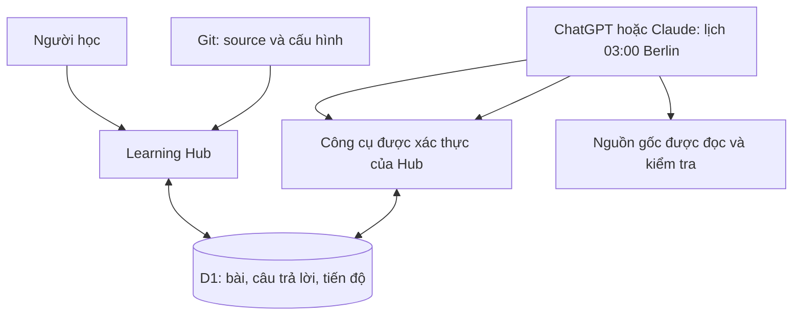

# Learning Hub

Source riêng tư: https://github.com/unhuman1289/learning-hub

Không gian học chung tại `learn.unhuman.cc`: đọc, hiểu, thực hành, nhận phản hồi và giữ tiến độ. Nội dung dùng chung; không chia quyền học theo Vũ/Ly/Gia đình.

## Trạng thái triển khai

Learning Hub đang chạy trên Cloudflare staging tại [learning-hub-staging.tranvu-812.workers.dev](https://learning-hub-staging.tranvu-812.workers.dev). Ai cũng có thể đăng ký bằng email; sau khi xác minh, tài khoản chờ admin duyệt trước khi đăng nhập. Trang này dùng D1 staging cho bài, câu trả lời và tiến độ. Xem [hướng dẫn staging](docs/ops/STAGING-CUTOVER-GUIDE.md) để hoàn tất kiểm tra tài khoản.

`learn.unhuman.cc` vẫn chạy Sites v5. DNS/production chưa thay đổi. Staging hiện phục vụ snapshot và nội dung đã chuẩn bị sẵn; bộ sinh bài tự động theo lịch qua Automation API chưa triển khai. Theo [kế hoạch v2](docs/plan/learning-hub-plan-v2-cloudflare.md), cutover domain chỉ diễn ra cuối Phase 1, sau khi runner thay thế hoạt động.

- Source của Sites phiên bản 5, commit gốc `ed5cdc0a2b7e86b899f0810690a4de4033908d47`, được export ngày 07/10/2026; giữ nguyên lịch sử Git.
- Giao diện local đổi sang **xám–hồng**; tài liệu vận hành và phục hồi D1 đã bổ sung.
- Website hiện dùng React 19, Vinext/Vite, Cloudflare Workers, D1 và bucket backup R2 riêng cho staging. CI kiểm tra test, typecheck, lint và build; workflow deploy staging chỉ chạy thủ công.
- Bản sao dữ liệu live nằm tại `private-data/sites-export.json`, **không commit vào Git**. Bản export này gồm 5 bài, 5 slot, 1 lần cập nhật và 1 workspace; gồm câu trả lời và trạng thái tại thời điểm export.
- Google Docs hiện là các liên kết tài liệu gốc, **chưa đồng bộ tự động hai chiều**.
- Lịch tạo nội dung 03:00 Europe/Berlin hiện vẫn thuộc Sites; Worker staging chỉ chạy cron sao lưu D1. Export source không chuyển lịch tạo bài, credential hay database của Sites.
- Chủ dự án đã xác nhận đăng nhập staging được và câu trả lời đã lưu vẫn còn sau khi đăng xuất rồi đăng nhập lại. Đặt lại mật khẩu và các gate vận hành còn lại được ghi trong [hướng dẫn staging](docs/ops/STAGING-CUTOVER-GUIDE.md).

## Chạy trên máy

Cần Node.js **22.13+** cho ứng dụng; dùng **Node 24+** để chạy test TypeScript và SQLite tích hợp. npm dùng lockfile có sẵn.

```sh
npm ci
npm run db:migrate:local
# Chỉ với database local mới, nếu có bản sao dữ liệu:
npm run db:restore:local
npm run dev
```

Mở `http://localhost:5173`, tạo tài khoản local `local@example.test` bằng mật khẩu thử nghiệm của riêng bạn rồi đăng nhập. Tài khoản này chỉ được cho phép trong cấu hình dev loopback, không đi vào build/deploy production. Local auth không gửi email và không thay cho kiểm thử xác minh email trên staging. Với staging/production, chỉ bật đăng ký sau khi sender email đã xác thực và secrets đã được cấu hình; xem [EMAIL.md](docs/ops/EMAIL.md). Không cần AI API key để chạy Hub hoặc xem/chấm theo đáp án biên soạn sẵn.

Một người clone Git lần đầu sẽ không có `private-data/sites-export.json`. Có thể chạy local với DB trống; không tự giả lập tiến độ. Để có nội dung live, chuyển bản backup riêng qua kênh tin cậy rồi chạy restore trên DB local mới. Không chạy restore vào DB đã học: INSERT không ghi đè khóa có sẵn.

```sh
npm run test
npm run typecheck
npm run lint
npm run build
```

Build thành công không xác nhận đã deploy hoặc đã đạt giới hạn CPU của Workers Free. Nếu cổng 5173 đang có phiên khác, chạy `npm run dev -- --port 5267` và mở địa chỉ tương ứng.

## Học hằng ngày

1. Vào **Hôm nay**, mở bài đang học của một mảng.
2. Đọc các phần giải thích, sơ đồ và ví dụ. Đọc tài liệu gốc khi cần.
3. Làm thực hành, trả lời câu hỏi bằng lời của mình; đối chiếu tiêu chí sẵn.
4. Bấm **Lưu câu trả lời**; bấm **Đã học xong** khi thực sự hoàn thành. Các nút bài hằng ngày lưu ngay. Ghi chú/nhật ký ở khu vực khác cần bấm **Lưu thay đổi**.
5. Lượt cập nhật ngày tiếp theo chỉ thay bài của mảng đã xong trước 03:00 Berlin. Bài chưa xong giữ nguyên. Bài cũ và câu trả lời được giữ để ôn.
6. Mở **Nhật ký cập nhật** để xem dữ liệu hiện có. Admin có thể tạo bản sao trên R2 hoặc tải bản sao mới nhất về; bộ sinh bài hằng ngày chưa được nối vào staging. Bài, câu trả lời, ghi chú và tiến độ được lưu trong D1 khi máy chủ xác nhận.

Thời lượng mục tiêu là tối thiểu 240 phút/ngày, chia thành nhiều phiên linh hoạt. Dùng sơ đồ → đọc → nhớ lại → thực hành → phản hồi → ôn. Đánh dấu hoàn thành là hành động của người học; AI không tự đánh dấu.

## Năm mảng nội dung

| Mảng | Mục tiêu và bối cảnh |
|---|---|
| Deutsch | A2 tự đánh giá → B2 trong một năm cho công việc/chứng chỉ → C2 dài hạn; ưu tiên viết và nói |
| AI & Engineering | Coding, deploy và vận hành SWARM; dữ liệu ung thư hiếm → giả thuyết → phản biện bằng chứng → expert review → therapy ranking; đánh giá hồi cứu |
| Medical Systems Biology | MTB, oncology, pathology, sequencing, pharmacogenomics; kiến thức nền cho AG Busch/PM4Onco. Người học đã biết thống kê, Python, Linux, Git |
| Cardio | Kiến thức tim và phương pháp nghiên cứu. Mục tiêu 3 tháng của Ly: concept, protocol và bước đầu bảo trợ cho ý tưởng can thiệp hở hai lá nguyên phát bằng implant vòng van kết hợp clip; cần kiểm tra tính mới và khả thi |
| Bột | Ăn/ngủ, vận động, tương tác, giao tiếp, tự tin và ứng xử; cá thể hóa theo giai đoạn. Không hứa tăng IQ/chiều cao; phân biệt nghiên cứu với quan niệm văn hóa |

Giải thích chính bằng tiếng Việt, giữ thuật ngữ Anh/Đức; bài Đức dùng tiếng Đức theo trình độ. Tháng tuổi trong phần nội dung tĩnh là bối cảnh ngày export, không phải hồ sơ phát triển đã được xác nhận.

## AI bằng thuê bao hiện có

**Mục tiêu triển khai:** Workers Free + D1 cho website/trạng thái; ChatGPT Plus hoặc Claude Pro làm tác vụ cloud định kỳ để nghiên cứu và biên soạn. Không cần model API cho luồng cập nhật theo đợt. Phần runner và API thay bài chưa có trong staging.



Repo chưa có kết nối Claude hoặc OAuth Google riêng, và API Sites cũ đã bị tắt trên Worker. Chưa có tác vụ nào tự thay nội dung D1. Đăng nhập Plus/Pro không tự tạo quyền dịch vụ; laptop không cần chạy để Hub và D1 hoạt động. Xem [AUTOMATION.md](docs/AUTOMATION.md) và [LEARNING-UPDATES.md](LEARNING-UPDATES.md).

Không cần push code mỗi ngày để đổi bài: dữ liệu bài nằm trong D1. Nếu biên soạn bài dạng file trong Git, chỉ cập nhật thư mục content và import qua writer có kiểm tra completion; deploy source không được tự thay bài đang học.

## Source, tài liệu, trạng thái ở đâu?

- **Git:** source, schema/migrations, tài liệu hướng dẫn, thiết kế, prompt chuẩn. Repo riêng tư; không có token, câu trả lời hay backup live.
- **D1:** hiện còn trạng thái dùng chung, bài/lịch sử, câu trả lời, revision và nhật ký từng lượt. Giai đoạn 1 sẽ tách tiến độ theo người đăng nhập, vẫn cho mọi người học mọi mảng.
- **Google Docs/Drive:** tài liệu dài, ghi chú có thể chỉnh sửa, paper/PDF. Docs không làm database tiến độ.
- **Local private-data:** snapshot phục hồi; cần backup riêng vì Git không chứa nó.

Các tài liệu nền: [AGENTS.md](AGENTS.md), [DESIGN.md](DESIGN.md), [PRODUCT.md](PRODUCT.md). PRODUCT giữ bối cảnh export; README/DESIGN mô tả quyết định mới. QUEST/SWARM là dự án riêng; repo Hub không chứa source hay dữ liệu bệnh nhân của hai dự án.
