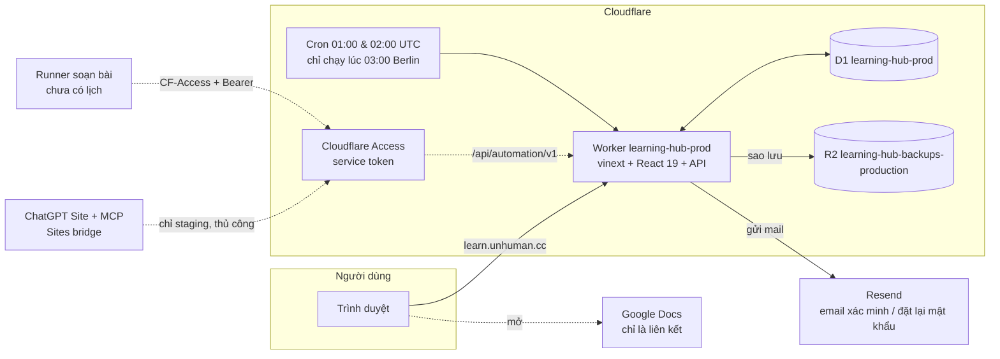

# Learning Hub — kiến trúc

Cập nhật 10/10/2026. Tính năng người dùng ở [FEATURES.md](FEATURES.md). Hướng tiếp theo (Learning Hub 2.0) ở [hub2/](hub2/README.md); thứ tự triển khai ở [docs/plan/PLAN.md](plan/PLAN.md).

> **Đọc trước:** production hiện chạy `main` (`bd4cddc`) **cộng với các thay đổi Phase 1 chưa commit** trong working tree của checkout chính: learner scope, automation API v1, Access, Sites bridge, migration `0004`–`0006`. Tài liệu này mô tả hệ thống đang chạy. Mỗi phần chỉ có trong working tree được đánh dấu **(chưa commit)**. Xem §10 về việc đưa Git về khớp với production.

## 1. Tóm tắt

- **Ứng dụng web**: React 19 render phía server bằng [vinext](https://github.com/cloudflare/vinext) (App Router kiểu Next.js trên Vite 8), chạy trong **một Cloudflare Worker** cho mỗi môi trường. Giao diện dùng Tailwind CSS 4.
- **Dữ liệu**: Cloudflare **D1** (SQLite). Bài, câu trả lời, tiến độ, thời gian học, nhật ký lượt soạn bài và tài khoản đều nằm trong D1.
- **Sao lưu**: cron của Worker tạo bản sao D1 lúc 03:00 Berlin vào **R2**; giữ 30 bản mới nhất.
- **Đăng nhập**: Better Auth với email và mật khẩu, xác minh email qua Resend, admin duyệt tài khoản mới.
- **Soạn bài tự động**: API `/api/automation/v1` cho một "runner" (tác vụ cloud) có xác thực riêng qua Cloudflare Access và khoá bearer **(chưa commit)**. API **bật trên staging, tắt trên production**. Hiện **chưa có lịch nào tự soạn bài**.
- **Chi phí**: Workers Free và D1; chưa có API model nào trong ứng dụng.

## 2. Sơ đồ hệ thống

Nét đứt là đường đã có nhưng chưa dùng trên production.

## 3. Môi trường

| | local | staging | production |
| --- | --- | --- | --- |
| Worker | `learning-hub-local` | `learning-hub-staging` | `learning-hub-prod` |
| URL | `http://localhost:8791` (bản build qua `wrangler dev`) | `learning-hub-staging.tranvu-812.workers.dev` | `learn.unhuman.cc` (Custom Domain); `workers_dev` cũng bật |
| D1 | `learning-hub` (ID giả, `.wrangler/state`) | `learning-hub-staging` | `learning-hub-prod` |
| R2 | không | `learning-hub-backups-staging` | `learning-hub-backups-production` |
| Cron | không | `0 1,2 * * *` | `0 1,2 * * *` |
| `APP_VERSION` (`/api/health`) | `local` | `mvp-2026-10-09` | `production-admin-bootstrap` |
| Automation API | tuỳ cấu hình | bật (Access + `AUTOMATION_ACCESS_AUD`) | **tắt**: thiếu `AUTOMATION_ACCESS_AUD` nên trả 503 |
| Đăng ký | tài khoản local tự active | xác minh email, admin duyệt | như staging |

Kiểm tra ngày 10/10/2026: `/api/health` của cả staging và production trả `status: ok` và `d1: connected`.

**Secret** (đặt bằng `wrangler secret put`, không có trong Git): `BETTER_AUTH_SECRET`, `BOOTSTRAP_ADMIN_EMAIL`, `RESEND_API_KEY`, `AUTOMATION_CLIENTS`. **Biến thường**: `ENVIRONMENT`, `APP_VERSION`, `DEPLOYMENT_ID`, `APP_ORIGIN`, `EMAIL_FROM`, `ACCESS_TEAM_DOMAIN`, `AUTOMATION_ACCESS_AUD`. Cấu hình nằm trong `wrangler.jsonc`.

## 4. Mã nguồn

| Thư mục | Nội dung |
| --- | --- |
| `build/worker.ts` | Điểm vào Worker. `fetch`: chặn đường cũ (`/api/learning-run` trả 410), khoá staging khi cần, rồi chuyển cho vinext. `scheduled`: khi giờ Berlin là 03:00 thì tạo bản sao lưu `daily-YYYY-MM-DD`; **không làm gì khác**. |
| `app/` | Trang (`page.tsx`, `login/`, `register/`, `forgot-password/`, `reset-password/`) và API (`app/api/**/route.ts`). |
| `app/hub/` | Giao diện đã đăng nhập: Phòng học (`desk.tsx`), cuốn sổ (`notebook-view.tsx`), trang bài (`lesson-page.tsx`), ghi chú (`journal.tsx`, `pages.tsx`), thước giờ học (`study-meter.tsx`); hook dữ liệu `use-daily`, `use-workspace`, `use-study-clock`, `use-route` (định tuyến bằng query `?so=…&bai=…`, chuyển cảnh View Transitions). |
| `components/notebook/` | Thành phần hình ảnh: giấy kẻ, bìa sổ, post-it, con dấu, bàn, tủ, khung, logo. |
| `app/content.ts`, `app/lesson-content.ts`, `app/google-docs.ts` | Nội dung tĩnh trong Git: 5 mảng, 13 bài nền, 2 dự án, 6 liên kết Docs. |
| `lib/` | Logic server: `auth/` (Better Auth, duyệt tài khoản, xác thực automation), `automation/` (context, state machine, SQL có điều kiện, kiểm tra riêng tư) **(chưa commit)**, `daily-*` (chính sách 03:00, đọc bài theo người), `study-sql.ts`, `backup-*`, `run-*`. |
| `db/schema.ts`, `drizzle/` | Schema Drizzle và migration SQL. |
| `scripts/` | D1 cục bộ, import/verify từ xa, diễn tập restore, smoke test, chuẩn bị secret cho Sites bridge. |
| `tests/` | Test Node (`node:test` + `node:sqlite`) cho chính sách, SQL, auth, automation, backup, giờ học. |
| `integrations/sites-bridge/` | Mã chạy trong ChatGPT Site để gọi automation API **(chưa commit)**. |

## 5. Dữ liệu (D1)

| Bảng | Phạm vi | Nội dung |
| --- | --- | --- |
| `user`, `account`, `session`, `verification`, `rate_limit` | theo tài khoản | Better Auth. `user.role` (`admin` / `learner`), `user.status` (`pending` / `active` / `disabled`). **Không nằm trong bản sao lưu ứng dụng.** |
| `learning_lessons` | **theo người** (`user_id`) **(chưa commit)** | Mỗi bài: `track`, `payload` (JSON `DailyContent`), `assigned_date` (ngày Berlin), `completed_at`, `response` (một ô trả lời), `updated` (khoá lạc quan), `automation_reviewed_at`. Duy nhất theo `(user_id, track, assigned_date)`. |
| `learning_slots` | theo người, mỗi mảng một dòng | Bài hiện tại `(user_id, track) → lesson_id`, có `revision`. |
| `learning_workspace` | **dùng chung cả nhà** | Một dòng JSON `__shared_family_workspace__`: ghi chú, nhật ký, mốc dự án, dấu "đã học" của bài nền, ngày bắt đầu dự án. Ghi theo `revision`; xung đột trả 409. |
| `study_time` | theo người và ngày | Số giây học theo `(user_id, day, track)`, tối đa 24 giờ mỗi mảng mỗi ngày. |
| `learner_settings` | theo người | `daily_target_minutes`, mặc định 60. |
| `automation_runs`, `run_targets`, `run_items`, `run_events` | hệ thống **(chưa commit)** | Lượt soạn bài v1: runner, khoá idempotency, hash context và kết quả, trạng thái, hạn 2 giờ; mục tiêu từng (người, mảng); kết quả từng mục; nhật ký sự kiện chỉ thêm, có trigger chặn sửa và xoá. |
| `runs`, `legacy_run_items`, `learning_runs` | lịch sử | Nhật ký lượt từ thời Sites, giữ để tương thích. |
| `backup_events` | hệ thống | Lịch sử tạo bản sao lưu. |

Kiểu nội dung bài `DailyContent` (`lib/daily-types.ts`): `title, objective, minutes, level, sections[{heading,text}], diagram, exercise, questions[{question,answer}], deliverable, sources[{title,url,readScope,retrievedAt,publishedAt}], nextTopic`.

## 6. API

**Cho người dùng** (cookie phiên Better Auth; mọi lệnh ghi kiểm tra `Origin`):

| Đường dẫn | Mô tả |
| --- | --- |
| `GET /api/health` | Trạng thái, môi trường, phiên bản, kết nối D1. Không cần đăng nhập. |
| `/api/auth/*` | Better Auth: đăng ký, đăng nhập, xác minh email, đặt lại mật khẩu; có giới hạn tần suất (ví dụ đăng nhập 8 lần/phút). |
| `GET, POST /api/daily` | Bài hiện tại và lịch sử (100 bài) **của người đang đăng nhập**; POST lưu bài làm hoặc hoàn thành theo `id` + `expectedUpdated`. Admin nhận thêm nhật ký lượt và trạng thái sao lưu. |
| `GET, PUT /api/state` | Workspace dùng chung theo `revision`. |
| `GET, POST, PUT /api/study` | Giờ học hôm nay; POST cộng tối đa 120 giây mỗi lần; PUT đổi mục tiêu (5–720 phút). |
| `GET /api/export` | Bản sao lưu đầy đủ (đăng nhập). |
| `/api/admin/users`, `/api/admin/backup` | Duyệt tài khoản; tạo / tải bản sao R2 (admin). |
| `/api/learning-run` | Đường cũ của Sites, trả **410**. |

**Cho runner** **(chưa commit)**: `/api/automation/v1`. Hợp đồng đầy đủ ở `docs/AUTOMATION.md`.

Một lượt gồm 4 bước:

1. `POST /runs`.
2. `GET context`: mỗi mục tiêu là một cặp (người học, mảng), kèm `eligible` và lý do, bài hiện tại, tối đa 3 câu trả lời mới. Không có email; tối đa 64 KB.
3. `POST result`: mỗi mục là `assign` (kèm `lesson-package/1`), `issue` hoặc `no_action`. Phải khớp `expectedCurrentLessonId` và `contextHash`.
4. `GET /runs/{id}` để xác minh.

Tính chất của lượt:

- Hết hạn sau 2 giờ.
- Phát lại an toàn.
- Nhật ký sự kiện chỉ thêm, không sửa.

Server tự giữ các ràng buộc sau:

- Không thay bài chưa xong.
- Không tự hoàn thành.
- Mỗi người, mỗi mảng tối đa một bài mới mỗi ngày Berlin.
- Hoàn thành sau 03:00 thì chờ sang ngày.

Mới thử một vòng thủ công trên staging, chưa gán bài nào. API job v2 ([hub2/AI-API.md](hub2/AI-API.md)) sẽ thay v1; v1 tắt ở H8.6.

| Đường dẫn | Quyền (scope) |
| --- | --- |
| `POST /runs` | `runs:create` |
| `GET /runs/{runId}/context` | `context:read` |
| `POST /runs/{runId}/result` | `result:write` |
| `POST /runs/{runId}/fail` | `result:write` |
| `GET /runs/{runId}`, `GET /schema` | `context:read` |

## 7. Xác thực và quyền

- **Người dùng**:
  - Email và mật khẩu (12–128 ký tự). Bắt buộc xác minh email (trừ local).
  - Tài khoản mới ở trạng thái `pending` cho tới khi admin duyệt; chỉ tài khoản `active` mới tạo được phiên.
  - Admin đầu tiên lấy từ secret `BOOTSTRAP_ADMIN_EMAIL`.
  - Cookie bảo mật; IP lấy từ `cf-connecting-ip`.
- **Runner**, cần đủ hai lớp **(chưa commit)**:
  - **Cloudflare Access service token** (`CF-Access-Client-Id/Secret`). Worker tự kiểm JWT `Cf-Access-Jwt-Assertion`: RS256, đúng issuer `ACCESS_TEAM_DOMAIN`, audience `AUTOMATION_ACCESS_AUD`, `common_name` khớp client.
  - **Khoá bearer** `lhk_<clientId>_<secret>`. Worker so SHA-256 với `AUTOMATION_CLIENTS` (chỉ lưu hash) và kiểm tra scope.
  - Phiên đăng nhập của người không gọi được automation, và ngược lại.
- **Riêng tư** **(chưa commit)**:
  - Context gửi runner không có email hay tên; người học chỉ hiện bằng mã `lrn_…` (hash).
  - Nội dung bài gửi lên bị kiểm tra dữ liệu liên hệ và định danh lâm sàng. Bộ lọc này hiện chặn nhầm nhiều bài hợp lệ; xem §11 (B1, B2).
- **Ranh giới cũ**: header `oai-authenticated-user-*` của Sites không còn được tin.

## 8. Sao lưu và phục hồi

- **Tự động**: cron lúc 03:00 Berlin ghi JSON vào R2 (`learning-hub/<env>/backups/<iso>-<id>.json`), giữ 30 bản. Hub nhắc khi quá 7 ngày chưa có bản sao.
- **Thủ công**: trang Quản trị tạo hoặc tải bản sao; `GET /api/export`.
- **Nội dung**: mọi bảng ứng dụng trong `lib/backup-contract.mjs`, gồm cả `study_time` và `learner_settings`; format 3 **(chưa commit; `main` vẫn là format 2)**. Bảng auth không được sao lưu.
- **Phục hồi**: `npm run db:restore:local` (chỉ local), `db:restore:drill` và `db:drill:learner-migration` (dựng lại trong SQLite rồi so từng ô). `d1-import` / `d1-verify` cho staging và production cần đúng một admin đã xác minh làm chủ dữ liệu cũ. Chi tiết: `docs/ops/BACKUP.md`.

## 9. Build, kiểm thử, triển khai

- **CI** (`.github/workflows/ci.yml`, mỗi lần push và PR, Node 24): `npm ci`, `test`, `typecheck`, `lint`, `build`.
- **Deploy staging**: workflow `deploy-staging.yml` chạy thủ công; chạy lại các kiểm tra, áp migration D1 staging, rồi deploy.
- **Deploy production**: thủ công bằng wrangler; lần cutover 10/10 ghi trong `docs/ops/CLOUDFLARE.md` (working tree). Chưa có workflow production.
- **Chạy local**:
  - `npm run db:migrate:local`, rồi `npm run build`, rồi `wrangler dev --local --persist-to .wrangler/state`.
  - `npm run dev` hiện lỗi `sessionSchema.loose is not a function` do hai bản `zod` (Better Auth dùng zod 4, gốc dùng zod 3).

## 10. Git và production đang lệch nhau

| Hạng mục | `main` (`bd4cddc`) | Production |
| --- | --- | --- |
| Giao diện sổ học | có | có |
| Learner scope, automation v1, Access, Sites bridge | **không** | có |
| Migration đã áp | — | `0000`–`0006` (`0004_learner_scope`, `0005_automation`, `0006_study_time`) |
| Migration giờ học trong Git | `0004_study_time.sql` | áp dưới tên `0006_study_time.sql` (nội dung giống hệt) |
| Định dạng sao lưu | 2 | 3 |

Hệ quả:

- Deploy từ `main` sẽ **mất** learner scope và automation.
- Chạy migration từ `main` lên production sẽ thử áp lại `0004_study_time` và lỗi vì bảng đã có.

Cần làm: commit Phase 1 vào `main`. Trong cùng commit đó, xoá `drizzle/0004_study_time.sql` của `main` và dùng thứ tự `0004_learner_scope`, `0005_automation`, `0006_study_time` như production. Sau đó deploy production từ đúng commit đó.

## 11. Rủi ro và nợ kỹ thuật

| Mức | Vấn đề | Chỗ |
| --- | --- | --- |
| Cao | Git không khớp production (§10). | toàn repo |
| Cao | **B1, B2.** Bộ lọc riêng tư chặn nhầm: ngày `2026-10-09`, dải năm, ISBN bị coi là số điện thoại; bài MTB/Cardio có "case/patient" cùng "cancer/tumor/hospital" bị từ chối. | `lib/automation/privacy.ts` |
| Vừa | Ghi chú, nhật ký, mốc dự án vẫn dùng chung cả nhà (xử lý ở H1.3). | `app/api/state` |
| Vừa | **B5.** Trang Quản trị chỉ đọc nhật ký lượt cũ; lượt v1 không hiện (xử lý ở H5.8). | `lib/run-journal.ts` |
| Vừa | **B3, B4.** Mọi tài khoản active đều thành 5 mục tiêu soạn bài (kể cả mảng Bột), chưa có chọn mảng hay mục tiêu riêng (`goal: null`). | `lib/automation/context.ts` |
| Vừa | **B6.** Automation tắt trên production (thiếu `AUTOMATION_ACCESS_AUD`); Sites bridge chỉ trỏ tới staging. | `wrangler.jsonc`, `integrations/sites-bridge` |
| Vừa | Code soạn bài cũ (`learningContext`, `applyRun`, `UPDATE_INSTRUCTIONS` có mục tiêu gia đình viết cứng) vẫn còn dù không dùng. | `lib/daily-store.ts` |
| Thấp | Context giới hạn 64 KB và 10 bài mỗi lượt; khoảng hơn 10 tài khoản thì một lượt không trả lời hết. | `lib/automation/*` |
| Thấp | `replayed` trả `0` ở lần đầu nhưng `true` khi phát lại. | `lib/automation/state.ts` |
| Thấp | `workers_dev` bật trên production, mở thêm một hostname. | `wrangler.jsonc` |
| Thấp | `npm run dev` lỗi zod; `db/schema.ts` lệch so với migration auth (drizzle-kit muốn dựng lại bảng `user`). | `package.json`, `db/schema.ts` |

**Tài liệu mâu thuẫn hoặc đã cũ:**

- `docs/AUTOMATION.md` ghi API chưa deploy.
- `docs/plan/...` dòng 26 và 34 trái với dòng 28–35 và với `docs/ops/CLOUDFLARE.md`.
- `docs/ops/ACCESS.md` ghi mã lỗi khác với code.
- `AGENTS.md` vẫn ghi Sites giữ v5 tới cutover và `/api/learning-run` còn hoạt động.
- `docs/DEPLOYMENT.md`, `docs/PHASE-0-OPERATIONS.md`, `LEARNING-UPDATES.md` mô tả thời Sites; đã gắn nhãn lịch sử.

## H2/H3 — đợt tích hợp 13/10/2026 (staging, chưa production)

- Giao diện v2 dùng `HUB2_ENABLED=true` ở local/staging; đọc bài từ D1, không lấy local draft làm dữ liệu chính.
- `GET /api/lessons/{id}`: strip key/ẩn gợi ý, kèm submission gần nhất; `PUT .../draft` dùng revision; `POST .../items/{itemId}/reveal` ghi support trước khi trả.
- `POST .../submissions`: body chỉ chứa client UUID, revision và danh sách câu/giai đoạn. Server lấy đáp án đã lưu và mức hỗ trợ của server. Một D1 batch tạo submission, attempts, grades; replay cùng mã trả lại kết quả cũ. Không nhận điểm/support do client gửi.
- `GET /api/submissions/{id}`: chủ bài, admin hoặc guardian được phép đọc; người học khác 404. Ghi bài của người khác không được phép, kể cả admin/guardian.
- `PUT .../completion`: CAS timestamp, hoàn thành độc lập với điểm. Import admin kiểm cutoff 03:00 Berlin; không ghi đè bài cũ, đáp án hay lịch sử.
- `POST /api/admin/lessons/import`: active admin + cùng Origin + contract/privacy validation; lỗi có path. Giao bài và item/skill refs cùng batch.
- `0011_evidence.sql`: submissions → attempts → grades, thêm disputes cho H6 (chưa có luồng phản đối). Backup format 4 giữ cả bảng mới, điểm thập phân và retry links; ảnh R2 vẫn có vòng đời riêng 30 ngày.
- Câu mở `pending`, submission `deferred`. Chưa có assessor hoặc scheduled planner; trạng thái này không được trình bày như đã chấm.
- UI nháp giữ trong bộ nhớ khi đổi bài/mất mạng; chưa lưu bền vững offline qua đóng/tải lại tab. Lỗi nộp không rõ kết quả giữ nguyên UUID; không tạo lượt mới mù quáng.

## H4–H5 staging — 13/10/2026

D1 thêm skill_states/error_patterns, ai_jobs/attempt_diagnoses/alert_events. Submission và grade tạo bằng chứng; pure rules suy ra bốn chiều, mức trần, lịch ôn và mẫu lỗi. Grade + state + job outcome ghi trong một batch có revision/lease guards. API v2 kiểm Access JWT, bearer scopes/purposes/triggers và lease token; ảnh chỉ đọc khi thuộc snapshot còn hiệu lực. Context 14 ngày được lọc định danh, chụp và hash trước khi runner đọc. Queue producer chỉ báo metadata; chưa có consumer AI thật. Cron staging chạy đúng 03:00/06:00 Berlin qua hai trigger UTC.

Production vẫn bản cũ. E2E staging dùng tài khoản QA, runner giả, không đại diện chất lượng giảng dạy. CPU khi áp ba gói gần 96KB là 192ms: chưa có biên an toàn Workers Free cho trường hợp cực đại. Xem số đo và đề xuất trong VALIDATION; không đổi gói Cloudflare tự động.

## Kiến trúc MCP trực tiếp — staging

Theo yêu cầu trực tiếp của chủ dự án: bổ sung Worker `learning-hub-mcp-staging`, OAuth/PKCE và migration 0015 trên D1 staging. Đường mới: ChatGPT → MCP Worker → các hàm job v2 → D1 staging; không thông qua Sites, không dùng quyền service token chung. Quyền chỉ soạn bài của chính tài khoản đã duyệt và cấp consent; không chấm/admin. API khóa khi MCP/HUB2 tắt. Có trang thu hồi kết nối.

OAuth, MCP, lưu bài giả/đọc lại, refresh và thu hồi đã đạt trên HTTPS staging. Chưa nghiệm thu kết nối/ghi của tài khoản ChatGPT thật, chưa đặt lịch cloud, chưa bật production MCP hoặc H4/H5 production. Cầu nối Sites và DNS giữ nguyên. Các cổng nghiệm thu còn lại không được coi là hoàn tất bởi phép thử QA. Hướng dẫn và giới hạn: [DIRECT-MCP](ops/DIRECT-MCP.md).
