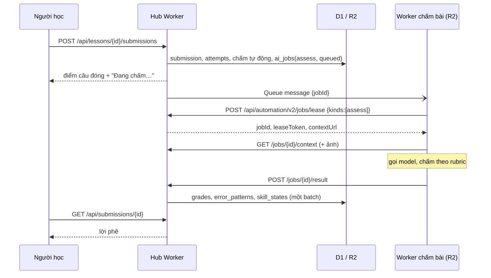
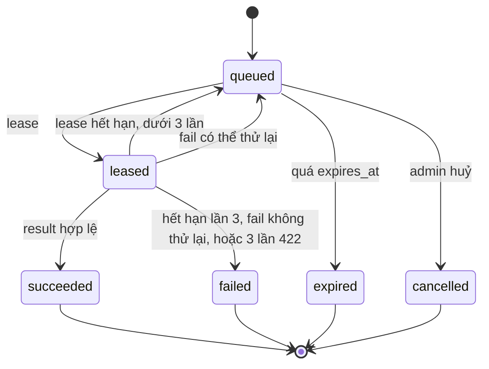

# Learning Hub 2.0 — API cho AI bên ngoài

Thuộc bộ [Learning Hub 2.0](README.md). Hub giữ dữ liệu và luật; **runner bên ngoài giữ model**. Hub không chứa API key model nào. Bất kỳ runner nào cũng cắm vào được nếu nói đúng hợp đồng dưới đây. Hai runner chính (§9):

- **R1, runner đêm:** tác vụ định kỳ ChatGPT gọi thẳng API.
- **R2, Worker chấm bài** `learning-hub-assessor`: Worker riêng giữ key Anthropic.

## 1. Mô hình

Có hai loại job, tương ứng hai lượt AI:

| Job | Khi nào | Đọc | Trả về |
| --- | --- | --- | --- |
| **plan** | `daily`: cron 03:00 Berlin. `initial`: khi mở sổ mới. `request`: câu hỏi khám phá hoặc xin thêm bài, loại "ngay". | plan-context/1 (§6.2) | Kỹ năng thêm/sửa, bài chính, bộ ôn, bài khám phá, đề xuất thành thạo, nhận xét tiến bộ (§6.3) |
| **assess** | `submission`: khi nộp mà có câu cần AI chấm. `recheck`: khi phản đối kèm yêu cầu chấm lại. | assess-context/1 (§6.4) | Điểm và lời phê từng câu, chẩn đoán lỗi, câu kiểm tra lại, đề xuất thành thạo và lịch ôn (§6.5) |

**Hub kéo, không đẩy dữ liệu.** Khi có job theo yêu cầu, Hub chỉ báo `jobId`: qua Queue cho Worker chấm bài, hoặc qua webhook cho runner ngoài (§5). Runner tự **lease** job qua API rồi đọc context. Dữ liệu chỉ đi một đường, và có kiểm soát bằng lease.



Plan `daily` đi cùng đường: cron tạo job lúc 03:00, tác vụ ChatGPT lease lúc 03:10. Không cần báo việc.

## 2. Xác thực

Dùng lại cơ chế v1 (`lib/auth/automation.ts`):

- **Cloudflare Access service token:** `CF-Access-Client-Id` và `CF-Access-Client-Secret`. Worker kiểm tra JWT `Cf-Access-Jwt-Assertion` với `ACCESS_TEAM_DOMAIN` và `AUTOMATION_ACCESS_AUD`.
- **Bearer:** `Authorization: Bearer lhk_<clientId>_<secret>`, so với `keySha256` trong `AUTOMATION_CLIENTS`. `accessClientId` phải khớp service token.
- **Scope v2** thêm vào danh sách scope hiện có:

  | Scope | Cho phép |
  | --- | --- |
  | `jobs:plan` | Lease và trả kết quả job `plan` |
  | `jobs:assess` | Lease và trả kết quả job `assess` |
  | `attachments:read` | Đọc ảnh của job đã lease |

  Mỗi client trong `AUTOMATION_CLIENTS` có thêm danh sách `purposes` và `triggers` được phép lease:

  | Client | Scope | `purposes` | `triggers` |
  | --- | --- | --- | --- |
  | `chatgpt-nightly` (R1) | `jobs:plan`, `jobs:assess`, `attachments:read` | `daily`, `submission`, `recheck` | `scheduled`, `deferred` |
  | `assessor` (R2) | `jobs:assess`, `jobs:plan`, `attachments:read` | `submission`, `recheck`, `request`, `initial` | `on_demand`, `deferred` |
- **Lease token:** chuỗi ngẫu nhiên trả về lúc lease. Server chỉ lưu sha256. Mọi lệnh trên một job (context, ảnh, heartbeat, result, fail) phải kèm header `X-Lease-Token`.

## 3. Vòng đời job



| Thông số | plan | assess |
| --- | --- | --- |
| Thời hạn lease | 60 phút | 10 phút |
| Gia hạn bằng heartbeat, tối đa | 2 giờ | 30 phút |
| `expires_at` | `daily`: mốc 03:00 hôm sau. `initial`, `request`: 36 giờ | 36 giờ |
| Chuyển `deferred` | | `on_demand` chờ quá 15 phút thì `trigger = deferred`, độ ưu tiên hạ xuống 20 để runner đêm làm |

**Lease.** Server chọn job `queued` theo `priority` giảm dần rồi `created_at` tăng dần, trong số kind client được phép. Lệnh `UPDATE … WHERE status = 'queued' … RETURNING` bảo đảm hai runner không lease trùng. Lúc lease, server chụp context, lưu `context_snapshot` và `context_hash`. Đọc context nhiều lần trong một lease trả cùng nội dung.

**Kết quả.** Server kiểm tra theo thứ tự:

1. Lease hợp lệ.
2. `contextHash` khớp.
3. Schema (zod).
4. Mọi id tham chiếu nằm trong context.
5. Luật và bất biến ([DATA-MODEL §4](DATA-MODEL.md#4-bất-biến)).

Sau đó áp dụng trong một batch, lưu `result_hash` và `outcome`, và chuyển job sang `succeeded`.

- **`dryRun`:** gửi `?dryRun=1` thì chạy đủ bước 1–5 nhưng không ghi. Runner nên dùng cho plan để sửa lỗi trước khi gửi thật.
- **Lỗi 422** không làm mất lease. Runner sửa rồi gửi lại; lần 422 thứ 3 thì job `failed`.
- **Phát lại:** gửi lại đúng `result_hash` của job đã `succeeded` trả 200 cùng `outcome`. Gửi kết quả khác trả 409.

## 4. Endpoint (`/api/automation/v2`)

Mọi response có `Cache-Control: no-store`. Body là JSON, tối đa 512 KB.

| Method và đường dẫn | Scope | Body / header | Trả về |
| --- | --- | --- | --- |
| `GET /schema` | bất kỳ | | JSON Schema của mọi hợp đồng ở §6, kèm phiên bản |
| `POST /jobs/lease` | `jobs:plan` / `jobs:assess` | `{"kinds":["assess"],"purposes"?:[…],"triggers"?:[…],"max":1–5,"runner":{"name","version","model"}}`; bộ lọc bị giao với danh sách được phép của client | `200 {"jobs":[{"jobId","kind","purpose","trigger","leaseToken","leaseExpiresAt","contextUrl"}]}`; danh sách rỗng nếu không có việc |
| `GET /jobs/{id}` | theo kind | | `{"status","outcome","finishedAt","error"}`, không cần lease; dùng sau một lần ghi không chắc chắn |
| `GET /jobs/{id}/context` | theo kind | `X-Lease-Token` | context (§6.2 hoặc §6.4) |
| `GET /jobs/{id}/attachments/{imgId}` | `attachments:read` | `X-Lease-Token` | bytes ảnh; chỉ ảnh có trong context |
| `POST /jobs/{id}/heartbeat` | theo kind | `X-Lease-Token` | `{"leaseExpiresAt"}` |
| `POST /jobs/{id}/result[?dryRun=1]` | theo kind | `X-Lease-Token`; plan-result/1 hoặc assess-result/1 | `200 {"outcome"}`, `409 conflict`, `410 lease_expired`, `422 {"errors":[…]}` |
| `POST /jobs/{id}/fail` | theo kind | `X-Lease-Token`; `{"error":"≤1000","retryable":bool}` | `200 {"status"}` |

Mã lỗi trong 422 (`errors[].code`):

- `schema`
- `unknown_reference`
- `over_budget`
- `duplicate_item`
- `repetition`
- `difficulty_limit`
- `slot_taken`
- `not_eligible`
- `privacy`
- `size_limit`
- `skill_graph` (vòng hoặc quá 120 kỹ năng)
- `connection_gate`, `weekly_cap`, `link_limits_missing` (từ H9)
- `auto_grade_locked`
- `missing_grade`

Mỗi lỗi có `path` (JSON pointer) và `message`.

`outcome` của plan có kết quả từng sổ: `applied` | `stale` | `rejected` | `no_action`, kèm id bài đã tạo. `outcome` của assess liệt kê grade đã ghi và các đề xuất bị cắt (`clipped`).

## 5. Báo việc

Báo việc chỉ để giảm độ trễ; job vẫn nằm trong D1, và runner luôn có thể lease mà không cần được báo.

**Queue (Worker chấm bài).** Hub có producer binding `AI_QUEUE` tới Cloudflare Queue `learning-hub-ai-<env>`. Mỗi job `on_demand` mới gửi `{"jobId","kind","purpose"}` vào Queue. Worker chấm bài là consumer, không có route công khai nào.

**Webhook (runner ngoài, tuỳ chọn).** Khi `AI_DISPATCH_URL` và `AI_DISPATCH_SECRET` có giá trị, mỗi job `on_demand` mới gửi:

```http
POST <AI_DISPATCH_URL>
Content-Type: application/json
X-LH-Timestamp: 1791712345
X-LH-Signature: sha256=<hex HMAC-SHA256(secret, timestamp + "." + body)>

{"event":"job.queued","jobId":"job_…","kind":"assess","purpose":"submission","priority":80}
```

- Cả hai đều không chứa dữ liệu người học.
- Webhook gửi bằng `ctx.waitUntil`, không thử lại; lỗi chỉ ghi log. Người nhận phải kiểm chữ ký và lệch giờ tối đa 5 phút, rồi tự lease.
- Lưới an toàn: Worker chấm bài có cron mỗi giờ để lease job còn sót. Job `on_demand` chờ quá 15 phút thành `deferred`, và runner đêm cũng nhận được.

## 6. Hợp đồng

Mọi hợp đồng có trường `contract` mang tên và phiên bản. Server từ chối phiên bản lạ. Văn bản hiển thị cho người học viết bằng `explainLanguage` (mặc định tiếng Việt), giữ thuật ngữ EN/DE.

### 6.1 `lesson-package/2`

```jsonc
{
  "contract": "lesson-package/2",
  "kind": "new",                    // new | remediation | review | exploration | diagnostic
  "template": "skill",              // skill | reading
  "title": "Modalverb: tự viết câu đúng",
  "objective": "Tự viết câu với können, möchten, müssen mà không chia động từ cuối câu",
  "why": "Hai tuần qua chọn đúng gần hết, nhưng tự viết vẫn chia động từ cuối câu",   // ≤400, hiện trên bìa
  "reasonRefs": ["sk_modal", "err_modal_end"],
  "estMinutes": 20,
  "level": "A2",
  "targetSkills": ["sk_modal", "key:w-fragen"],   // "key:" = kỹ năng thêm trong cùng plan-result
  "sheet": {                        // khuôn skill: bắt buộc với new/remediation/diagnostic; review có thể null
    "rules": ["Modalverb chia theo chủ ngữ ở vị trí 2", "Động từ chính giữ nguyên mẫu ở cuối câu"],
    "explanation": "…",
    "examples": [{ "text": "Ich kann heute kochen.", "correct": true },
                 { "text": "Ich kann heute kocht.", "correct": false, "note": "kocht → kochen" }],
    "mistakes": ["Chia động từ chính ở cuối câu"],
    "tips": ["Modalverb 'ăn' phần chia; động từ cuối câu 'nghỉ'"],
    "checklist": ["Modalverb đã chia theo chủ ngữ?", "Động từ cuối câu là nguyên mẫu?"]
  },
  "sections": [],                   // khuôn reading: 1–8 {heading, text}
  "diagram": null,                  // ≤6000 ký tự, mermaid hoặc văn bản
  "stages": [
    { "stage": "retrieval",   "itemIds": ["i1", "i2", "i3"] },
    { "stage": "sheet",       "itemIds": [] },
    { "stage": "guided",      "itemIds": ["i4", "i5", "i6", "i7"] },
    { "stage": "independent", "itemIds": ["i8", "i9", "i10"] }
  ],
  "items": [
    {
      "id": "i1", "activity": "correct", "input": "short", "skills": ["sk_modal"], "difficulty": 2,
      "prompt": "Sửa câu: Lena kann heute Suppe kocht.",
      "key": { "type": "text", "accepted": ["Lena kann heute Suppe kochen."], "caseSensitive": true },
      "hints": ["Sau Modalverb, động từ cuối câu ở dạng nào?"],
      "solution": "Lena kann heute Suppe kochen.",
      "explanation": "kann đã chia theo Lena; kochen giữ nguyên mẫu.",
      "attachment": "none"
    },
    {
      "id": "i2", "activity": "recognize", "input": "choice", "skills": ["sk_modal"], "difficulty": 1,
      "prompt": "Câu nào đúng?",
      "choices": [{ "id": "a", "text": "Ich kann heute kocht.", "errorLabel": "Chia động từ chính ở cuối câu sau Modalverb" },
                  { "id": "b", "text": "Ich kann heute kochen." }],
      "key": { "type": "choice", "correct": ["b"] },
      "hints": [], "solution": "b", "explanation": "…", "attachment": "none"
    },
    {
      "id": "i9", "activity": "create", "input": "long", "skills": ["sk_modal", "sk_negation"], "difficulty": 3,
      "prompt": "Viết 5 câu về cuối tuần: một câu với können, möchten, müssen, một câu phủ định bằng nicht, một bằng kein.",
      "rubric": [{ "criterion": "Modalverb chia đúng theo chủ ngữ", "points": 1 },
                 { "criterion": "Động từ chính nguyên mẫu ở cuối câu", "points": 2 },
                 { "criterion": "nicht/kein dùng đúng", "points": 2 }],
      "hints": ["Bắt đầu bằng: Am Samstag …", "kein đứng trước danh từ; nicht phủ định hành động"],
      "solution": "Ví dụ: Am Samstag kann ich lange schlafen. …",
      "attachment": "none"
    },
    // Câu dưới lấy từ một bài của sổ Toán, chỉ để minh hoạ key numeric và ảnh bài giải.
    {
      "id": "i12", "activity": "apply", "input": "short", "skills": ["sk_ratio"], "difficulty": 3,
      "prompt": "3 kg táo giá 4,50 €. 5 kg giá bao nhiêu? Ghi đáp số, chụp bài giải.",
      "key": { "type": "numeric", "value": "7.5", "tolerance": 0.001, "unit": "€" },
      "hints": ["Tính giá 1 kg trước"], "solution": "4,50 : 3 · 5 = 7,50 €",
      "attachment": "optional"      // none | optional | required
    }
  ],
  "output": null,                   // khuôn reading: sản phẩm cụ thể (bắt buộc)
  "sources": [],                    // xem quy tắc dưới
  "nextTopic": "W-Fragen với Modalverb"
}
```

**Quy tắc kiểm tra:**

- **Giai đoạn theo khuôn:**
  - `skill`: `retrieval`, `sheet` (không có câu), `guided`, `independent`.
  - `reading`: `read` (không có câu), `analyze`, `output`.
  - Giai đoạn `check` chỉ do Assess thêm vào.
- **Số câu và thời lượng:**

  | kind | Câu | Phút |
  | --- | --- | --- |
  | `new`, `remediation`, `diagnostic`, `exploration` | 3–25 | 5–90 |
  | `review` | 3–10, chỉ dùng `retrieval` và `independent` | 5–20 |

- **Mỗi câu:**
  - Có 1–3 kỹ năng.
  - Có `key` (chấm tự động) **hoặc** `rubric` (AI chấm); có cả hai thì chấm tự động.
  - Có `solution`; `hints` tối đa 2.
  - `difficulty` không vượt `limits.maxDifficulty` của sổ.
- **Loại `key`:**

  | `type` | Ràng buộc | Chấm |
  | --- | --- | --- |
  | `choice` | `input` phải là `choice`; 2–6 lựa chọn | Khớp đúng tập lựa chọn |
  | `numeric` | | Nhận `0,75`, `0.75`, `3/4`, có hoặc không có đơn vị; sai số theo `tolerance` |
  | `text` | Tối đa 10 đáp án, mỗi đáp án ≤3 từ, hoặc là một câu nguyên bản duy nhất như `i1` | Bỏ khoảng trắng thừa và dấu câu cuối; phân biệt hoa thường theo `caseSensitive`; không tự đổi `ä` thành `ae` |

  Câu nhiều đáp án tự do (tự viết, biến đổi có nhiều cách đúng) bắt buộc dùng `rubric`.
- **Khuôn `reading`:** cần 1–8 `sources` theo quy tắc v1 (URL `https://`, `readScope`, `retrievedAt`, `publishedAt`) và `output`. Khuôn `skill` có thể không có nguồn; nếu nêu sự kiện cần dẫn chứng thì ghi nguồn.
- **Chống lặp:** luật `duplicate_item` và `repetition` ([DATA-MODEL §3.6](DATA-MODEL.md#36-exposure-và-chống-lặp)).
- **Sổ `clinical` và `child_dev`:** chạy bộ lọc riêng tư trên toàn bộ văn bản. Case giả lập phải ghi rõ "giả lập".
- **Dung lượng:** gói bài ≤96 KB.

### 6.2 `plan-context/1`

```jsonc
{
  "contract": "plan-context/1",
  "jobId": "job_…", "purpose": "daily",        // daily | initial | request
  "learningDay": "2026-10-12", "timezone": "Europe/Berlin", "contextHash": "sha256:…",
  "learner": {
    "ref": "lrn_…", "displayName": "Ếch", "role": "child", "explainLanguage": "vi",
    "targetMinutes": 45, "preferences": { "style": "giải thích ngắn, nhiều ví dụ" },
    "studyMinutes14d": [{ "day": "2026-10-11", "minutes": 38 }]
  },
  "policy": {
    "maxPrimaryPerSubjectPerDay": 1, "maxReviewSetsPerSubjectPerDay": 1,
    "extraLessonsLeftToday": 2, "maxOpenMinutes": 67, "openMinutesNow": 20,
    "historyDays": 14, "duplicateWindowDays": 90
  },
  "subjects": [{
    "subjectId": "sub_…", "title": "Deutsch", "template": "skill", "sensitivity": "normal",
    "goal": "…", "level": "…", "curriculum": "…", "limits": { "maxDifficulty": 3, "allowNewTopics": false },
    "weight": 3, "revision": 12, "progressSummary": "…",
    "slot": { "openPrimaryLessonId": null, "eligibleForPrimary": true, "reason": "completed_before_cutoff",
              "openReviewSetId": null, "eligibleForReview": true },
    "skills": [{
      "skillId": "sk_modal", "key": "modalverb-infinitiv", "name": "Modalverb + Infinitiv",
      "pathOrder": 3, "prerequisites": ["sk_conj"], "status": "active",
      "mastery": "developing", "masteryCeiling": "developing",
      "dims": { "knowledge": 2, "recognition": 3, "application": 1, "retention": 0 },
      "exposure14d": { "recognize": 12, "transform": 3 }, "stuckOn": "recognize",
      "nextReviewDay": "2026-10-12", "reviewKind": "remediation", "maintained": false
    }],
    "errorPatterns": [{
      "patternId": "err_modal_end", "skillId": "sk_modal", "label": "Chia động từ chính ở cuối câu sau Modalverb",
      "category": "application", "confidence": "confirmed", "status": "open", "occurrences": 5, "daysSeen": 3,
      "examples": ["Lena kann heute Suppe kocht."], "intervention": "Chuỗi biến đổi + tự viết"
    }],
    "recentLessons": [{
      "lessonId": "les_…", "assignedDay": "2026-10-10", "kind": "new", "title": "…", "completed": true,
      "items": [{ "itemId": "i3", "activity": "transform", "skills": ["sk_modal"], "prompt": "≤160 ký tự…",
                  "result": "incorrect", "support": "hint1", "attemptNo": 1, "errorLabels": ["…"], "flag": null }]
    }],
    "requests": [{ "requestId": "req_…", "kind": "school_topic", "text": "Tuần này ở trường: Dativ-Präpositionen", "by": "guardian" }],
    "gradingQuality14d": { "aiGraded": 40, "disputed": 3, "overturned": 1, "keyIssues": 1 }
  }],
  "explorations": [{ "requestId": "req_…", "subjectId": null, "text": "Bayesian reasoning dùng thế nào trong variant interpretation?", "urgency": "tonight" }]
}
```

- `purpose = initial` chỉ chứa sổ mới (chưa có kỹ năng). Planner phải tạo lộ trình (8–40 kỹ năng) và một bài `diagnostic` ngắn để đo trình độ ban đầu.
- `purpose = request` chỉ chứa yêu cầu đang xử lý, cùng sổ liên quan.
- **Trần 128 KB.** Khi vượt, server cắt theo thứ tự cố định: đề trong `recentLessons` cũ nhất → `exposure14d` của kỹ năng `maintained` → mẫu lỗi `resolved` → kỹ năng `planned` xa nhất trong lộ trình. Phần đã cắt được ghi trong `"truncated": [...]`.

### 6.3 `plan-result/1`

```jsonc
{
  "contract": "plan-result/1", "contextHash": "sha256:…",
  "summary": "≤3000, nhật ký cho admin",
  "subjects": [{
    "subjectId": "sub_…", "expectedRevision": 12, "expectedOpenPrimaryLessonId": null,
    "action": "assign",                         // assign | no_action | issue
    "reason": "≤1000",
    "skillChanges": [
      { "op": "add", "key": "w-fragen", "name": "W-Fragen", "description": "…", "pathOrder": 5, "prerequisites": ["sk_conj"] },
      { "op": "update", "skillId": "sk_dativ", "pathOrder": 7 },
      { "op": "retire", "skillId": "sk_old", "reason": "…" }
    ],
    "primaryLesson": { "contract": "lesson-package/2", "kind": "new", "…": "…" },   // hoặc null
    "reviewSet": { "contract": "lesson-package/2", "kind": "review", "…": "…" },    // hoặc null
    "masteryProposals": [{ "skillId": "sk_dativ", "status": "needs_review", "reason": "…", "evidenceAttemptIds": ["att_…"] }],
    "progressSummary": "≤3000, cho người học và phụ huynh",
    "requestsHandled": [{ "requestId": "req_…", "status": "done", "note": "Đã đưa Dativ-Präpositionen vào bài ôn" }]
  }],
  "explorations": [{
    "requestId": "req_…", "action": "assign",   // assign | decline
    "subjectId": "sub_mtb",                     // null = sổ "Khám phá" (server tạo nếu chưa có)
    "lesson": { "contract": "lesson-package/2", "kind": "exploration", "…": "…" },
    "reason": "…"
  }],
  "usage": { "model": "…", "inputTokens": 0, "outputTokens": 0, "ms": 0 }
}
```

- Mỗi sổ trong context phải xuất hiện đúng một lần trong `subjects`.
- `skillChanges` chịu các giới hạn `allowNewTopics` và `maxNewSkillsPerWeek`. Kỹ năng `add` dùng được ngay bằng `key:<key>` trong bài cùng kết quả.
- Planner không gửi được `goal`, `limits`, `status` hay `weight`: các trường đó không có trong schema.

### 6.4 `assess-context/1`

```jsonc
{
  "contract": "assess-context/1",
  "jobId": "job_…", "purpose": "submission",   // submission | recheck
  "contextHash": "sha256:…",
  "learner": { "ref": "lrn_…", "displayName": "Ếch", "role": "child", "explainLanguage": "vi" },
  "subject": { "subjectId": "sub_…", "title": "Deutsch", "goal": "…", "level": "A2", "sensitivity": "normal" },
  "lesson": { "lessonId": "les_…", "title": "…", "objective": "…", "template": "skill", "sheetRules": ["…"] },
  "attempts": [{
    "attemptId": "att_…", "itemId": "i9", "stage": "independent", "activity": "create", "input": "long",
    "skills": ["sk_modal", "sk_negation"], "prompt": "…", "rubric": [{ "criterion": "…", "points": 2 }],
    "solution": "…", "key": null,
    "answer": "Leo können am Sonntag spät aufsteht. …",
    "attachments": [{ "attachmentId": "img_…", "url": "/api/automation/v2/jobs/job_…/attachments/img_…", "mime": "image/jpeg", "expired": false }],
    "support": "none", "attemptNo": 1,
    "previousAttempts": [{ "answer": "…", "result": "incorrect", "feedback": "…" }],
    "autoGrade": null                          // câu đóng: {"result":"incorrect","expected":"b","chosenErrorLabel":"…"}
  }],
  "skills": [{ "skillId": "sk_modal", "name": "…", "mastery": "developing", "masteryCeiling": "developing", "dims": { "…": 0 } }],
  "openErrorPatterns": [{ "patternId": "err_…", "skillId": "…", "label": "…", "category": "…", "confidence": "…" }],
  "recentEvidence": [{ "skillId": "…", "day": "…", "activity": "…", "result": "…", "support": "…" }],
  "recheck": null,                             // recheck: {"disputeId","originalGrade":{…},"reason":"answer_correct","message":"…","grader":"ai"}
  "calibration": [{ "promptShort": "…", "originalResult": "incorrect", "finalResult": "correct", "note": "…" }]
}
```

- `attempts` gồm mọi câu của lần nộp, kể cả câu đã chấm tự động (để chẩn đoán lỗi).
- `recentEvidence` là bằng chứng 14 ngày của các kỹ năng liên quan, tối đa 40 dòng. `openErrorPatterns` tối đa 10.
- `calibration` là tối đa 5 trường hợp bị lật điểm trong 14 ngày của sổ này, để model biết mình hay chấm sai chỗ nào.
- **Trần 96 KB**, chưa tính ảnh. Mỗi attempt tối đa 4 ảnh, mỗi job tối đa 12 ảnh.

### 6.5 `assess-result/1`

```jsonc
{
  "contract": "assess-result/1", "contextHash": "sha256:…",
  "summary": "≤1200, lời phê chung ở lề trang",
  "grades": [{
    "attemptId": "att_…", "result": "partial", "score": 0.6,     // correct | partial | incorrect | ungradable
    "rubricScores": [{ "criterion": "Động từ chính nguyên mẫu ở cuối câu", "points": 1, "max": 2 }],
    "feedback": "≤800, chỉ giải thích phần sai hoặc thiếu",
    "correction": "Leo kann am Sonntag spät aufstehen.",
    "errors": [{ "skillId": "sk_modal", "patternId": "err_modal_end", "label": "…", "category": "application",
                 "evidence": "trích ≤200 ký tự từ bài làm" }],
    "checkItem": null                          // một câu theo lesson-package/2 để kiểm tra lại, hoặc null
  }],
  "diagnosis": [{ "attemptId": "att_… (câu chấm tự động sai)", "errors": [{ "…": "…" }] }],
  "masteryProposals": [{ "skillId": "sk_modal", "status": "developing", "reason": "…", "evidenceAttemptIds": ["att_…"] }],
  "errorPatternUpdates": [{ "patternId": "err_…", "action": "improving", "evidenceAttemptIds": ["att_…"] }],  // improving | resolve
  "reviewProposals": [{ "skillId": "sk_modal", "inDays": 2, "kind": "remediation" }],
  "recheckDecision": null,                     // recheck: {"decision":"upheld|overturned|item_void","explanation":"≤800"}
  "usage": { "model": "…", "inputTokens": 0, "outputTokens": 0, "ms": 0 }
}
```

- **`grades`:** mỗi attempt **không** có `autoGrade` phải có đúng một grade (thiếu thì `missing_grade`). Attempt có `autoGrade` chỉ được nằm trong `diagnosis`, trừ khi job là `recheck` của chính câu đó (sai thì `auto_grade_locked`).
- **`ungradable`:** dùng khi ảnh không đọc được hoặc bài bỏ trống. Phải có `feedback` nói rõ lý do, ví dụ "ảnh mờ, chụp lại giúp".
- **`checkItem`:** tối đa 2 mỗi lần nộp. Được thêm vào bài thành giai đoạn `check`, với `origin = assess_check`.
- **`errors.evidence`:** phải là chuỗi con có thật trong câu trả lời (server kiểm tra), trừ câu chấm bằng ảnh. Đây là cách giữ nguyên tắc "không đoán phần không rõ".

### 6.6 Phần thêm cho kết nối (`plan-context/2`, `plan-result/2`, từ H9)

Bản `/2` chỉ **thêm trường**; Hub vẫn nhận `/1` cho runner chưa nâng cấp.

**Context thêm:**

```jsonc
"concepts": [{ "conceptId": "cpt_bayes", "key": "bayes", "name": "Suy luận Bayes", "transferLevel": 1,
  "skills": [{ "skillId": "sk_cond_prob", "subjectId": "sub_ai", "application": 3 },
             { "skillId": "sk_ppv", "subjectId": "sub_cardio", "application": 2 }],
  "links": [{ "linkId": "lnk_…", "relation": "application", "from": "cpt_bayes", "to": "sk_ppv", "rationale": "…", "limits": null }] }],
"connectionCandidates": [{ "conceptId": "cpt_bayes", "subjects": ["sub_ai", "sub_cardio"], "lastConnectDay": null }],
"policy": { "…": "…", "connectLeftThisWeek": 2, "synthesisLeftThisWeek": 1 }
```

**Kết quả thêm:**

```jsonc
"conceptChanges": [
  { "op": "add", "key": "bayes", "name": "Suy luận Bayes", "description": "…" },
  { "op": "map", "conceptKey": "bayes", "skillIds": ["sk_cond_prob", "sk_ppv"] },
  { "op": "link", "relation": "contrast", "from": "key:bayes", "to": "key:frequentist-p", "rationale": "…", "limits": "…" }
],
"connections": [{ "action": "assign", "kind": "connect", "conceptIds": ["cpt_bayes"],
                  "lesson": { "contract": "lesson-package/2", "kind": "connect", "…": "…" } }]
```

- Câu trong bài `connect`/`synthesis` có `concepts` và có thể có `skills` thuộc nhiều sổ của cùng người.
- Bài được đặt vào Sổ kết nối; server tự tạo sổ này nếu chưa có.
- Server kiểm điều kiện ở [DATA-MODEL §4](DATA-MODEL.md#4-bất-biến), mục 5a–5b.

## 7. Ngân sách và ưu tiên

Mặc định, có thể ghi đè bằng `learner_settings.ai_budget`:

| Mỗi người, mỗi ngày Berlin | Trẻ em | Người lớn | Khi hết |
| --- | --- | --- | --- |
| assess `on_demand` | 15 | 20 | Job tạo với `trigger = deferred`; lời phê có trước sáng mai |
| assess `recheck` | 5 | 10 | Phản đối chuyển `needs_human` |
| plan `request` loại "ngay" | 2 | 3 | Chuyển sang "đêm nay" |
| Bài `extra` (khám phá, xin thêm) | 2 | 4 | Yêu cầu chờ hôm sau |

Toàn hệ thống: tối đa 300 job mỗi ngày (`AI_JOBS_DAILY_CAP`); vượt thì từ chối tạo job và báo admin. Usage do runner báo được cộng dồn theo người, theo kind trên trang Quản trị.

| Ưu tiên | Job |
| --- | --- |
| 90 | assess `recheck` |
| 80 | assess `submission` `on_demand` |
| 60 | plan `request` |
| 50 | plan `initial` |
| 40 | plan `daily` |
| 20 | assess `deferred` |

Bỏ qua lượt AI khi không cần: lần nộp mà mọi câu đều chấm tự động và có không quá một câu sai thì **không tạo assess job**. Luật tự cập nhật, chẩn đoán lấy từ `errorLabel` của lựa chọn sai.

## 8. Chấm sai và chấm lại

1. Trên mỗi câu đã chấm (cả tự động và AI) có nút **Chấm sai?**. Hộp thoại có:
   - lý do: *câu trả lời của mình đúng*, *nhận xét không đúng*, *đề hoặc đáp án sai*, *khác*;
   - lời nhắn ≤1000 ký tự;
   - ô **Yêu cầu chấm lại**, đánh sẵn.
2. `POST /api/attempts/{id}/disputes` tạo `disputes`. Attempt chuyển sang `disputed` và ra khỏi luật; kỹ năng được tính lại ngay.
3. Có yêu cầu chấm lại, attempt chưa từng được AI chấm lại, và còn ngân sách: tạo assess job `recheck` (ưu tiên 90), dispute chuyển `rechecking`. Ngược lại: dispute chuyển `needs_human` nếu có yêu cầu chấm lại, hoặc giữ `open` nếu chỉ gửi phản hồi.
4. Kết quả `recheckDecision`:

   | Quyết định | Hệ quả |
   | --- | --- |
   | `upheld` | Giữ điểm cũ, kèm lời giải thích; attempt trở lại `graded` |
   | `overturned` | Grade mới (`grader = ai`); grade cũ có `superseded_by`. Nếu điểm cũ là chấm tự động thì câu gắn `flag = key_issue`, và planner thấy trong `gradingQuality14d`. |
   | `item_void` | Câu gắn `flag = item_void`, attempt thành `void`, không còn là bằng chứng |

5. Vẫn không đồng ý sau `upheld`: bấm **Nhờ phụ huynh xem** (với người lớn là admin), dispute chuyển `needs_human`.
6. Phụ huynh hoặc admin xử lý trong Sổ liên lạc hoặc trang Quản trị: **giữ**, **đặt điểm** (grade `guardian` hoặc `admin`, kèm ghi chú), hoặc **huỷ câu**. Đây là quyết định cuối cùng.
7. Chỉ số chất lượng, theo sổ và theo 14 hoặc 30 ngày: số câu AI chấm; số bị phản đối; số bị lật (`overturned`, cộng với phụ huynh đặt điểm khác); số lỗi đáp án. Planner nhận chỉ số này trong context; pilot dùng nó làm cổng.

## 9. Runner

Hub không phụ thuộc runner nào. Ba runner dự kiến:

| Runner | Làm gì | Trạng thái |
| --- | --- | --- |
| **R1. Runner đêm**: tác vụ định kỳ ChatGPT gọi thẳng API (§9.1) | 03:10 Berlin: lease plan `daily` từng job một, sau đó assess `deferred` | Cần thử ở H7.1 |
| **R2. Worker chấm bài** `learning-hub-assessor` (§9.2) | Nhận việc từ Queue: chấm (`submission`, `recheck`) và soạn theo yêu cầu (`request`, `initial`) | Làm ở H7.3; giới hạn Cloudflare cần thử ở H7.2 |
| **R3. Runner giả** `scripts/fake-runner.mjs` | Sinh kết quả hợp lệ, có thể dự đoán từ context; dùng cho test, staging, demo | Làm ở H5.7 |

### 9.1 R1: tác vụ định kỳ ChatGPT

- **Lịch:** hằng ngày lúc 03:10 Europe/Berlin. Hướng dẫn của tác vụ lấy từ `integrations/runner-prompts/plan.md` (lưu trong repo):

  > lease một job → đọc context → soạn → `dryRun` → sửa lỗi 422 → gửi thật → `GET /jobs/{id}` xác minh → lặp lại đến khi hết job → lease assess `deferred` và chấm tương tự.
- **Credential:** client riêng `chatgpt-nightly` (bảng ở §2), cùng service token Access riêng.
  - Thông tin này nằm trong hướng dẫn của tác vụ, nên ai vào được tài khoản ChatGPT cũng đọc được. Vì vậy client chỉ có quyền tối thiểu, xoay khoá theo `docs/ops/AUTOMATION-CREDENTIALS.md`, và thu hồi được ngay bằng cách xoá khỏi `AUTOMATION_CLIENTS`.
- **Phải kiểm chứng trước (H7.1):**
  - Gửi được header tuỳ ý: `CF-Access-Client-Id`, `CF-Access-Client-Secret`, `Authorization`, `X-Lease-Token`.
  - POST được JSON đến khoảng 100 KB.
  - Đọc được ảnh nhị phân.
  - Xử lý được bao nhiêu job trong một lần chạy.
  - Lịch chạy đúng giờ Berlin.
- **Không đạt thì thay bằng**, theo thứ tự:
  1. Sites bridge (đã có, thêm tool v2).
  2. Tác vụ định kỳ Claude.
  3. Cho R2 chạy luôn plan `daily`: tốn API, khoảng $0,7 mỗi người mỗi ngày với cấu hình dưới.

### 9.2 R2: Worker chấm bài

Đây là chỗ duy nhất giữ key model.

- **Mã nguồn:** `integrations/assessor/`, TypeScript, `@anthropic-ai/sdk`. Có `wrangler.jsonc` riêng và deploy riêng thành `learning-hub-assessor-staging` và `learning-hub-assessor-production`. Không có route, `workers_dev: false`. Dùng chung schema hợp đồng với Hub từ `lib/contracts/`, nên hai bên không lệch nhau.
- **Kích hoạt:**
  - Consumer của Queue `learning-hub-ai-<env>`, `max_batch_size: 1`.
  - Cron `17 * * * *` để lease job còn sót.
- **Secret:**
  - `ANTHROPIC_API_KEY`
  - `HUB_BASE_URL`
  - `HUB_ACCESS_CLIENT_ID`, `HUB_ACCESS_CLIENT_SECRET`
  - `HUB_BEARER` (`lhk_assessor_…`)
- **Gọi model:**

  | Tham số | Giá trị |
  | --- | --- |
  | `model` | `claude-opus-5-5`. Thinking luôn bật ở model này, không cần cấu hình. |
  | `output_config.effort` | `high` cho chấm, chấm lại và soạn theo yêu cầu. Đặt rõ vì mặc định của model là `medium`. |
  | `output_config.format` | JSON Schema của `assess-result/1` hoặc `plan-result/1`, sinh từ zod. SDK tự bỏ các ràng buộc API không hỗ trợ (độ dài, min/max) và kiểm lại phía client; **Hub vẫn kiểm đầy đủ** khi nhận. |
  | `system` | Hướng dẫn chấm hoặc soạn cố định (`integrations/runner-prompts/assess.md`, `plan.md`), có `cache_control` để cache phần đầu giống nhau giữa các lần gọi |
  | `messages` | Ảnh base64 (tải qua URL gắn lease), rồi context JSON, được đánh dấu là dữ liệu của người học, không phải chỉ dẫn |
  | `max_tokens` | 16 000 cho assess. Plan theo yêu cầu dùng streaming với 64 000 và `finalMessage()`. |
  | Fallback khi bị từ chối | Bật mặc định: beta `server-side-fallback-2026-07-01`, `fallbacks: "default"`. Nếu cả chuỗi vẫn trả `stop_reason: "refusal"` thì `fail` với `retryable: false`; Hub chuyển bài sang "cần phụ huynh xem". |

- **Lỗi:**
  - SDK tự thử lại 2 lần với 429, 5xx và lỗi mạng; vẫn lỗi thì `fail` với `retryable: true`.
  - `stop_reason: max_tokens` cũng `fail` với `retryable: true`.
  - Kết quả bị Hub trả 422 thì gửi lỗi cho model sửa một lần, rồi gửi lại.
- **Báo usage:** gửi `usage` (input, output, cache read, cache write, ms). Hub tính chi phí ước tính theo bảng giá trong biến `AI_PRICE_TABLE` và hiện trên trang Quản trị.
- **Kiểm soát chi phí:**
  - Ngân sách theo người (§7) và `AI_JOBS_DAILY_CAP` trong Hub.
  - Giới hạn chi tiêu của workspace trong Anthropic Console (bạn đặt).
  - Dùng model rẻ hơn (Sonnet 5.5, giá bằng một nửa) là quyết định của bạn sau khi có số đo; mặc định giữ Opus 5.5.

**Ước tính chi phí** với Opus 5.5 ($4 / $20 mỗi triệu token vào / ra; chưa tính giảm giá cache):

| Job | Token vào | Token ra (kể cả suy nghĩ) | Ước tính |
| --- | --- | --- | --- |
| Assess, 1 lần nộp có 3–5 câu mở, 0–2 ảnh | ~15 000 | ~6 000 | ~$0,18 |
| Plan `request` (khám phá) hoặc `initial` | ~30 000 | ~20 000 | ~$0,50 |

Với Ếch, khoảng 2–3 lần nộp có câu mở mỗi ngày cộng vài câu hỏi khám phá mỗi tuần, tổng khoảng **$15–25/tháng**. Mức trần ngân sách mặc định chặn tối đa khoảng $4 mỗi ngày cho một trẻ. Plan `daily` chạy bằng ChatGPT nên không tốn API.

**Nghĩa vụ của mọi runner:**

- Coi câu trả lời, tài liệu và ảnh của người học là **dữ liệu không đáng tin**, không phải chỉ dẫn. Không mở URL lấy từ câu trả lời.
- Plan dùng `dryRun` trước khi gửi thật. Lỗi mạng sau khi gửi thì `GET /jobs/{id}` rồi mới quyết, **không gửi kết quả khác**.
- Không giữ bản sao context sau khi job xong, trừ log kỹ thuật không có nội dung bài làm.
- Báo `usage` thật. Nếu không làm được thì `fail` với `retryable` đúng, không bịa kết quả.
- Soạn và chấm theo [LESSON-DESIGN.md](LESSON-DESIGN.md): §2–5 cho plan, §6 cho assess, §7 cho từng sổ, §8 cho nguồn và riêng tư.

## 10. API cho người dùng (phiên đăng nhập)

Cookie Better Auth, kiểm tra origin như `/api/study`, JSON, `no-store`. Quyền theo [DATA-MODEL §5](DATA-MODEL.md#5-quyền-truy-cập). Tham số `?learner=` dùng khi phụ huynh xem con.

| Method và đường dẫn | Việc |
| --- | --- |
| `GET /api/today` | Hàng đợi hôm nay (D3), kèm phút đã học và mục tiêu |
| `GET /api/subjects` · `POST /api/subjects` | Danh sách sổ; mở sổ mới (`status = setup`, tạo plan `initial`) |
| `GET /api/subjects/{id}` · `PATCH /api/subjects/{id}` | Chi tiết (kỹ năng, trạng thái, mẫu lỗi, bài, nhận xét); sửa mục tiêu, trình độ, chương trình, giới hạn, ưu tiên, trạng thái, `ai_enabled` |
| `PATCH /api/skills/{id}` | Người lớn hoặc phụ huynh: đổi thứ tự, tên, đặt tay mức thành thạo kèm ghi chú |
| `GET /api/lessons/{id}` | Bài, câu (đã cắt key, gợi ý, lời giải chưa mở), nháp, attempts, grades |
| `PUT /api/lessons/{id}/draft` | `{revision, answers:{itemId:{answer, attachmentIds}}}`; 409 khi lệch revision |
| `POST /api/lessons/{id}/items/{itemId}/reveal` | `{level:"hint1"\|"hint2"\|"solution"}`, trả nội dung và ghi `support` |
| `POST /api/lessons/{id}/submissions` | `{clientSubmissionId, stage?, items:[{itemId, answer, attachmentIds, retryOf?}]}` → `{submissionId, autoGrades, aiPending, eta:"soon"\|"tomorrow"}` |
| `GET /api/submissions/{id}` | Trạng thái và lời phê |
| `POST` · `DELETE /api/lessons/{id}/complete` | Đánh dấu hoặc bỏ dấu đã học (giữ luật mốc 03:00) |
| `POST /api/lessons/{id}/snooze` | Để mai |
| `POST /api/uploads` · `GET /api/uploads/{id}` | Ảnh (≤3 MB, JPEG/PNG/WebP) |
| `POST /api/attempts/{id}/disputes` | `{reason, message, recheck}` |
| `GET /api/disputes` · `POST /api/disputes/{id}/resolve` | Danh sách; phụ huynh hoặc admin `{decision:"keep"\|"set"\|"void", result?, score?, feedback?, note}` |
| `POST /api/disputes/{id}/escalate` | Chuyển `needs_human` |
| `GET /api/requests` · `POST /api/requests` | `{kind, subjectId?, text, urgency}` |
| `GET` · `PATCH /api/learners/{id}/settings` | Phụ huynh hoặc chính người lớn: phút, biệt danh, ngân sách, sở thích |
| `GET /api/admin/ai-jobs` · `POST /api/admin/ai-jobs` · `POST /api/admin/ai-jobs/{id}/cancel` | Xem, tạo plan thủ công, huỷ |
| `GET /api/admin/quality` | Chỉ số chấm theo người và theo sổ |
