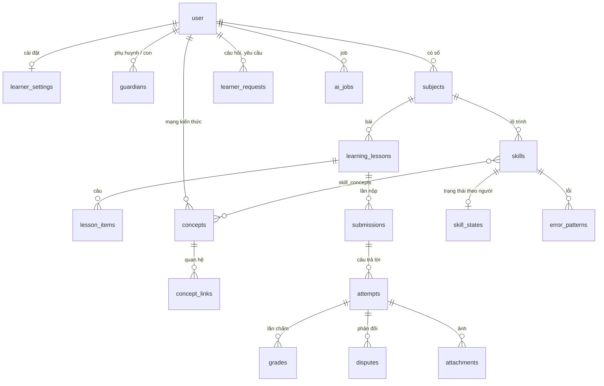

# Learning Hub 2.0 — mô hình dữ liệu và luật

Thuộc bộ [Learning Hub 2.0](README.md). Tất cả nằm trong D1 (SQLite), trừ ảnh bài làm nằm trong R2. SQL luôn dùng tham số bind; mọi lần ghi nhiều bảng chạy trong một `D1 batch`.

Nguyên tắc chung:

- **Lưu bằng chứng, không chỉ kết luận.** Mọi trạng thái kỹ năng phải truy ngược được về `attempts` và `grades`.
- **Luật ở server, AI đề xuất.** Server tính mức trần; AI chỉ được đặt bằng hoặc thấp hơn.
- **Không xoá bằng chứng.** Chấm lại tạo `grades` mới và đánh dấu bản cũ là đã thay thế.

## 1. Sơ đồ quan hệ

## 2. Bảng

Quy ước: id có tiền tố (`sub_`, `sk_`, `les_`, `subm_`, `att_`, `gr_`, `dsp_`, `img_`, `err_`, `req_`, `job_`) cộng chuỗi ngẫu nhiên 20 ký tự. Thời gian là ISO UTC; "ngày" là ngày Berlin `YYYY-MM-DD`. JSON lưu trong cột `text`, được kiểm tra bằng zod trước khi ghi.

### 2.1 Người học và môn

**`learner_settings`** (đã có: `user_id`, `daily_target_minutes`, `updated`). Thêm cột:

| Cột | Kiểu | Ghi chú |
| --- | --- | --- |
| `role` | text | `adult` \| `child`, mặc định `adult` |
| `display_name` | text | Biệt danh dùng trong context AI và giao diện, ≤40 ký tự. Không dùng tên thật đầy đủ. |
| `explain_language` | text | Mặc định `vi` |
| `preferences` | text JSON | ≤2 KB, ví dụ `{"style":"giải thích ngắn, nhiều ví dụ"}` |
| `ai_budget` | text JSON, null | Ghi đè ngân sách mặc định (AI-API §7) |

**`guardians`**: `guardian_id`, `learner_id` (cả hai trỏ tới `user.id`), `created_by`, `created_at`. Khoá chính `(guardian_id, learner_id)`, có CHECK `guardian_id <> learner_id`. Chỉ admin tạo hoặc xoá.

**`subjects`**: một cuốn sổ của một người.

| Cột | Kiểu | Ghi chú |
| --- | --- | --- |
| `id` | text PK | `sub_…` |
| `learner_id` | text | |
| `title` | text | ≤80, duy nhất theo `learner_id` |
| `template` | text | `skill` \| `reading`: khuôn mặc định |
| `sensitivity` | text | `normal` \| `clinical` \| `child_dev`. Quyết định bộ lọc riêng tư (thay cho việc so tên mảng MTB/Cardio). |
| `goal` | text | ≤2000. Chỉ người học người lớn hoặc phụ huynh sửa. |
| `level` | text | ≤200 |
| `curriculum` | text | ≤500, ví dụ "Chương trình GDPT 2018 (Việt Nam), lớp 7, Toán" |
| `limits` | text JSON | `{"maxDifficulty":1–5,"allowNewTopics":bool,"maxNewSkillsPerWeek":0–10}` |
| `weight` | integer | 1–5, ưu tiên khi xếp hàng đợi |
| `status` | text | `setup` \| `active` \| `paused` \| `archived` |
| `ai_enabled` | integer | 0/1. Cờ bật AI cho từng sổ, dùng trong pilot. |
| `legacy_track` | text, null | `Deutsch` \| `AI` \| `MTB` \| `Cardio` \| `Bột` với sổ chuyển từ 5 mảng cũ |
| `system_kind` | text, null | `explore` (sổ Khám phá) \| `connect` (Sổ kết nối); mỗi người tối đa một sổ mỗi loại, server tự tạo |
| `progress_summary` | text | ≤3000, planner viết |
| `progress_updated_at` | text | |
| `revision` | integer | Tăng mỗi lần đổi bài đang mở hoặc cài đặt; dùng cho optimistic concurrency |
| `created_by`, `created_at`, `updated_at` | | |

**`skills`**: lộ trình của một sổ. Tối đa 120 kỹ năng mỗi sổ.

| Cột | Kiểu | Ghi chú |
| --- | --- | --- |
| `id` | text PK | `sk_…` |
| `subject_id`, `learner_id` | text | `learner_id` lặp lại để lọc nhanh và kiểm quyền |
| `key` | text | slug, duy nhất theo `subject_id`, ví dụ `modalverb-infinitiv` |
| `name` | text | ≤120 |
| `description` | text | ≤500 |
| `path_order` | integer | Thứ tự trong lộ trình; không bắt buộc học tuần tự |
| `prerequisites` | text JSON | ≤8 id cùng sổ; server kiểm tra không có vòng |
| `status` | text | `planned` \| `active` \| `retired`. Không xoá kỹ năng đã có bằng chứng, chỉ `retired`. |
| `origin` | text | `ai` \| `user` \| `migration` |
| `created_at`, `updated_at` | | |

**`learner_requests`**: mọi yêu cầu gửi cho planner.

| Cột | Kiểu | Ghi chú |
| --- | --- | --- |
| `id` | text PK | `req_…` |
| `learner_id` | text | |
| `subject_id` | text, null | null nghĩa là để planner chọn sổ, hoặc dùng sổ "Khám phá" |
| `kind` | text | `explore` (câu hỏi khám phá), `extra_practice` (xin thêm bài), `school_topic` (tuần này ở trường học gì), `note` (lời dặn cho planner) |
| `text` | text | ≤2000 |
| `urgency` | text | `tonight` \| `now` |
| `created_by` | text | user id (người học hoặc phụ huynh) |
| `status` | text | `queued` \| `in_job` \| `done` \| `declined` \| `expired` |
| `active_until` | text, null | `school_topic` và `note` còn hiệu lực 14 ngày |
| `result_lesson_id`, `response_note`, `job_id` | | |
| `created_at`, `processed_at` | | |

### 2.2 Bài và câu

**`learning_lessons`** (đã có). Cần **dựng lại bảng** (giống `0004_learner_scope`) để:

- bỏ `UNIQUE(user_id, track, assigned_date)`;
- cho `track` nhận null;
- thêm các cột dưới đây.

| Cột mới | Kiểu | Ghi chú |
| --- | --- | --- |
| `subject_id` | text | Bắt buộc với bài mới; bài cũ gắn theo `legacy_track` |
| `package_version` | text | `1` (cũ) \| `2` |
| `template` | text | `skill` \| `reading` \| null (v1) |
| `kind` | text | `new` \| `remediation` \| `review` \| `exploration` \| `diagnostic` \| `connect` \| `synthesis` \| `legacy` |
| `slot` | text | `primary` (new, remediation, diagnostic) \| `review` \| `extra` (exploration, xin thêm bài) \| `connect` (connect, synthesis; trong Sổ kết nối) |
| `related_subject_ids` | text JSON | Bài `connect`/`synthesis`: các sổ có kỹ năng được dùng |
| `reason` | text | ≤400, "Vì sao hôm nay" |
| `reason_refs` | text JSON | id kỹ năng và mẫu lỗi mà bài nhắm tới; dùng để đo pilot |
| `est_minutes` | integer | |
| `draft` | text JSON | `{itemId: {answer, attachmentIds}}`; nháp theo câu |
| `draft_revision` | integer | |
| `support` | text JSON | `{itemId: "hint1"\|"hint2"\|"solution"}`, mức hỗ trợ cao nhất đã mở; **chỉ server ghi** |
| `snoozed_until` | text, null | Ngày Berlin, từ nút "Để mai" |
| `origin_job_id` | text, null | |

Chỉ mục duy nhất một phần: `UNIQUE(user_id, subject_id, assigned_date, slot) WHERE slot IN ('primary','review')`. Nhờ vậy mỗi sổ mỗi ngày có tối đa một bài chính và một bộ ôn ngay ở tầng DB.

Bài v1 giữ `payload` và `response` như cũ và hiển thị bằng giao diện hiện tại.

**`lesson_items`**: một câu của bài v2. Tách khỏi `payload` để truy vấn exposure, chống lặp và nối với `attempts`.

| Cột | Kiểu | Ghi chú |
| --- | --- | --- |
| `lesson_id`, `item_id` | text | Khoá chính chung; `item_id` là `i1`… |
| `learner_id`, `subject_id` | text | |
| `stage` | text | Xem AI-API §6.1 |
| `activity` | text | `recall` \| `recognize` \| `correct` \| `transform` \| `apply` \| `explain` \| `create` \| `investigate` (`learn` không có câu; `dialogue` để dành) |
| `input_kind` | text | `choice` \| `short` \| `long` |
| `skill_ids` | text JSON | 1–3 |
| `difficulty` | integer | 1–5 |
| `auto_gradable` | integer | 1 nếu có `key` |
| `prompt_hash` | text | sha256 của đề đã chuẩn hoá (chữ thường, gộp khoảng trắng) |
| `origin` | text | `plan` \| `assess_check` (câu kiểm tra lại do Assess thêm) |
| `payload` | text JSON | Đề, lựa chọn, key, rubric, gợi ý, lời giải, giải thích, chế độ ảnh |
| `flag` | text, null | `key_issue` \| `item_void`: đề hoặc đáp án có vấn đề (từ phản đối) |
| `concept_ids` | text JSON | 0–3 khái niệm câu này dùng; câu có khái niệm ở sổ khác với nơi đã học khái niệm là câu **chuyển giao** (§3.7) |
| `created_at` | text | |

API cho người học **cắt** `key`, `hints`, `solution`, `explanation` khỏi `payload`. Các phần đó chỉ trả về khi đã mở (`support`) hoặc khi câu đã được chấm.

### 2.3 Bằng chứng

**`submissions`**: một lần bấm Nộp (cả bài, hoặc một giai đoạn như "Nhớ lại").

| Cột | Kiểu | Ghi chú |
| --- | --- | --- |
| `id` | text PK | `subm_…` |
| `learner_id`, `lesson_id` | text | |
| `stage` | text, null | |
| `client_submission_id` | text | uuid do trình duyệt tạo; `UNIQUE(learner_id, client_submission_id)` để gửi lại không tạo trùng |
| `status` | text | `grading` \| `graded` \| `deferred` \| `failed` |
| `ai_job_id` | text, null | |
| `created_at`, `graded_at` | | |

**`attempts`**: một câu trả lời cho một câu.

| Cột | Kiểu | Ghi chú |
| --- | --- | --- |
| `id` | text PK | `att_…` |
| `submission_id`, `learner_id`, `lesson_id`, `item_id`, `subject_id` | text | |
| `skill_ids`, `activity` | | Chép từ `lesson_items` lúc nộp để thống kê không cần join |
| `attempt_no` | integer | 1, 2, … theo `(lesson_id, item_id)` |
| `retry_of` | text, null | `att_…` của lần trước |
| `answer` | text | ≤8000 |
| `attachment_ids` | text JSON | ≤4 |
| `support` | text | `none` \| `hint1` \| `hint2` \| `solution`, lấy từ `learning_lessons.support` lúc nộp |
| `context` | text | `lesson` \| `review` \| `check` |
| `status` | text | `pending` \| `graded` \| `disputed` \| `void` |
| `current_grade_id` | text, null | |
| `day` | text | Ngày Berlin lúc nộp |
| `created_at` | text | |

Chỉ mục: `(learner_id, subject_id, day)`, `(lesson_id, item_id)`.

**`grades`**: một lần chấm. Chấm lại thì thêm dòng mới.

| Cột | Kiểu | Ghi chú |
| --- | --- | --- |
| `id` | text PK | `gr_…` |
| `attempt_id` | text | |
| `grader` | text | `auto` \| `ai` \| `guardian` \| `admin` |
| `job_id` | text, null | |
| `result` | text | `correct` \| `partial` \| `incorrect` \| `ungradable` |
| `score` | real | 0–1 |
| `rubric_scores` | text JSON | `[{criterion, points, max}]` |
| `feedback` | text | ≤1500 |
| `correction` | text | ≤1500 |
| `errors` | text JSON | ≤3 `{skillId, patternId?, label, category, evidence}` |
| `superseded_by` | text, null | |
| `created_at` | text | |

**`disputes`**: phản đối điểm.

| Cột | Kiểu | Ghi chú |
| --- | --- | --- |
| `id` | text PK | `dsp_…` |
| `attempt_id`, `grade_id` | text | `grade_id` là bản chấm bị phản đối |
| `learner_id`, `raised_by` | text | |
| `reason` | text | `answer_correct` \| `feedback_wrong` \| `item_wrong` \| `other` |
| `message` | text | ≤1000 |
| `recheck_requested` | integer | 0/1 |
| `status` | text | `open` \| `rechecking` \| `upheld` \| `overturned` \| `item_void` \| `needs_human` \| `closed` |
| `resolution_grade_id`, `resolved_by`, `resolution_note` | | `resolved_by` là `ai` hoặc user id |
| `created_at`, `resolved_at` | | |

**`attachments`**: ảnh bài giải.

| Cột | Kiểu | Ghi chú |
| --- | --- | --- |
| `id` | text PK | `img_…` |
| `learner_id` | text | |
| `attempt_id` | text, null | Gắn khi nộp |
| `r2_key` | text | `uploads/<learner_id>/<id>` trong bucket `learning-hub-uploads-<env>` |
| `mime` | text | `image/jpeg` \| `image/png` \| `image/webp` (kiểm tra magic bytes) |
| `bytes`, `width`, `height`, `sha256` | | ≤3 MB, cạnh dài ≤2400 px |
| `created_at`, `expires_at`, `deleted_at` | | Giữ 30 ngày (D17) |

### 2.4 Learner model

**`skill_states`**: một dòng cho mỗi kỹ năng của một người.

| Cột | Kiểu | Ghi chú |
| --- | --- | --- |
| `skill_id` | text PK | (kỹ năng đã thuộc về một người) |
| `learner_id`, `subject_id` | text | |
| `mastery` | text | `not_assessed` \| `introduced` \| `developing` \| `demonstrated` \| `needs_review` |
| `mastery_ceiling` | text | Mức luật cho phép (§3.3) |
| `mastery_source` | text | `rules` \| `ai` \| `guardian` |
| `mastery_reason` | text | ≤500 |
| `dim_knowledge`, `dim_recognition`, `dim_application`, `dim_retention` | integer | 0–3 (§3.2) |
| `exposure` | text JSON | Tổng số lần theo activity, `{"recognize":40,"create":3}` |
| `attempts_total` | integer | |
| `last_attempt_at`, `last_independent_at` | text | |
| `review_interval_days` | integer, null | |
| `next_review_day` | text, null | Ngày Berlin |
| `review_kind` | text, null | `retention` \| `remediation` |
| `review_step_day` | text, null | Ngày gần nhất đã tăng bậc (mỗi ngày tăng tối đa một bậc) |
| `maintained` | integer | 1 khi đã qua bậc 60 ngày (§3.4) |
| `updated_at`, `revision` | | |

**`error_patterns`**: lỗi lặp lại.

| Cột | Kiểu | Ghi chú |
| --- | --- | --- |
| `id` | text PK | `err_…` |
| `learner_id`, `subject_id`, `skill_id` | text | |
| `label` | text | ≤120; `label_norm` (chữ thường, bỏ dấu câu) dùng để gộp lỗi trùng |
| `category` | text | `knowledge` (chưa hiểu quy tắc) \| `application` (hiểu nhưng tự làm sai) \| `slip` (tính toán, bất cẩn) \| `reading` (đọc đề sai) \| `unknown` |
| `confidence` | text | `suspected` \| `confirmed` |
| `status` | text | `open` \| `improving` \| `resolved` |
| `occurrences`, `days_seen` | integer | |
| `example_attempt_ids` | text JSON | ≤5 |
| `intervention` | text | ≤500, cách xử lý đang dùng |
| `first_seen_at`, `last_seen_at`, `resolved_at` | | |

Bản mô tả có 7 loại lỗi; ở đây gộp "tính toán" với "bất cẩn" thành `slip`. "Lỗi do đề không rõ" không phải lỗi của người học: nó đi qua phản đối, rồi gắn `lesson_items.flag = item_void`.

### 2.5 Mạng kiến thức (từ H9)

Mỗi người một mạng, nằm sau các sổ ([LESSON-DESIGN §3](LESSON-DESIGN.md#3-bốn-cấp-tập-trung--xen-kẽ--kết-nối--tổng-hợp)). **Khái niệm** (concept) là nguyên lý dùng được ở nhiều môn, ví dụ xác suất, tỉ lệ, suy luận nhân quả, phân loại. **Kỹ năng** vẫn thuộc một sổ. Thành thạo kỹ năng không tự chuyển sang sổ khác.

**`concepts`**:

| Cột | Kiểu | Ghi chú |
| --- | --- | --- |
| `id` | text PK | `cpt_…` |
| `learner_id` | text | |
| `key`, `name`, `description` | text | `key` duy nhất theo người; `name` ≤120; `description` ≤500 |
| `transfer_level` | integer | 0–3 (§3.7), server tính |
| `transfer_contexts` | text JSON | Danh sách `subject_id` đã có bằng chứng E2+ cho khái niệm |
| `origin`, `status` | text | `ai` \| `user`; `active` \| `rejected` |
| `created_at`, `updated_at` | | |

**`skill_concepts`**: `(skill_id, concept_id)`; một kỹ năng gắn 0–3 khái niệm.

**`concept_links`**:

| Cột | Kiểu | Ghi chú |
| --- | --- | --- |
| `id` | text PK | `lnk_…` |
| `learner_id` | text | |
| `from_kind`, `from_id`, `to_kind`, `to_id` | text | `concept` \| `skill`; cùng một người |
| `relation` | text | `prerequisite` (cần học trước) \| `shared_principle` (chung nguyên lý) \| `application` (ứng dụng của) \| `analogy` (tương tự nhưng không đồng nhất) \| `contrast` (dễ nhầm nhưng khác) |
| `rationale` | text | ≤500, **bắt buộc**: lý do chuyên môn |
| `limits` | text, null | ≤500, **bắt buộc** với `analogy` và `contrast`: phép so sánh không còn đúng ở đâu |
| `origin`, `status` | text | `ai` \| `user`; `active` \| `rejected` (người lớn hoặc phụ huynh bác) |
| `created_at` | text | |

### 2.6 Job AI

**`ai_jobs`**: xem vòng đời ở [AI-API.md §3](AI-API.md#3-vòng-đời-job).

| Cột | Kiểu | Ghi chú |
| --- | --- | --- |
| `id` | text PK | `job_…` |
| `kind` | text | `plan` \| `assess` |
| `purpose` | text | plan: `daily` \| `initial` \| `request`; assess: `submission` \| `recheck` |
| `trigger` | text | `scheduled` \| `on_demand` \| `deferred` |
| `learner_id` | text | |
| `subject_id`, `ref_id` | text, null | `ref_id` là submission, dispute hoặc request |
| `learning_day` | text | |
| `priority` | integer | |
| `status` | text | `queued` \| `leased` \| `succeeded` \| `failed` \| `expired` \| `cancelled` |
| `dedupe_key` | text UNIQUE | ví dụ `plan:daily:<learner>:<day>`, `assess:<submission>`, `recheck:<dispute>` |
| `lease_client_id`, `lease_token_sha256`, `lease_expires_at`, `lease_count` | | |
| `context_hash` | text | |
| `context_snapshot` | text | JSON đã phục vụ, ≤200 KB; dùng để kiểm tra kết quả và cho admin xem |
| `result_hash`, `outcome` | text | `outcome`: kết quả áp dụng từng phần |
| `usage` | text JSON | `{model, inputTokens, outputTokens, ms}` do runner báo |
| `validation_failures` | integer | |
| `error` | text | |
| `created_at`, `updated_at`, `finished_at`, `expires_at` | | |

Bảng v1 (`automation_runs`, `run_targets`, `run_items`, `run_events`) giữ nguyên để tra lịch sử. API v1 tắt sau khi v2 chạy (H8.6).

## 3. Luật (thuần hàm, có test)

Tất cả nằm trong `lib/learner-model/rules.ts`: hàm thuần, nhận danh sách bằng chứng, trả về trạng thái. Hàm `recomputeSkill(skillId)` đọc bằng chứng từ DB rồi gọi các hàm này. Hàm chạy lại khi:

- có grade mới;
- phản đối được mở hoặc đóng;
- câu bị `item_void`;
- cron đêm cần đánh dấu quá hạn ôn.

Bằng chứng được dùng là attempt có `status = graded` và câu không bị `item_void`. Attempt `disputed` hoặc `void` không được tính.

### 3.1 Độ mạnh của bằng chứng

| Mức | Điều kiện |
| --- | --- |
| **E3** độc lập | `correct`, `support = none`, `attempt_no = 1` |
| **E2** tự sửa / một phần | `correct`, `support = none`, `attempt_no > 1`; hoặc `partial`, `support = none` |
| **E1** có hỗ trợ | `correct` hoặc `partial` với `hint1` hoặc `hint2` |
| **E0** | `incorrect`; hoặc bất kỳ kết quả nào sau khi đã xem lời giải |

`ungradable` (ví dụ ảnh không đọc được) không phải bằng chứng; giao diện mời chụp lại.

### 3.2 Bốn chiều (0–3)

| Chiều | Activity đóng góp |
| --- | --- |
| Nhận diện (`recognition`) | `recognize`, `correct` |
| Hiểu (`knowledge`) | `recall`, `explain` |
| Vận dụng (`application`) | `transform`, `apply`, `create`, `investigate` |
| Ghi nhớ (`retention`) | Theo thời gian, xem dưới |

Với ba chiều đầu, xét bằng chứng của chiều đó trong 60 ngày:

- **0**: chưa có attempt.
- **1**: có attempt nhưng chưa có E2 trở lên.
- **2**: có ít nhất một E3, hoặc ít nhất hai E2.
- **3**: có E3 trên ít nhất 2 ngày khác nhau, và attempt gần nhất của chiều đó không phải E0.

**Ghi nhớ** xét các "lần kiểm tra trễ": attempt cách attempt E2+ trước đó của cùng kỹ năng ít nhất 5 ngày.

- **0**: chưa có lần kiểm tra trễ.
- **1**: có lần kiểm tra trễ, nhưng sai hoặc cần hỗ trợ.
- **2**: một lần kiểm tra trễ đạt E3.
- **3**: hai lần kiểm tra trễ đạt E3, lần sau cách lần trước ít nhất 14 ngày.

Ví dụ Ếch làm 40 câu chọn đúng về Modalverb nhưng tự viết vẫn sai: `recognition = 3`, `application = 1`. Một điểm tổng sẽ không cho thấy khác biệt này.

### 3.3 Mức thành thạo

**Mức trần theo luật:**

| Mức | Điều kiện |
| --- | --- |
| `not_assessed` | Chưa có attempt |
| `introduced` | Có attempt; cả ba chiều đầu ≤ 1 |
| `developing` | Có chiều ≥ 2, nhưng `application` < 3 |
| `demonstrated` | `application = 3`, `knowledge` hoặc `recognition` ≥ 2, và không còn mẫu lỗi `confirmed` loại `knowledge` hay `application` đang mở cho kỹ năng |
| `needs_review` | (lớp phủ) đang `developing`/`demonstrated` và: quá hạn ôn hơn một nửa khoảng ôn, hoặc attempt gần nhất là E0 sau khi đã `demonstrated` |

**Trạng thái hiển thị** bằng mức trần, trừ ba trường hợp:

- **AI đề xuất thấp hơn**, kèm lý do và id bằng chứng. Ví dụ: các câu đúng quá dễ. Đề xuất giữ hiệu lực đến khi có bằng chứng mới; `mastery_source` là `ai`.
- **AI đề xuất `needs_review`** kèm bằng chứng: luôn được nhận.
- **Phụ huynh hoặc người học người lớn đặt tay**: giữ đến khi có bằng chứng mới; `mastery_source` là `guardian`.

AI đề xuất cao hơn mức trần thì bị cắt về mức trần, và ghi `clipped` vào `ai_jobs.outcome`.

### 3.4 Lịch ôn

Bậc khoảng ôn: **1 → 3 → 7 → 14 → 30 → 60 ngày**.

- Lần đầu kỹ năng có attempt E2 trở lên: lịch ôn sau 3 ngày, `review_kind = retention`.
- Mỗi attempt đã chấm trong bộ ôn, câu kiểm tra lại, hoặc giai đoạn "Tự làm":

  | Bằng chứng | Bậc ôn |
  | --- | --- |
  | E3 | Tăng một bậc; mỗi ngày Berlin tối đa một lần |
  | E2 | Giữ nguyên |
  | E1 | Lùi một bậc |
  | E0 | Về 1 ngày. `review_kind = remediation` nếu kỹ năng có mẫu lỗi `knowledge`/`application` đang mở; ngược lại là `retention`. |

- AI có thể đề xuất `inDays`. Server kẹp vào khoảng [½, 2] lần khoảng theo luật, và trong [1, 60].
- **Dừng ôn:** đang ở bậc 60 ngày mà đạt E3 thì đặt `maintained = 1`, xoá `next_review_day`. Planner được kiểm tra duy trì tối đa một kỹ năng `maintained` mỗi sổ mỗi tuần. Nhờ vậy ôn tập không thành vòng lặp vô tận.

Kỹ năng **đến hạn**: `next_review_day <= learningDay`, sổ đang `active`.

### 3.5 Mẫu lỗi

- **Nguồn:** `grades.errors` (từ AI), và `errorLabel` của phương án sai trong câu trắc nghiệm (chấm tự động, không cần AI).
- **Gộp:** khớp `patternId` mà AI trả về trước; nếu không có thì khớp `(skill_id, label_norm)`; không khớp thì tạo mới.
- **Vòng đời:**

  | Bước | Điều kiện |
  | --- | --- |
  | Tạo mới | `suspected`, `open` |
  | `confirmed` | Gặp trên ít nhất 2 ngày khác nhau |
  | `improving` | Hai attempt gần nhất của kỹ năng đạt E2+ và không mắc lỗi đó |
  | `resolved` | E3 trên 2 ngày khác nhau sau `last_seen_at`; hoặc AI đề xuất `resolve` kèm bằng chứng và 14 ngày không gặp lại |
  | Mở lại | Gặp lại lỗi đã `resolved`: thành `open` và `confirmed` |

- **Không kết luận khi thiếu bằng chứng:**
  - `slip` chỉ được nhận khi trong cùng lần nộp có E3 khác của cùng kỹ năng; nếu không thì hạ thành `unknown`.
  - Mẫu `suspected` chỉ hiện cho phụ huynh với chữ "nghi ngờ".

### 3.6 Exposure và chống lặp

- `skill_states.exposure` đếm tổng số attempt theo activity. Context của planner tính thêm số lần trong 14 ngày.
- **`stuckOn`**: một kỹ năng có ít nhất 8 attempt cùng một activity trong 14 ngày mà `application` < 2 thì đặt `stuckOn = <activity>`. Trong bài mới, các câu của kỹ năng đó dùng activity này **không được quá 1/3** (server từ chối với mã `repetition`).
- **Trùng đề:** `prompt_hash` đã dùng cho cùng người, cùng sổ trong 90 ngày thì bị từ chối (`duplicate_item`). Chỉ đổi số hay tên không bị bắt bằng hash; đó là trách nhiệm của prompt planner, và chỉ số pilot sẽ theo dõi.

### 3.7 Chuyển giao (từ H9)

**Câu chuyển giao:** câu có `concept_ids`, thuộc một sổ không nằm trong `transfer_contexts` của khái niệm lúc giao bài.

`transfer_level` của khái niệm:

| Mức | Điều kiện |
| --- | --- |
| **0** | Chưa có câu chuyển giao |
| **1** | Đã làm câu chuyển giao nhưng chưa đạt E3 |
| **2** | Một câu chuyển giao đạt E3 |
| **3** | Câu chuyển giao đạt E3 ở ít nhất 2 bối cảnh khác nhau, trên 2 ngày cách nhau ít nhất 7 ngày |

- Chuyển giao **không** làm thay đổi thành thạo của từng kỹ năng. Kỹ năng thành phần vẫn tính theo §3.1–3.4 từ tiêu chí rubric gắn với kỹ năng đó.
- Sai ở tiêu chí kỹ năng thì ghi vào kỹ năng; chỉ tiêu chí "kết nối" mới tính cho chuyển giao.

**Ứng viên kết nối** (server đưa vào plan context): khái niệm có kỹ năng ở ít nhất 2 sổ, mỗi phía có `application` ≥ 2, và không có bài `connect` nào về khái niệm đó trong 14 ngày.

## 4. Bất biến

Kiểm bằng code ở server, có test SQLite. Không dựa vào lời dặn trong prompt.

**Giao bài:**

1. Mỗi sổ có tối đa **một bài `primary` đang mở**. Chỉ giao bài `primary` mới khi chưa có bài nào, hoặc bài trước đã xong **trước mốc 03:00** của ngày giao.
2. Mỗi sổ mỗi ngày Berlin tối đa một bài `primary` và một bộ ôn; DB đã chặn bằng chỉ mục duy nhất. Mỗi sổ có tối đa một bộ ôn đang mở.
3. Bài `extra` (khám phá, xin thêm bài) không quá ngân sách ngày (AI-API §7).
4. Tổng `est_minutes` của các bài đang mở cộng bài mới không vượt 1,5 × `daily_target_minutes`; bài vượt bị từ chối với mã `over_budget`.
5. Sổ `paused`, `archived`, `setup`, hoặc có `ai_enabled = 0` không nhận bài từ plan `daily`.
   - **5a. Bài kết nối và tổng hợp** (từ H9):
     - `connect`: mọi kỹ năng được nối có `application` ≥ 2.
     - `synthesis`: mọi kỹ năng thành phần có `application` ≥ 2, và khái niệm có `transfer_level` ≥ 1.
     - Mỗi người mỗi tuần: tối đa 2 bài `connect`; tối đa 1 bài `synthesis` với trẻ em, 2 với người lớn.
     - Độ khó không vượt `limits.maxDifficulty` của **mọi** sổ liên quan.
     - Vi phạm thì trả mã `connection_gate` hoặc `weekly_cap`.
   - **5b.** Liên kết `analogy` hoặc `contrast` thiếu `limits` bị từ chối (`link_limits_missing`). Không có liên kết nào giữa hai người học.

**Không phá dữ liệu:**

6. Bài đã giao không bị thay. Câu chỉ được thêm vào (câu kiểm tra lại), không sửa, không xoá. Không xoá attempt hay grade.
7. AI không đánh dấu hoàn thành. Hoàn thành sau 03:00 chỉ mở bài `primary` mới vào ngày hôm sau. Bỏ dấu hoàn thành được tôn trọng.
8. Điểm `auto` chỉ bị thay bằng một grade mới trong luồng chấm lại.

**Ghi đúng chỗ:**

9. Mọi thứ AI ghi đều thuộc đúng người học và sổ của job. Id ngoài context bị từ chối (`unknown_reference`).
10. Plan result phải khớp `expectedRevision` và `expectedOpenPrimaryLessonId` của sổ; lệch thì sổ đó nhận `stale`, các sổ khác vẫn áp dụng.
11. Gửi lại cùng một kết quả trả về cùng `outcome` và không tạo trùng. Job đã `succeeded` mà nhận kết quả khác thì trả 409.
12. Sau một lần ghi không chắc chắn, runner đọc lại `GET /jobs/{id}`, không gửi kết quả khác.

## 5. Quyền truy cập

Theo D15: mỗi người chỉ thấy dữ liệu của mình; admin thấy tất cả; phụ huynh thấy của con.

| Dữ liệu | Người học | Phụ huynh của người học | Người học khác | Admin | Runner (job đã lease) |
| --- | --- | --- | --- | --- | --- |
| Sổ, mục tiêu, tiến độ, phút học, mạng kiến thức | đọc | đọc | **không** | đọc | đọc (trong context) |
| Sửa mục tiêu, giới hạn, trạng thái sổ | người lớn: sửa; trẻ em: không | sửa | không | sửa | không |
| Bài, câu, nháp | đọc, sửa nháp | đọc | không | đọc | đọc (trong context) |
| Câu trả lời, ảnh, lời phê, mẫu lỗi, kỹ năng | đọc | đọc | không | đọc | đọc (trong context) |
| Ghi chú, nhật ký, mốc dự án (workspace) | đọc, sửa | đọc | không | đọc | không |
| Phản đối điểm | tạo | tạo, xử lý | không | xử lý | chấm lại |
| Cài đặt phút, ngân sách | người lớn: sửa | sửa | không | sửa | không |

Mỗi route đi qua một hàm `canAccessLearner(viewer, learnerId, action)` duy nhất, có test cho từng ô trong bảng.

## 6. Chuyển dữ liệu cũ

| Hiện tại | Sau 2.0 |
| --- | --- |
| 5 mảng cố định `learningTracks` | Với mỗi người đã có bài ở mảng T: tạo `subjects`, đặt `legacy_track = T`. Thiết lập theo mảng: `Deutsch` khuôn `skill`; `AI` khuôn `reading`; `MTB` và `Cardio` khuôn `reading`, `clinical`; `Bột` khuôn `reading`, `child_dev`. |
| `learning_lessons` v1 | Gắn `subject_id`, `package_version = 1`, `kind = legacy`, `slot = primary` |
| `learning_slots` | Không dùng nữa; bài đang mở tính từ `learning_lessons`. Bảng giữ đến H8.6. |
| `study_time.track` | Sổ cũ vẫn ghi tên mảng; sổ mới ghi `subject_id`. Cột giữ tên cũ. |
| 13 bài nền trong `app/content.ts` | Vẫn hiện trong sổ có `legacy_track` tương ứng, chỉ đọc |
| Workspace chung `__shared_family_workspace__` (ghi chú, nhật ký, dự án, dấu "đã học" bài nền) | Tách theo người (H1.3). Bản chung hiện tại giao cho admin đầu tiên, giống cách `0004_learner_scope` gán bài cũ; người khác bắt đầu trống. |
| Bộ lọc riêng tư theo tên mảng | Theo `subjects.sensitivity` |

## 7. Sao lưu, lưu giữ, riêng tư

- **Sao lưu:** bảng mới vào `lib/backup-contract.mjs`, dạng 4. Restore vào DB trống theo thứ tự khoá ngoại. Ảnh trong R2 **không** nằm trong bản sao lưu D1. Bucket uploads có lifecycle xoá sau 30 ngày; cron đánh dấu `deleted_at`. Hết hạn ảnh thì context chấm lại ghi `"expired": true` cho ảnh đó.
- **Ảnh:**
  - Trình duyệt thu nhỏ (cạnh dài ≤2400 px) và mã hoá lại JPEG; việc này xoá EXIF, kể cả GPS.
  - Server kiểm tra magic bytes và kích thước.
  - Chỉ chủ, phụ huynh và admin đọc được ảnh; runner chỉ đọc qua URL gắn với lease.
- **Context AI:** chỉ có `lrn_…` (mã đã hash theo môi trường như v1) và `display_name`. Không email, không user id.
- **Sổ `clinical`:** bộ lọc định danh (đã sửa B1/B2) chạy trên cả bài AI gửi lên lẫn câu trả lời người học. Câu trả lời có định danh rõ thì bị chặn kèm thông báo; nghi ngờ thì cảnh báo trước khi nộp.
- **Trẻ em:** không có chat tự do. Gợi ý soạn sẵn. Mọi lời phê AI đều hiện trong Sổ liên lạc.
