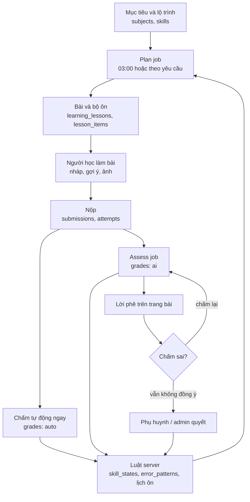

# Learning Hub 2.0 — kiến trúc và kế hoạch triển khai

Bản thiết kế để review, cập nhật 12/10/2026. **Chưa có code.** Dựa trên bản mô tả sản phẩm "Learning Hub 2.0" và các quyết định ngày 11–12/10/2026. Hiện trạng hệ thống: [../FEATURES.md](../FEATURES.md), [../ARCHITECTURE.md](../ARCHITECTURE.md).

| Tài liệu | Nội dung |
| --- | --- |
| README.md (file này) | Quyết định, phạm vi, vòng học, vai trò, giao diện, rủi ro |
| [LESSON-DESIGN.md](LESSON-DESIGN.md) | **Hướng xây dựng bài học**: nguyên tắc, planner chọn gì, cấu trúc bài, viết câu hỏi, chấm và lời phê, hướng theo từng sổ |
| [DATA-MODEL.md](DATA-MODEL.md) | Bảng D1, luật thành thạo, lịch ôn, mẫu lỗi, bất biến, quyền, chuyển dữ liệu cũ |
| [AI-API.md](AI-API.md) | Hai lượt AI, API job cho runner bên ngoài, hợp đồng JSON, ngân sách, chấm lại, Worker chấm bài |
| [../plan/PLAN.md](../plan/PLAN.md) | **Plan triển khai** H0–H9: lịch, task, migration, test, nghiệm thu, cảnh báo, bảo mật, pilot, đề xuất sửa AGENTS.md |

## 1. Quyết định đã chốt

| # | Chủ đề | Quyết định |
| --- | --- | --- |
| D1 | Lượt AI | Hai loại: **Plan** (lập lộ trình, soạn bài và bộ ôn; theo lịch 03:00 hoặc theo yêu cầu) và **Assess** (chấm khi nộp, chấm lại khi bị phản đối). Không có Tutor dạng chat; mỗi câu có gợi ý soạn sẵn 2 bậc và lời giải. |
| D2 | Learner model | Rút gọn nhưng đủ: bằng chứng (`attempts`, `grades`), trạng thái kỹ năng (4 chiều 0–3, 5 mức thành thạo, lịch ôn, exposure) và mẫu lỗi (5 loại). Server tính theo luật; AI chỉ đề xuất trong giới hạn luật. |
| D3 | Kế hoạch ngày | Hàng đợi có thứ tự, không chia phút: chờ sửa → ôn đến hạn → bài đang dở → bài mới → khám phá. Đạt mục tiêu phút thì phần còn lại là "thêm nếu muốn". |
| D4 | Dạng hoạt động | 10 nhãn activity cho planner; giao diện chỉ có 3 kiểu nhập (`choice`, `short`, `long`) cộng ảnh. Dialogue để dành. |
| D5 | Chấm tự động | Chỉ trắc nghiệm, đáp số, điền tối đa 3 từ. Còn lại AI chấm theo rubric. |
| D6 | Toán, Hóa | Nhập đáp số cuối trên web, kèm ảnh bài giải trên giấy; AI đọc ảnh khi chấm. |
| D7 | Exploration | Giữ. Câu hỏi → lượt Plan (đêm nay hoặc ngay) → bài khám phá trong sổ liên quan hoặc sổ "Khám phá". |
| D8 | Màn hình | Không thêm trang mới cho người học. Hôm nay là mặt bàn; ôn tập là post-it; lời phê nằm trên trang bài; tiến bộ là trang đầu cuốn sổ; phụ huynh có "Sổ liên lạc" trên kệ của con. |
| D9 | Khuôn buổi học | Hai khuôn: `skill` (nhớ lại → phiếu → luyện có hướng dẫn → tự làm → nộp → lời phê) và `reading` (đọc → phân tích → đầu ra → nộp → lời phê). |
| D10 | Chấm sai | Nút **Chấm sai?** trên mỗi câu đã chấm: gửi phản hồi, tuỳ chọn yêu cầu chấm lại. AI chấm lại tối đa một lần; sau đó phụ huynh hoặc admin quyết. |
| D11 | Ngữ cảnh | Plan đọc 14 ngày gần nhất cùng toàn bộ trạng thái kỹ năng của môn; Assess trả về đề xuất cập nhật thành thạo, lỗi và lịch ôn. |
| D12 | Kết nối AI | **Quyết định 11.3 ngày 18/11/2026.** Worker dùng OpenAI qua Cloudflare Queue cho soạn bài và chấm. ChatGPT MCP và Sites bridge tiếp tục dùng Job API v2. Production chuyển ở bước R. Xem [AI-API §9](AI-API.md#9-client-xử-lý-công-việc) và [LGTK §11](../plan/LGTK.md#11-chủ-dự-án-cần-quyết). |
| D13 | Môn học | Môn động theo từng người, thay cho 5 mảng cố định. 5 mảng cũ chuyển thành môn của những người đang học chúng. |
| D14 | Người học | **Đã thay bằng D23: hồ sơ không tài khoản, sau cổng nhà.** Mỗi người một tài khoản, tiến độ riêng. Ếch đăng ký bằng **email riêng**, admin duyệt như mọi tài khoản, rồi đặt `role = child` và gắn phụ huynh. |
| D15 | Ai thấy tiến độ | **Đã thay bằng D23: mọi hồ sơ trong nhà, cài đặt sau chế độ quản lý.** **Mỗi người chỉ thấy tiến độ của mình. Admin thấy tất cả.** Phụ huynh thấy của con (quyền phụ huynh trong bản mô tả). Ghi chú, nhật ký, mốc dự án đang dùng chung cũng tách theo người (H1.3). |
| D16 | Chương trình của Ếch | Theo **chương trình GDPT 2018 của Việt Nam, lớp 7**. Ba sổ: • **Toán 7** • **Hóa 7**: theo phần Hóa của môn Khoa học tự nhiên 7, vì lớp 7 ở Việt Nam học Hóa trong môn này • **Deutsch**: tiếng Đức theo trình độ, độc lập với chương trình Việt Nam Giải thích bằng tiếng Việt. |
| D17 | Ảnh bài làm | Giữ **30 ngày** rồi xoá. Điểm, lời phê và bằng chứng vẫn giữ. Câu có ảnh chỉ chấm lại được trong 30 ngày đó. |
| D18 | Học kết nối | Bốn cấp ([LESSON-DESIGN §3](LESSON-DESIGN.md#3-bốn-cấp-tập-trung--xen-kẽ--kết-nối--tổng-hợp)): • **Tập trung** và **xen kẽ** trong từng sổ: làm ngay từ H2. • **Kết nối** và **tổng hợp** giữa các sổ: làm ở H9, sau khi có ít nhất hai sổ chạy ổn. Phía sau các sổ là **mạng kiến thức** riêng của từng người (khái niệm, quan hệ có lý do và giới hạn). Thêm chiều **chuyển giao** cho khái niệm; thành thạo kỹ năng vẫn tính riêng theo sổ. Bài kết nối nằm trong **Sổ kết nối** trên kệ, kèm bản đồ khái niệm, nên không thêm trang. |

## 2. Phạm vi

**Trong 2.0:**

- Sổ theo người, quyền riêng tư theo người.
- Phụ huynh.
- Lộ trình kỹ năng.
- Bài v2 có từng câu, gợi ý và lời giải.
- Nộp bài, chấm tự động.
- AI chấm theo rubric và chấm bằng ảnh.
- Chấm sai và chấm lại.
- Trạng thái kỹ năng, mẫu lỗi, lịch ôn, bộ ôn hằng ngày.
- Lập kế hoạch hằng đêm.
- Exploration.
- API job, runner giả, Worker chấm bài.
- Trang quản trị lượt AI.
- Học xen kẽ trong sổ; kết nối và tổng hợp giữa các sổ, mạng kiến thức, chuyển giao (H9).

**Không làm trong 2.0:**

- Tutor dạng chat, Dialogue thời gian thực.
- Đồng bộ Google Docs.
- Thuật toán SRS phức tạp (FSRS) hoặc thống kê IRT.
- App native, thông báo push.
- Duyệt bài trước khi người học thấy. Thay vào đó: luật server, bộ bài mẫu đo chất lượng, và sổ `clinical` bật AI sau cùng (H8.4).
- Chuyển 13 bài nền trong `app/content.ts` vào D1. Chúng vẫn hiện trong sổ cũ, chỉ đọc.

## 3. Vòng học

Một vòng có ba nhịp:

1. **Ngay khi nộp:** câu đóng được chấm tại chỗ và hiện lời giải.
2. **Một đến vài phút sau:** Worker chấm bài chấm câu mở, viết lời phê và chẩn đoán lỗi.
3. **Đêm:** lịch theo giờ Berlin và Worker kiểm tra điều kiện giao bài chính. Worker có thể soạn sẵn bài rồi kiểm lại điều kiện trước khi lưu lúc 00:00.

Khi chấm chưa xong, giao diện hiển thị trạng thái chờ dựa trên lượt xử lý đã lưu.

## 4. Vai trò và quyền

| Vai trò | Ai | Được làm |
| --- | --- | --- |
| Người học (người lớn) | Bạn, Ly | Chỉ thấy kệ và tiến độ của mình. Mở sổ mới; sửa mục tiêu, trình độ, giới hạn của sổ mình; học, nộp, phản đối điểm; gửi câu hỏi khám phá. |
| Người học (trẻ em) | Ếch | Chỉ thấy kệ của mình. Học, nộp, xin gợi ý, phản đối điểm, gửi câu hỏi khám phá. Không sửa mục tiêu, giới hạn, ngân sách, số phút. |
| Phụ huynh | Tài khoản có dòng trong `guardians` | Thêm kệ của con. Đặt mục tiêu, giới hạn, số phút; tạm dừng hoặc ưu tiên môn; ghi "tuần này ở trường học gì"; xin thêm bài; xử lý phản đối điểm; xem toàn bộ bài làm và lời phê của con. |
| Admin | `BOOTSTRAP_ADMIN_EMAIL` và người được cấp | Xem tiến độ và bài làm của mọi người (chọn người học trên Phòng học). Duyệt tài khoản, gắn phụ huynh, xem lượt AI, huỷ job, xử lý phản đối cuối cùng. |
| Runner | Client trong `AUTOMATION_CLIENTS` | Chỉ qua API job: đọc context của job đã lease, gửi kết quả theo hợp đồng. |

Người học khác **không** thấy kệ, tiến độ, phút học, bài làm hay lời phê của nhau.

**Giới hạn AI do server ép, không dựa vào prompt:**

- AI không đổi được mục tiêu, giới hạn, số phút, trạng thái môn, liên kết phụ huynh.
- AI không đánh dấu hoàn thành, không xoá hay sửa bài đã giao, không xoá bằng chứng.
- Độ khó câu hỏi không vượt `limits.maxDifficulty` của môn.
- AI không nâng thành thạo vượt mức luật cho phép.
- AI không đổi điểm chấm tự động, trừ khi đang chấm lại theo phản đối.

## 5. Giao diện trong "Sổ Học"

| Màn hình trong bản mô tả | Nằm ở đâu | Thêm gì |
| --- | --- | --- |
| Home / Hôm nay | Mặt bàn Phòng học | Post-it theo hàng đợi (D3): **Chờ sửa**, **Cần ôn**, **Học tiếp**, **Bài mới**, **Khám phá**. Mỗi post-it có lý do ngắn của planner và nút **Để mai**. Khi thước phút đạt mục tiêu, post-it còn lại mờ đi với nhãn "thêm nếu muốn". |
| Knowledge View | **Sổ kết nối** trên kệ (từ H9) | Bản đồ khái niệm của người học: khái niệm, sổ nào có kỹ năng liên quan, mức chuyển giao, quan hệ kèm lý do và giới hạn; người lớn hoặc phụ huynh bác được liên kết. Bài `connect` và `synthesis` nằm trong sổ này. |
| Bookshelf | Tủ sách | Chỉ có kệ của người đang đăng nhập. Phụ huynh thấy thêm kệ của con; admin có ô chọn người học. Nút **Mở sổ mới** (tên, khuôn, mục tiêu, trình độ). Sổ mới ở trạng thái "Đang lập lộ trình" đến khi lượt Plan `initial` xong. |
| Lesson Player | Trang bài trong cuốn sổ | Xem mục 5.1. |
| Assessment Review | Ngay trên trang bài | Lời phê bút đỏ dưới mỗi câu; lời phê chung ở lề; nút **Sửa lại** và **Chấm sai?**; câu kiểm tra lại được thêm vào cuối bài. |
| Progress Dashboard | Trang đầu mỗi cuốn sổ | "Lộ trình và kỹ năng": kỹ năng theo thứ tự, chip thành thạo, 4 chấm cho 4 chiều, ngày ôn tới. "Lỗi hay gặp": mẫu lỗi đang mở, kèm ví dụ. "Nhận xét tiến bộ": planner viết mỗi đêm. |
| Review Center | Post-it "Cần ôn" và mục "Ôn" trong trang đầu sổ | Bắt đầu bộ ôn bất kỳ lúc nào. |
| Báo cáo phụ huynh | **Sổ liên lạc** trên kệ của con (chỉ phụ huynh và admin thấy) | Cài đặt (phút, môn, giới hạn, ngân sách), "Tuần này ở trường", phản đối điểm cần xử lý, tỉ lệ chấm sai, nhận xét từng môn. |
| Quản trị | Trang Quản trị hiện có | Thêm "Lượt AI" (job, trạng thái, thời gian, lỗi, usage, chi phí ước tính) và "Chấm sai cần xem". |

### 5.1 Trang bài

**Khuôn `skill`** (Deutsch, Toán 7, Hóa 7):

1. **Bìa bài:** tiêu đề, "Vì sao hôm nay", mục tiêu, phút dự kiến, chip kỹ năng.
2. **Nhớ lại:** 2–5 câu ngắn, thường là câu đóng; bấm **Kiểm tra** để chấm ngay. Sai thì hiện liên kết "Xem lại phiếu".
3. **Phiếu kiến thức:** quy tắc, giải thích, ví dụ đúng và sai, lỗi hay gặp, mẹo, checklist. Có thể gập lại ("Mình nắm rồi").
4. **Luyện có hướng dẫn:** chuỗi biến đổi trên cùng một câu gốc. Nút **Gợi ý 1**, **Gợi ý 2**, **Xem lời giải**; xem lời giải phải xác nhận vì sẽ ghi là "đã xem lời giải".
5. **Tự làm:** gợi ý ẩn sau "Cần trợ giúp?". Câu Toán và Hóa có ô đáp số và nút **Chụp bài giải**.
6. **Tự kiểm và nộp:** checklist, rồi **Nộp bài**. Câu đóng hiện điểm ngay; câu mở hiện "Đang chấm…" hoặc "Sẽ có lời phê trước 7:00 sáng mai".

**Khuôn `reading`** (AI, MTB, Cardio, Bột): bìa → các phần đọc kèm nguồn → câu phân tích (long, rubric) → đầu ra cụ thể → nộp → lời phê.

**Trên điện thoại:** mỗi màn một câu, có nút trước/sau. **Trên máy tính:** mỗi giai đoạn là một trang giấy.

Nháp tự lưu theo từng câu; chỉ hiện "Đã lưu" khi server xác nhận.

Hoàn thành bài là việc của người học, độc lập với thành thạo.

## 6. Một ngày của Ếch (Deutsch)

| Lúc | Việc | Dữ liệu |
| --- | --- | --- |
| 03:00 | Cron tạo plan job `daily` cho Ếch. | `ai_jobs` |
| 03:10 | Tác vụ ChatGPT lease job, đọc context: Modalverb `application=1`, `stuckOn=recognize`; mẫu lỗi "chia động từ chính ở cuối câu" đã xác nhận; W-Fragen đến hạn ôn; phụ huynh ghi "tuần này ở trường: Dativ-Präpositionen". | plan-context/1 |
| 03:12 | Tác vụ gửi bài Modalverb (ít câu chọn, nhiều câu biến đổi và tự viết) và bộ ôn W-Fragen 6 câu. Server kiểm luật rồi giao. | `learning_lessons`, `lesson_items` |
| 16:30 | Ếch làm bộ ôn: 6 câu đóng, chấm ngay, 5/6 đúng; lịch ôn W-Fragen giãn ra. | `attempts`, `grades`, `skill_states` |
| 16:45 | Ếch làm bài chính, dùng Gợi ý 1 ở câu i7, nộp. Câu đóng chấm ngay; tạo assess job và đẩy vào Queue. | `submissions` |
| 16:46 | Worker chấm bài lease job, gọi model, trả lời phê, chẩn đoán lỗi, đề xuất giữ Modalverb ở "đang hình thành", thêm 1 câu kiểm tra lại. | assess-result/1 |
| 16:50 | Ếch thấy câu i9 bị chấm sai oan, bấm **Chấm sai?** và yêu cầu chấm lại. Worker chấm lại, đổi thành đúng; bằng chứng tính lại. | `disputes`, `grades` |
| 03:00 hôm sau | Planner thấy mẫu lỗi đang giảm, ra bài hội thoại ngắn và một bài tìm lỗi trong đoạn văn. | |

## 7. Rủi ro chính

| Rủi ro | Giảm thiểu |
| --- | --- |
| AI chấm sai làm hỏng bằng chứng | Câu đóng chấm bằng code; luật chặn nâng thành thạo khi thiếu bằng chứng; phản đối loại câu đó khỏi luật cho đến khi xử lý xong. Bộ bài mẫu đo chất lượng chấm trước pilot (H7.4); đo tỉ lệ chấm sai trong pilot. |
| Tác vụ ChatGPT không gửi được header tuỳ ý, hoặc không POST được JSON lớn | Thử ở H7.1 trước khi dựa vào nó. Phương án thay, theo thứ tự: Sites bridge (đã có), tác vụ định kỳ Claude, hoặc Worker chấm bài chạy luôn plan `daily` (có chi phí API). |
| Giới hạn Cloudflare Free cho Queue hoặc thời gian chạy của Worker chấm bài | Thử ở H7.2. Phương án thay: cron mỗi giờ của Worker chấm bài, hoặc chuyển Worker đó sang gói trả phí ($5/tháng). Hub vẫn ở Free. |
| Chi phí API model | Ngân sách theo người và mức trần toàn hệ thống trong Hub; giới hạn chi tiêu trong Anthropic Console; usage và chi phí ước tính hiện trên trang Quản trị. Ước tính pilot khoảng $15–25/tháng (AI-API §9.2). |
| Kết nối giả hoặc quá tải khi trộn môn | Điều kiện server cho bài kết nối và tổng hợp; liên kết bắt buộc có lý do và giới hạn; chấm tách kỹ năng thành phần với khả năng tổng hợp; hạn mức tuần. |
| Dữ liệu thưa (vài câu mỗi kỹ năng mỗi tuần) | Luật bảo thủ: cần đúng độc lập trên 2 ngày khác nhau mới "đã thể hiện". |
| Dữ liệu trẻ em gửi ra model ngoài | Chỉ gửi biệt danh; không email, không tên trường; xoá metadata ảnh; ảnh xoá sau 30 ngày; phụ huynh xem được mọi lời phê. |
| CPU Worker Free (10 ms) khi kiểm tra gói bài lớn | Đo ở H5.9; chỉ chuyển gói trả phí khi số đo cho thấy cần. |
