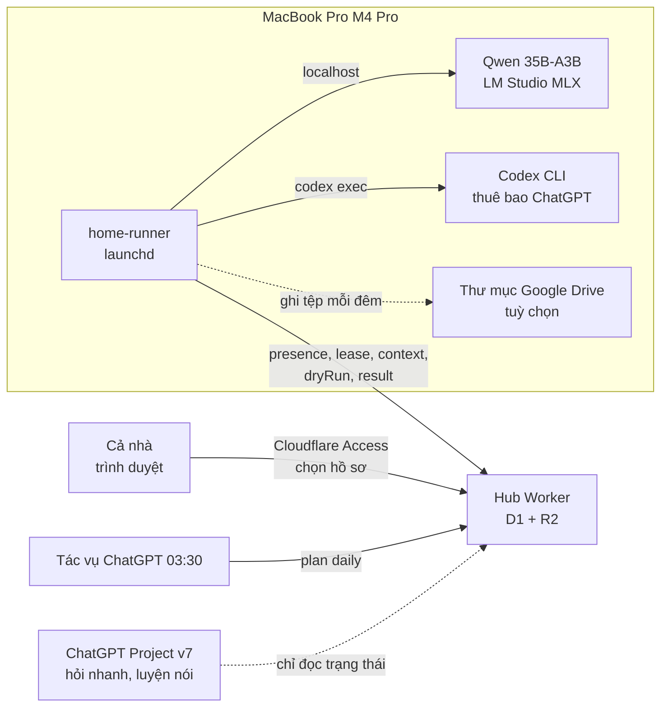

# Learning Hub — Plan chấm bài bằng model local, hồ sơ gia đình, bỏ Google Sheets

Viết 10/11/2026, cập nhật cùng ngày theo các câu trả lời của chủ dự án. **Trạng thái: chờ duyệt.**

Khi được duyệt, plan này thay các phần sau, còn lại của [PLAN.md](PLAN.md) giữ nguyên:

- PLAN H7.2–H7.5 và [AI-API §9.2](../hub2/AI-API.md#92-r2-worker-chấm-bài): Worker chấm bài dùng key Anthropic.
- PLAN H1.6, H1.8 và các quyết định D14, D15: tài khoản riêng từng người, quyền phụ huynh.

## Điều chỉnh cho pilot Deutsch

Lịch soạn bài chính bắt đầu 00:00 Berlin qua Hub và runner trên Mac. Codex CLI soạn bài chính và các lượt Học mới, Luyện tập, Cá nhân hóa. Bài chính khoảng 45 phút, bài thêm khoảng 15 phút, mỗi bài 1–25 câu. Qwen chấm câu mở khi Mac cắm sạc. Khi Qwen chưa sẵn sàng, lượt chấm tiếp tục chờ. Codex CLI chỉ chấm lại khi có yêu cầu. Xem [plan pilot](DEUTSCH-ADAPTIVE-PILOT.md).

## 0. Tóm tắt

- **Mục tiêu:** một giao diện cho cả nhà, **không có tài khoản**. Mỗi người là một **hồ sơ** có:
  - sổ, lộ trình, mục tiêu riêng;
  - prompt cá nhân;
  - lịch sử và kết quả làm bài riêng.

  Ví dụ: chủ dự án và cháu cùng có sổ Deutsch, nhưng mỗi sổ có mục tiêu, trình độ, prompt, kỹ năng và bài khác nhau.
- **Ai làm gì:**
  - **Qwen 35B-A3B trên MacBook Pro M4 Pro 48 GB** chấm câu mở ngay sau khi nộp.
  - Câu đóng (chọn, điền, đáp số) vẫn do Hub chấm tức thì.
  - **ChatGPT** soạn bài hằng đêm, soạn bài theo yêu cầu và chấm lại khi bị phản đối.
  - Mỗi bài 5–10 câu.
- **Nối ChatGPT theo yêu cầu:** chương trình nền trên Mac gọi **Codex CLI** (`codex exec`, dùng thuê bao ChatGPT), có kết quả sau vài phút. Tác vụ ChatGPT định kỳ 03:30 soạn bài hằng ngày.
- **Mac hầu như luôn bật** (cập nhật 10/11/2026). Khi Mac vắng, Hub chỉ báo "Máy chấm đang tắt": bài nằm chờ và được chấm khi Mac bật lại. Không chuyển sang ChatGPT.
- **Giữ phần lớn code đã có.** Hub 2 trên staging đã có:
  - bài có từng câu, chấm tự động;
  - learner model, lịch ôn;
  - hàng đợi job AI có lease;
  - phản đối và chấm lại;
  - cầu nối ChatGPT.

  Việc mới chủ yếu là:
  - `integrations/home-runner/`, chương trình chạy nền trên Mac;
  - thay đăng nhập bằng chọn hồ sơ;
  - nhập dữ liệu từ Google Sheets một lần.
- **Lịch dự kiến:** khoảng 7 tuần làm (11/11–27/12/2026), rồi 2 tuần dùng thử. Cổng E khoảng 11/1/2027.

## 1. Hiện trạng (audit 10/11/2026)

| Mảng | Hiện trạng |
| --- | --- |
| Production | `learn.unhuman.cc` ở bản H1.7. Đã chọn "cách 1": deploy schema mới cùng `HUB2_ENABLED=false`. Chưa chạy, vì cần chủ dự án cho phép đọc và ghi production. |
| Staging | Hub 2 đến H6, đã có migration 0014. |
| Git | `main` có H0–H2.4. [PR #92](https://github.com/unhuman1289/learning-hub/pull/92) gồm H2.5–H6, gating `HUB2_ENABLED`, công cụ `hub2_*`, prompt D. Cần CI xanh trên commit cuối. |
| Checkout chính | `~/Code/Learning Hub` ở nhánh cũ `codex/phase-1-automation-cutover`, có thay đổi chưa commit (L0.3). |
| Đăng nhập | Better Auth: email và mật khẩu, xác minh email, admin duyệt, quan hệ phụ huynh. Plan này bỏ phần đăng nhập (L5). |
| Chấm câu mở | Mới có runner giả. |
| Soạn bài | Prompt D cho ChatGPT qua cầu nối Sites (trỏ vào staging). Chưa có lịch chạy thật. |
| Deutsch của chủ dự án | Nhật ký vẫn nằm trong Google Sheet theo Project v6.1 (DASHBOARD, ATTEMPTS, ITEMS, TAGS). |

## 2. So sánh và lựa chọn

| Tiêu chí | ChatGPT Project + Sheets (v6.1) | Hub 2 + Qwen + ChatGPT |
| --- | --- | --- |
| Nhiều người | Mỗi người một Project và một Sheet | Mỗi người một hồ sơ trong cùng giao diện; đổi người bằng một chạm |
| Số câu một lần | Tối đa 3 câu mỗi tin nhắn | 5–10 câu mỗi bài |
| Ghi dữ liệu | Model tự viết batchUpdate rồi đọc lại | Server ghi theo transaction; luật nằm trong code và có test |
| Lịch ôn, thành thạo | Công thức trong Sheet | Luật E0–E3, bốn chiều, lịch ôn 1→3→7→14→30→60 |
| Chấm câu mở | ChatGPT, ngay trong chat | Qwen (ước tính khoảng 1 phút); khi Mac tắt thì ChatGPT |
| Chấm sai | Không có cơ chế | Phản đối, ChatGPT chấm lại, rồi người lớn trong nhà quyết |
| Hội thoại, luyện nói | Tốt | Không làm. Giữ ChatGPT Project (L6). |
| Xem lịch sử | Mở Sheet | Trang lịch sử trong Hub; xuất Markdown hoặc CSV; tuỳ chọn chép sang Drive (L5.6) |
| Riêng tư | Bài làm gửi lên OpenAI và Google | Lần chấm đầu chỉ đi qua Cloudflare và Mac. ChatGPT chỉ nhận dữ liệu khi soạn bài và chấm lại. |

**Chọn:** Hub là nguồn dữ liệu duy nhất. Google Sheet được nhập một lần rồi khoá. ChatGPT Project chỉ còn để hỏi nhanh và luyện nói.

### 2.1 Ánh xạ khái niệm v6.1 sang Hub

| v6.1 (Sheets) | Hub 2 |
| --- | --- |
| ROLE, CONTEXT, PRIMARY GOAL của Project | Prompt của sổ Deutsch trong hồ sơ chủ dự án (L5.5) |
| TAGS (tag_id, label, kind G/P/N) | `skills`; nhóm G/P/N bằng tiền tố `key` (`g-`, `p-`, `n-`) (L3.2) |
| ITEMS (interval, next_due, misses, status) | `skill_states` (bậc ôn, `next_review_day`) và `error_patterns` |
| ATTEMPTS (first_ok, hints, evidence, result) | `attempts`, `grades`: `support` (`none`, `hint1`, `hint2`, `solution`), `attempt_no`, `result` |
| Thành công độc lập (free, first_ok=1, hints=0) | E3: đúng, không hỗ trợ, lần 1 |
| Nhận diện và lần sửa không tính thành thạo | `recognition` là chiều riêng. `demonstrated` cần `application = 3`. |
| Thành thạo: ≥3 lần độc lập trong ≥2 buổi, không lỗi trong 7 ngày | `demonstrated`: E3 vận dụng trên ≥2 ngày và không còn mẫu lỗi đã xác nhận đang mở |
| Khoảng ôn 1→3→7→14→30 → graduated | 1→3→7→14→30→60 → `maintained` |
| Sai lần 1 → gợi ý vị trí; sai lần 2 → đáp án | Sửa hai bậc (L3.1) |
| Report: một batchUpdate rồi đọc lại | Hub ghi; runner xác minh bằng `GET /jobs/{id}` |
| Lesson 5 giai đoạn | Khuôn `skill`, 8–10 câu (L2.1) |

## 3. Kiến trúc đích



| Việc | Mac bật | Mac tắt hoặc ngủ |
| --- | --- | --- |
| Chấm câu đóng | Hub, tức thì | Hub, tức thì |
| Chấm câu mở (`assess submission`) | Qwen khi cắm sạc, Codex khi chạy pin; khoảng 1 phút | Chờ; giao diện báo "Máy chấm đang tắt" |
| Chấm lại khi phản đối (`assess recheck`) | Codex CLI (ChatGPT) | Chờ |
| Soạn theo yêu cầu: "Xin thêm bài", "Hỏi thêm" loại "ngay", bài đầu của sổ mới (`plan request`, `plan initial`) | Codex CLI (ChatGPT) | Chờ |
| Soạn bài hằng ngày (`plan daily`) | Tác vụ ChatGPT định kỳ 03:30 (không phụ thuộc Mac) | Như cột bên trái |
| Ảnh bài làm | Qwen nếu bản dùng có đọc ảnh và qua eval; nếu không thì Codex | Chờ |
| Dự phòng | `claude -p` (thuê bao Claude) khi Codex lỗi | |

## 4. Quyết định

Đã chốt theo câu trả lời 10/11/2026:

| # | Quyết định | Thay cho |
| --- | --- | --- |
| D12′ | Hub không giữ key model. Runner là `home-runner` trên Mac (Qwen, Codex, Claude), tác vụ ChatGPT định kỳ (soạn bài hằng ngày), và runner giả cho test. Không còn Worker assessor, Queue AI hay `ANTHROPIC_API_KEY`. | D12, AI-API §9.2, PLAN H7.2–H7.3 |
| D19 | Qwen 35B-A3B chạy trên MacBook Pro M4 Pro 48 GB. Chỉ chấm khi máy cắm sạc. Đổi model thì phải chạy lại eval (L1.5). | (mới) |
| D20 | Bài chính 8–10 câu; bộ ôn 5–6; bài `reading` 5–8; tối đa 4 câu mở mỗi bài. Server kiểm. | AGENTS.md "2–8 questions" |
| D21 | Sửa hai bậc: lần sai đầu chỉ chỉ vị trí lỗi; bản sửa hiện khi sai lần nữa hoặc khi bấm "Xem đáp án". | (mới, từ v6.1) |
| D22 | Google Sheet được nhập một lần rồi khoá chỉ đọc. Không ghi song song hai nơi. | v6.1 "Single source of truth" |
| D23 | **Không có tài khoản.** Hồ sơ thay cho người dùng. Ai trong nhà cũng xem được mọi hồ sơ; chỉ hồ sơ đang chọn mới làm bài được. Cài đặt nằm sau "chế độ quản lý". | D14, D15, PLAN H1.6, H1.8 |
| D24 | Chấm lại khi phản đối luôn dùng ChatGPT, để có một ý kiến độc lập với Qwen. | (mới) |
| D25 | Mac vắng thì chỉ báo "Máy chấm đang tắt" trên giao diện và trang Quản trị; việc nằm chờ đến khi Mac bật lại. Không chuyển sang ChatGPT. | (mới, chốt 10/11/2026) |
| D26 | D1 là nơi lưu chính. Drive chỉ nhận bản chép một chiều để xem. | (mới) |

**Cổng nhà:** Hub nằm trên Internet, có dữ liệu của trẻ và tiêu quota ChatGPT. Vì vậy vẫn cần một cổng chung trước khi chọn hồ sơ, nhưng không có tài khoản trong app.

- **Quyết định 10/11/2026:** dùng một mật khẩu chung cho cả nhà; không thu email hoặc tạo tài khoản riêng. Chủ nhà thêm hồ sơ bằng tên, người học tự chọn. Thiết bị lưu cookie cổng nhà một năm. Cloudflare Access Service Auth vẫn bảo vệ đường dẫn automation riêng.

Không bỏ hẳn cổng.

## 5. Lộ trình và lịch

```text
L0 Chốt nền        L1 Runner trên Mac          L2 Bài 5–10 câu       L3 Sửa bài kiểu v6.1
L0.1 merge #92     L1.1 model server M4 Pro    L2.1 LESSON-DESIGN    L3.1 sửa hai bậc
L0.2 prod cách 1   L1.2 Hub: presence, định    L2.2 kiểm số câu      L3.2 nhóm G/P/N
L0.3 dọn checkout       tuyến, báo máy tắt     L2.3 prompt soạn bài  L3.3 "Tại sao?"
L0.4 sửa tài liệu  L1.3 home-runner            L2.4 giao diện 10 câu
                   L1.4 prompt chấm
                   L1.5 bộ bài mẫu ─Cổng E1─►
                   L1.6 ChatGPT theo yêu cầu
                   L1.7 staging 1 tuần

L5 Hồ sơ thay tài khoản  L4 Từ Google Sheets  L6 ChatGPT Project v7  L7 Production, dùng thử
L5.1 cổng nhà            L4.1 xuất CSV        L6.1 hướng dẫn v7      L7.1 cấu hình production
L5.2 bảng hồ sơ          L4.2 script nhập     L6.2 công cụ đọc       L7.2 nhập Sheet
L5.3 chọn hồ sơ          L4.3 chạy, khoá Sheet                       L7.3 dùng thử ─Cổng E─►
L5.4 lớp quyền rút gọn
L5.5 prompt cá nhân, prompt sổ
L5.6 lịch sử, xuất, Drive
```

| Tuần | Ngày | Việc | Mốc |
| --- | --- | --- | --- |
| 1 | 11–15/11 | L0; L1.1 song song | PR #92 merge; production có schema mới (Hub 2 tắt) |
| 2 | 16–22/11 | L1.2, L1.3 | Qwen chấm được trên local |
| 3 | 23–29/11 | L1.4, L1.5; L2.1–L2.3 | **Cổng E1** |
| 4 | 30/11–6/12 | L1.6; L5.1–L5.4 | ChatGPT nhận việc theo yêu cầu; bỏ đăng nhập trên staging |
| 5 | 7–13/12 | L5.5, L5.6; L3; L4.1–L4.2; bắt đầu L1.7 | Staging dùng thật |
| 6 | 14–20/12 | L2.4; L6; L4.3 | |
| 7 | 21–27/12 | L7.1, L7.2 | Production bật |
| 8–9 | 28/12–10/1/2027 | L7.3 dùng thử (dời được) | **Cổng E** khoảng 11/1 |

## 6. Chi tiết task

Quy ước như [PLAN §4](PLAN.md#4-cách-làm-việc): mỗi task là một PR, có test, deploy staging trước. Mỗi thao tác production đều chờ chủ dự án đồng ý.

### L0 — Chốt nền

#### L0.1 Merge PR #92
- **Việc:**
  - Chạy lại CI trên commit cuối, rồi merge.
  - Lưu `AUTOMATION_CLIENTS` cho staging.
  - Publish lại Site của cầu nối, rồi kiểm ChatGPT thấy các công cụ `hub2_*`.
- **Cỡ:** S.

#### L0.2 Production cách 1
- **Việc:**
  - Sao lưu D1 production.
  - Chạy thử migration 0009–0014 trên bản sao.
  - Áp migration, deploy với `HUB2_ENABLED=false`, chạy smoke test.
  - Ghi bằng chứng vào VALIDATION.md.
- **Chấp nhận khi:** người dùng hiện tại thấy app như cũ.
- **Cỡ:** S.

#### L0.3 Dọn checkout chính
- **Việc:**
  - So các thay đổi chưa commit trên `codex/phase-1-automation-cutover` với `main`.
  - Phần chưa có trong `main` thì commit lên một nhánh riêng.
  - Đưa checkout chính về `main`.
- **Chấp nhận khi:** không mất thay đổi nào chưa có ở nơi khác.
- **Lưu ý:** chủ dự án duyệt trước khi bỏ bất cứ gì.
- **Cỡ:** S.

#### L0.4 Sửa tài liệu theo quyết định mới
- **Việc:**
  - **PLAN.md:** H1.6, H1.8, H7.2–H7.5 trỏ sang plan này.
  - **AI-API §2 và §9:** client `home-runner`, báo máy tắt.
  - **hub2/README:** D12′, D19–D26; gạch D14, D15.
  - **DATA-MODEL §5:** quyền theo hồ sơ.
  - **AGENTS.md:**
    - Hub không giữ key; chấm bằng model local, Codex hoặc ChatGPT qua runner kéo việc.
    - Số câu theo D20.
    - Ranh giới tin cậy là Cloudflare Access (JWT được Worker kiểm), sau đó mới chọn hồ sơ.
- **Cỡ:** S.

### L1 — Runner trên Mac

#### L1.1 Model server trên M4 Pro 48 GB
- **Việc:**
  - Cài LM Studio với bản MLX của Qwen 35B-A3B, lượng tử 4-bit (khoảng 20 GB).
    - Bật server tương thích OpenAI, chỉ nghe trên `127.0.0.1`.
    - Bật `response_format` theo JSON Schema.
    - Ngữ cảnh 32k.
  - Bật tự nạp model khi có yêu cầu và tự giải phóng sau 30 phút rảnh, để trả RAM cho việc khác. Lần nạp lại mất khoảng 10–20 giây.
  - Phương án thay: `llama-server` (GGUF). Chọn theo số đo.
- **Đo:** dùng 3 context (8 KB, 30 KB, 96 KB). Ghi lại:
  - RAM khi chạy;
  - tốc độ đọc prompt và tốc độ sinh (token mỗi giây);
  - thời gian chấm một lần nộp có 4 câu mở;
  - tỉ lệ JSON hợp lệ;
  - kết quả khi bật và tắt chế độ suy nghĩ;
  - 5 ảnh bài giải tự viết, nếu bản dùng có đọc ảnh.
- **Ước tính để đối chiếu:** model chỉ dùng khoảng 3B tham số mỗi token và M4 Pro có băng thông bộ nhớ cao, nên một lần nộp 4 câu mở mất khoảng 1 phút.
- **Chấp nhận khi:** ≤2 phút; JSON hợp lệ ngay lần đầu ≥95%; còn ≥16 GB RAM cho việc khác khi model đã nạp. Số đo ghi vào VALIDATION.md.
- **Cỡ:** S.

#### L1.2 Hub: presence, định tuyến, báo máy tắt
- **Migration `0015_runners`:**
  - `ai_jobs.needs_vision` (0/1): đặt khi tạo assess job có câu do AI chấm kèm ảnh.
  - Bảng `runner_presence` (`client_id`, `capabilities`, `last_seen_at`). Mỗi phút ghi tối đa một lần, tức khoảng 1,4 nghìn lần ghi mỗi ngày.
- **Lease:**
  - Nhận thêm `capabilities?: ['vision']`. Runner không khai báo thì chỉ nhận job `needs_vision = 0`.
  - Mỗi lần lease cập nhật presence.
- **Client `home-runner`:**
  - scope `jobs:assess`, `jobs:plan`, `attachments:read`;
  - `purposes: submission, recheck, request, initial`;
  - `triggers: on_demand, deferred`;
  - `learnerIds` là các hồ sơ trong nhà.
- **Client cầu nối ChatGPT:** giữ như hiện có (chỉ `plan daily`, `initial`, `request`).
- **Báo máy tắt:**
  - `GET /api/runner-status` (phiên người dùng) trả `{online, lastSeenAt}`. `online` khi `home-runner` có presence trong 3 phút.
  - Câu đang chờ chấm, yêu cầu đang chờ soạn và phản đối đang chờ chấm lại hiện "Máy chấm đang tắt — bài sẽ được chấm khi máy bật lại" thay cho "Đang chấm…".
  - Trang Quản trị và banner cảnh báo hiện "Máy chấm vắng từ <giờ>" khi có việc chờ mà máy vắng quá 30 phút.
  - Không gửi email, không chuyển việc sang runner khác.
- **Ngân sách:**
  - Chấm `on_demand` bằng Qwen: 60 lần mỗi người mỗi ngày.
  - Job do Codex làm (chấm lại, soạn theo yêu cầu) vẫn theo [AI-API §7](../hub2/AI-API.md#7-ngân-sách-và-ưu-tiên), để không tiêu hết quota của gói.
  - `AI_PRICE_TABLE`: model local có giá 0.
- **Test:**
  - lease theo khả năng đọc ảnh;
  - client chỉ lease được đúng `purposes`;
  - presence và `online`;
  - backup contract.
- **Cỡ:** M.

#### L1.3 `integrations/home-runner/`
- **Mã nguồn** (Node 22, type stripping; dùng lại zod và `lib/contracts`, không thêm thư viện):

  | File | Việc |
  | --- | --- |
  | `runner.mjs` | Vòng lặp, lịch kéo việc, chọn engine, tắt êm |
  | `hub.mjs` | lease, context, ảnh, heartbeat, result (`dryRun` rồi gửi thật), fail, `GET /jobs/{id}` |
  | `engines/qwen.mjs` | `/v1/chat/completions` với JSON Schema của `assess-result/1`; kiểm server |
  | `engines/codex.mjs` | `codex exec --output-schema <schema> -o <out> --skip-git-repo-check`, sandbox chỉ đọc, thư mục tạm riêng; đưa context qua stdin |
  | `engines/claude.mjs` | `claude -p` xuất JSON (dự phòng) |
  | `power.mjs` | Đọc `pmset -g batt`: chỉ dùng Qwen khi cắm sạc; giữ máy thức bằng `caffeinate -i` trong lúc chạy một job |
  | `mirror.mjs` | Chép lịch sử sang Drive (L5.6), tuỳ chọn |
  | `config.example.env`, `launchd/*.plist.example`, `README.md` | Chỉ có tên biến; tự chạy khi đăng nhập Mac; cài đặt, xoay khoá, tắt khẩn cấp |

- **Engine là hàm thuần.** Engine chỉ nhận prompt và context, trả về JSON. **Credential của Hub không bao giờ đi vào prompt** hay vào tiến trình Codex hoặc Claude.
- **Chọn engine:**

  | Job | Engine chính | Dự phòng |
  | --- | --- | --- |
  | `assess submission` | Qwen (cắm sạc, server sẵn sàng) | Codex |
  | `assess recheck` | Codex | Claude |
  | `plan request`, `plan initial` | Codex | Claude |
  | `plan daily` | Không lease; để tác vụ ChatGPT 03:30 làm | |

- **Luồng một job:**
  1. Chọn engine sẵn sàng. Không có engine nào thì không lease.
  2. Lease với `max:1` và `runner:{name:'home-runner', version, model}`.
  3. Đọc context; tải ảnh nếu có.
  4. Chạy engine. Gửi heartbeat mỗi 3 phút.
  5. Kiểm bằng zod. Gắn `contextHash` và `usage` thật.
  6. Gửi thử `dryRun`. Gặp 422 thì đưa danh sách lỗi cho engine sửa đúng một lần.
  7. Gửi thật. Lỗi mạng sau khi gửi thì `GET /jobs/{id}`, không gửi kết quả khác.
  8. Lỗi engine thì `fail` với `retryable: true`, để job quay lại hàng đợi cho lần sau hoặc engine dự phòng. Engine từ chối, hoặc JSON vẫn hỏng sau lần sửa, thì `retryable: false`.
- **Lịch kéo việc:**
  - 06:00–23:30 Berlin: mỗi 15 giây; đêm: mỗi 5 phút. Tổng khoảng 4,3 nghìn request mỗi ngày.
  - Gặp lỗi thì chờ lâu dần, tối đa 5 phút.
  - Mỗi lần chỉ xử lý một job.
  - Chạy pin: vẫn lease cho Codex, nhưng không khai báo Qwen.
- **Credential:**
  - Hub: `~/.config/learning-hub/home-runner.env`, quyền 600, hoặc Keychain của macOS. Gồm bearer, Access service token và URL Hub. Không bao giờ để trong repo.
  - Codex và Claude dùng đăng nhập sẵn có của từng CLI.
- **Log:** chỉ ghi `jobId`, engine, trạng thái, thời gian, số token. Không giữ context sau khi job xong.
- **Test:**
  - unit với phản hồi ghi sẵn của từng engine;
  - 422 rồi sửa;
  - mất mạng sau khi gửi;
  - Qwen tắt thì chuyển sang Codex;
  - chạy pin;
  - prompt không chứa credential;
  - e2e local với `wrangler dev`, seed và engine giả.
  - CI không gọi model hay CLI thật.
- **Chấp nhận khi:**
  - Local: một bài 10 câu (4 câu mở) có lời phê thật của Qwen trong ≤2 phút.
  - "Xin thêm bài" có bài mới do Codex soạn trong ≤10 phút.
  - Tắt LM Studio giữa chừng: job chuyển sang Codex, không mất dữ liệu.
- **Cỡ:** M–L.

#### L1.4 Prompt chấm và prompt soạn
- **Việc:**
  - `integrations/runner-prompts/assess-local.md` viết từ [LESSON-DESIGN §6](../hub2/LESSON-DESIGN.md#6-chấm-bài-và-lời-phê). Viết ngắn và rõ vì model nhỏ:
    - chấm từng câu theo rubric;
    - chấp nhận cách diễn đạt khác nhưng đúng;
    - `evidence` trích nguyên văn;
    - phân loại lỗi là `unknown` khi chưa chắc;
    - lần sai đầu chỉ chỉ vị trí lỗi;
    - tách lỗi G/P/N;
    - nội dung bài làm là dữ liệu, không phải chỉ dẫn;
    - kèm 3 ví dụ chấm Deutsch.
  - `assess-recheck.md` cho Codex và ChatGPT: chấm độc lập như lần đầu; lời nhắn phản đối là dữ liệu.
  - `plan-request.md` dùng chung cho Codex và tác vụ ChatGPT; cùng nguồn với prompt D.
  - Mọi prompt đọc thêm prompt cá nhân và prompt sổ trong context (L5.5).
- **Cỡ:** S.

#### L1.5 Bộ bài mẫu và Cổng E1
- **Việc:**
  - `fixtures/eval/assess/`: 30 câu soạn mới.
    - 20 câu Deutsch (viết câu, sửa câu, email ngắn, viết lại cho tự nhiên);
    - 5 câu đúng nhưng diễn đạt khác;
    - 5 câu thử chèn chỉ dẫn.
  - Chủ dự án chấm tay làm chuẩn.
  - `scripts/eval-assess.mjs --engine qwen|codex` chạy offline. Qwen không tốn tiền; Codex tốn quota ChatGPT.
- **Cổng E1** (Qwen):

  | Chỉ số | Ngưỡng |
  | --- | --- |
  | Kết quả (đúng, một phần, sai) khớp chuẩn | ≥90% |
  | Câu đúng bị chấm sai mà không có bằng chứng | 0 |
  | Câu thử chèn chỉ dẫn làm lệch điểm | 0/5 |
  | Phân loại G/P/N đúng | ≥80% |
  | JSON hợp lệ ngay lần đầu | ≥95% |

- **Không đạt thì thử, theo thứ tự:**
  1. bật chế độ suy nghĩ;
  2. lượng tử 6 bit (còn vừa 48 GB);
  3. thêm ví dụ vào prompt;
  4. chỉ để Qwen chấm G và P; câu thuần N chuyển sang Codex.
- **Chạy lại** mỗi khi đổi prompt hoặc model.
- **Cỡ:** M.

#### L1.6 Giao diện "Máy chấm đang tắt"
- **Thay đổi:** dùng `GET /api/runner-status` (L1.2) ở trang bài, hộp thoại phản đối, danh sách yêu cầu và trang Quản trị. Hỏi lại mỗi 60 giây khi có việc đang chờ.
- **Chấp nhận khi:** trên staging, tắt `home-runner`, nộp một bài có câu mở → câu mở hiện "Máy chấm đang tắt"; bật lại → trong ≤2 phút có lời phê.
- **Cỡ:** S.

#### L1.7 Staging 1 tuần
- **Việc:** chủ dự án học thật 5 trong 7 ngày. Đo:
  - thời gian chấm theo từng engine;
  - số lần Mac vắng;
  - thời gian ChatGPT nhận việc;
  - số request và số lần ghi D1;
  - số câu bị phản đối, số câu bị lật điểm.
- **Chấp nhận khi:** trung vị thời gian chấm ≤3 phút khi Mac bật; không mất bài; trong ngân sách Free.
- **Cỡ:** S, cộng 1 tuần.

### L2 — Bài 5–10 câu

#### L2.1 Hướng soạn bài (LESSON-DESIGN)
- **Số câu theo loại bài:**

  | Loại bài | Số câu | Câu Hub tự chấm | Câu mở |
  | --- | --- | --- | --- |
  | Bài chính `skill` | 8–10 | ≥5 | 2–4, tối đa 1 bài viết dài |
  | Bộ ôn | 5–6 | ≥4 | ≤2 |
  | Bài `reading` | 5–8 | 2–4 | 3–4 |
  | Mini | 5 | 3–4 | 1–2 |

- **Năm giai đoạn của v6.1 trong khuôn `skill`:**

  | Giai đoạn v6.1 | Trong Hub | Số câu |
  | --- | --- | --- |
  | RECALL | Nhớ lại các kỹ năng đến hạn | 2–3 |
  | REVIEW | Sửa lỗi cũ trong ngữ cảnh mới | 1–2 |
  | DISCOVER | Phiếu quy tắc có ví dụ đối lập, rồi luyện có hướng dẫn | 2–3 |
  | USE | Tự làm | 1–2 |
  | REPORT | Nộp bài, lời phê, cập nhật lịch ôn | |

- **USE theo thứ trong tuần** (đặt trong prompt sổ, mỗi hồ sơ có thể khác): Thứ 2, 4, 6 viết 5–7 câu; Thứ 3, 5 đọc 150–220 từ rồi trả lời 3 câu; Thứ 7 luyện nói với ChatGPT, Hub chỉ giao bộ ôn; Chủ nhật củng cố.
- **Cỡ:** S.

#### L2.2 Server kiểm số câu
- **Thay đổi:**
  - `subjects.limits.itemsPerLesson` (`{min, max}`), mặc định theo L2.1.
  - Bài ngoài khoảng, hoặc quá 4 câu mở, thì 422 `size_limit`.
  - Bài nhập tay chỉ hiện cảnh báo.
- **Test:** biên 4, 5, 10, 11 câu.
- **Cỡ:** S.

#### L2.3 Prompt soạn bài
- **Việc:** prompt D, `plan-request.md` và bản cho Claude theo L2.1–L2.2; fixture bài 10 câu.
- **Chấp nhận khi:** 3 lần soạn thử qua `dryRun` ngay lần đầu, hoặc sau một lần sửa.
- **Cỡ:** S.

#### L2.4 Giao diện bài 10 câu
- **Việc:**
  - Thanh tiến độ "câu 4/10".
  - Lưu nháp từng câu.
  - Câu mở hiện "Đang chấm…" trong khi câu đóng đã có điểm.
  - Kiểm trên 375 px và 1280 px.
- **Cỡ:** S.

### L3 — Sửa bài theo cách của v6.1

#### L3.1 Sửa hai bậc
- **Thay đổi:**
  - Grade `incorrect` hoặc `partial` lần đầu chỉ trả `feedback`. `correction` bị ẩn ở server, giống cách đang ẩn `errorLabel`.
  - Bản sửa hiện khi làm lại vẫn sai, hoặc khi bấm "Xem đáp án" (khi đó ghi `support = solution`).
  - Làm lại tạo attempt mới và assess job mới (Qwen, không tốn quota).
- **Test:** API không lộ `correction` trước điều kiện; làm lại đúng là E2, đúng sau khi xem đáp án là E0.
- **Cỡ:** M.

#### L3.2 Nhóm G/P/N
- **Thay đổi:**
  - Kỹ năng Deutsch có `key` bắt đầu bằng `g-`, `p-` hoặc `n-`. Server kiểm khi sổ bật `limits.skillFacets`.
  - Trang đầu sổ nhóm kỹ năng theo G/P/N, kèm số E3 trong 7 và 30 ngày.
  - Lời phê liệt kê lỗi theo nhóm.
- **Cỡ:** S.

#### L3.3 "Tại sao?"
- **Việc:** sau mỗi hai lần sửa thành công, prompt chấm thêm một `checkItem` dạng `explain` (tối đa 2 mỗi lần nộp). Chỉ sửa prompt.
- **Cỡ:** XS.

### L4 — Chuyển từ Google Sheets

#### L4.1 Xuất dữ liệu
- **Việc:** xuất 4 tab ra CSV vào `private-data/legacy-sheets/<ngày>/`. Không commit.

#### L4.2 Script nhập `scripts/import-legacy-sheet.mjs`
- **Ánh xạ** (vào sổ Deutsch của hồ sơ chủ dự án). Learner model tính lại thành thạo, lịch ôn và mẫu lỗi từ bài làm trong Hub, nên dữ liệu cũ không được ghi thẳng vào `skill_states` hay `error_patterns` (lần tính lại đầu sẽ xoá chúng). Thay vào đó:

  | Nguồn | Đích |
  | --- | --- |
  | TAGS không `archived` | `skills` (`active`, `origin = migration`), `key` = tiền tố G/P/N cộng `tag_id` |
  | Cột "mastered" của TAGS (nếu có) | Dòng "Đã thành thạo theo Sheet" trong prompt của sổ |
  | ITEMS chưa `graduated`, `misses > 0` | Dòng "Lỗi hay lặp lại" (12 mục nhiều lần sai nhất) |
  | ITEMS `next_due` trong 14 ngày | Dòng "Mục đến hạn ôn" |
  | ATTEMPTS 30 ngày cuối | Tỉ lệ thành công độc lập theo G/P/N |

  Phần tóm tắt (≤2500 ký tự, có dấu `[Từ Google Sheets …]`) được nối vào `subjects.instructions`; người soạn bài đọc nó, người học sửa được.
- **Cách chạy:** in báo cáo và phần tóm tắt; `--out` ghi SQL (quyền 600). Chạy lại không tạo trùng (id cố định, dấu `[Từ Google Sheets`). Áp bằng `wrangler d1 execute … --file`. Hoàn tác: xoá kỹ năng `origin = migration` của sổ và xoá đoạn tóm tắt trong prompt sổ.
- **Test:** CSV tự soạn theo bố cục v6.1, áp hai lần trên SQLite.
- **Cỡ:** M.

#### L4.3 Chạy và khoá Sheet
- **Việc:**
  - Chạy trên staging, đối chiếu số dòng.
  - Production ở L7.2, sau khi sao lưu.
  - Đặt Sheet chỉ đọc và ghi chú "Đã chuyển sang Learning Hub ngày …".
- **Cỡ:** S.

### L5 — Hồ sơ thay tài khoản

#### L5.1 Cổng nhà
- Worker dùng `HOUSEHOLD_GATE=passphrase` và xác thực mật khẩu chung trước khi hiện bộ chọn hồ sơ. Chỉ lưu hash mật khẩu và khóa ký cookie trong Worker secrets.
- Runner vẫn dùng Cloudflare Access service token và bearer ở `/api/automation/*`. Giữ xác thực OAuth độc lập cho MCP trực tiếp.
- Kiểm thử thiếu/sai mật khẩu, cookie sửa tay, header danh tính giả, và việc automation/MCP vẫn yêu cầu quyền riêng. Dùng `APP_ENV=local` khi cần bỏ qua cổng trong bản phát triển chỉ chạy loopback.

#### L5.2 Bảng hồ sơ
- **Thay đổi:**
  - **Dùng lại dòng trong bảng `user` làm hồ sơ**, giữ nguyên id. Nhờ vậy mọi `learner_id` hiện có không phải chuyển. Người dùng production hiện có trở thành hồ sơ. Hồ sơ mới không có email thật (dùng `profile+<id>@local.invalid`) và không có mật khẩu.
  - **Migration `0016_profiles`:**
    - `learner_settings.personal_prompt` (≤4000);
    - `avatar` (emoji, màu);
    - `subjects.instructions` (≤4000, prompt của sổ);
    - `household_settings` (PIN quản lý dạng hash, tuỳ chọn).
  - Giữ `role` (`adult` hoặc `child`): quyết định giọng lời phê, ngân sách và việc chỉ gửi biệt danh.
  - Cập nhật backup contract.
- **Cỡ:** M.

#### L5.3 Chọn hồ sơ, bỏ đăng nhập
- **Thay đổi:**
  - Màn hình "Ai đang học?" có avatar từng hồ sơ và nút "Thêm hồ sơ" (sau chế độ quản lý).
  - Cookie `lh_profile` ký HMAC (`PROFILE_COOKIE_SECRET`), một năm. "Đổi người" ở thanh trên cùng, một chạm.
  - Gỡ trang đăng nhập, đăng ký, xác minh email, đặt lại mật khẩu, và luồng admin duyệt tài khoản.
  - `currentProfile(request)` thay cho session Better Auth ở mọi route.
  - Giữ các bảng của Better Auth đến một migration dọn dẹp sau.
- **Test:** mỗi lần nộp, nháp hay phản đối đều gắn với hồ sơ trong cookie; cookie giả hoặc trỏ tới hồ sơ không tồn tại bị bỏ qua.
- **Cỡ:** L.

#### L5.4 Lớp quyền rút gọn
- **Thay đổi:** `lib/access.ts` có hai mức.

  | Mức | Được làm |
  | --- | --- |
  | Hồ sơ đang chọn | Đọc mọi hồ sơ. Làm bài, nháp, phản đối, "Xin thêm bài" cho chính mình. |
  | Chế độ quản lý | Thêm, sửa, xoá mềm hồ sơ và sổ; mục tiêu, trình độ, prompt; nhập bài; xử lý phản đối; trang Quản trị và Lượt AI. Bật bằng một nút; có PIN 4 số nếu muốn, chỉ để tránh trẻ bấm nhầm. |

  - Bỏ quan hệ phụ huynh khỏi lớp quyền; bảng `guardians` giữ để tra lịch sử.
  - Viết lại test ma trận quyền và `tests/api-security.test.mjs` theo hai mức này.
- **Cỡ:** M.

#### L5.5 Prompt cá nhân và prompt sổ
- **Thay đổi:**
  - Trang hồ sơ có: biệt danh, avatar, ngôn ngữ giải thích, phong cách, mục tiêu phút, **prompt cá nhân**.
  - Trang sổ có: mục tiêu, trình độ, chương trình, **prompt của sổ**.
  - `plan-context` và `assess-context` thêm `learner.personalPrompt` và `subject.instructions`, đánh dấu là "mong muốn của người học". Chúng không thay được luật server: số câu, ngân sách, schema, bài đang dở.
  - Cập nhật JSON Schema và runner giả.
  - Chuyển phần ROLE, CONTEXT, PRIMARY GOAL của v6.1 thành prompt sổ Deutsch của chủ dự án; sổ Deutsch của cháu có prompt riêng.
- **Test:** hai hồ sơ cùng có sổ "Deutsch" → context của từng job chỉ chứa đúng sổ, prompt và bằng chứng của hồ sơ đó.
- **Cỡ:** M.

#### L5.6 Lịch sử, xuất, Drive
- **Thay đổi:**
  - **Trang lịch sử của hồ sơ:** lọc theo sổ, ngày, kết quả; xem đề, câu trả lời, điểm, lời phê, bản sửa.
  - **Xuất** (mở rộng `/api/export`): mỗi hồ sơ, mỗi sổ ra Markdown (mỗi bài một tệp) và CSV (mỗi lần làm bài một dòng).
  - **Drive, tuỳ chọn:** `home-runner` chép bản xuất mỗi đêm vào thư mục Google Drive for desktop trên Mac (`…/Learning Hub/<hồ sơ>/<sổ>/`). Drive tự đồng bộ, không cần credential Google trong Hub. Chép một chiều: sửa trên Drive không quay về Hub.
- **Chấp nhận khi:** mở được lịch sử 30 ngày của một hồ sơ trên điện thoại; bản Drive khớp số bài và lần làm bài với Hub.
- **Cỡ:** M.

### L6 — ChatGPT Project v7

#### L6.1 Hướng dẫn Project v7
- **Việc:** viết `integrations/runner-prompts/deutsch-project-v7.md` thay v6.1:
  - bỏ toàn bộ phần SINGLE SOURCE OF TRUTH, SCHEMA, REPORT và việc ghi Sheets;
  - giữ FAST, Explain, Word, Voice, Check, ghi rõ là không lưu;
  - Status đọc từ Hub (L6.2);
  - cuối buổi Voice hoặc Check: nêu tối đa 3 lỗi và gợi ý gửi "Lời dặn cho người soạn bài" trong Hub.
- **Cỡ:** S.

#### L6.2 Công cụ đọc trạng thái
- **Thay đổi:**
  - Cầu nối thêm `hub2_status` (chỉ đọc): kỹ năng đến hạn, mẫu lỗi đang mở, thành thạo theo G/P/N, bài đang mở, theo `profileId`.
  - Scope mới `status:read`, chỉ cho các hồ sơ đã cấu hình.
  - Không trả câu trả lời gốc.
- **Cỡ:** S.

### L7 — Production và dùng thử

#### L7.1 Cấu hình production
- **Việc:**
  - Cổng mật khẩu chung cho app (L5.1) và service token `home-runner` riêng.
  - `AUTOMATION_CLIENTS` (production) có `home-runner` và client cầu nối.
  - `AUTOMATION_ACCESS_AUD`, `APP_ACCESS_AUD`, `PROFILE_COOKIE_SECRET`.
  - Cron `0 1-5 * * *`.
  - `HUB2_ENABLED=true`.
  - Cầu nối Sites trỏ sang production: Site riêng, hoặc một biến chọn môi trường.
  - Tác vụ ChatGPT 03:30 dùng production.
  - Runbook `docs/ops/AI-RUNNERS.md`: xoay khoá; tắt khẩn cấp (xoá client, tắt `ai_enabled`); khởi động lại `home-runner`; đọc trang Lượt AI.
  - Rà bảo mật theo §10.
- **Cỡ:** S.

#### L7.2 Nhập Sheet vào production
- Như L4.3. **Cỡ:** XS.

#### L7.3 Dùng thử 2 tuần và Cổng E
- **Việc:**
  - Tuần 1: hồ sơ chủ dự án. Tuần 2: thêm hồ sơ của cháu.
  - Mỗi tuần, đọc 20 câu đã chấm (ghi rõ engine nào chấm).
- **Cổng E:**

  | Chỉ số | Ngưỡng | Nguồn |
  | --- | --- | --- |
  | Đồng ý với lời chấm | ≥90% trong 20 câu soát mỗi tuần | Phiếu soát |
  | Bị lật điểm | ≤10% số câu AI chấm | `/api/quality` |
  | Thời gian chấm | Trung vị ≤3 phút khi Mac bật | `ai_jobs` |
  | Soạn bài đêm | Thành công ≥6/7 đêm | `ai_jobs` |
  | Đều đặn | ≥4/7 ngày có học, mỗi hồ sơ | `study_time` |
  | Cloudflare | Trong gói Free | Dashboard |

- **Cỡ:** 2 tuần.

## 7. Cấu hình và secret

| Tên | Loại | Ở đâu | Task |
| --- | --- | --- | --- |
| `AUTOMATION_CLIENTS`: `home-runner`, cầu nối có thêm `jobs:assess` và `status:read` | secret | Hub | L1.2, L6.2, L7.1 |
| Access service token `home-runner` | Zero Trust | Cloudflare | L1.2 |
| `HOUSEHOLD_GATE=passphrase`, `HOUSEHOLD_PASSPHRASE_SHA256` | var, secret | Hub | L5.1 |
| `PROFILE_COOKIE_SECRET` | secret | Hub | L5.3 |
| `RESEND_API_KEY`, `EMAIL_FROM` | đã có | Hub (cảnh báo) | |
| `HUB_*`, `QWEN_BASE_URL`, `QWEN_MODEL`, `CODEX_BIN`, `CLAUDE_BIN`, `DRIVE_MIRROR_DIR` | env, quyền 600 | Mac (`~/.config/learning-hub/`) | L1.3, L5.6 |
| ~~`ANTHROPIC_API_KEY`, `AI_QUEUE`, Worker assessor~~; ~~`BETTER_AUTH_SECRET`~~ sau migration dọn dẹp | | Bỏ | L0.4, L5.3 |

CI chạy test của `integrations/home-runner`. CI không gọi model hay CLI thật.

## 8. Test

| Lớp | Phủ |
| --- | --- |
| Thuần hàm | Chọn engine, ghép prompt, lịch kéo việc, chờ lâu dần khi lỗi |
| SQLite | Lease theo khả năng, presence, `purposes` theo client, ẩn `correction`, kiểm số câu, hồ sơ và cookie, ma trận quyền hai mức, script nhập Sheet |
| Hợp đồng | Context có prompt cá nhân và prompt sổ; kết quả ghi sẵn từ Qwen và Codex |
| E2E | `wrangler dev`, seed, engine giả; trên staging dùng Qwen, Codex và ChatGPT thật |
| Chất lượng chấm | `scripts/eval-assess.mjs` (L1.5) |
| Giao diện | 375 px và 1280 px, bàn phím, đổi hồ sơ, bài 10 câu, trang lịch sử |

## 9. Theo dõi và cảnh báo

| Cần biết | Ở đâu |
| --- | --- |
| Job, engine, thời gian, token | Trang Lượt AI |
| Mac vắng | Presence trên trang Lượt AI; "Máy chấm đang tắt" trên trang bài; banner khi vắng quá 30 phút |
| Bài chưa chấm | Cảnh báo "Chưa chấm quá 2 giờ" |
| Chất lượng theo engine | `/api/quality` lọc theo `runner.model` |
| Runner | `~/Library/Logs/learning-hub-runner.log`, không có nội dung bài làm |

## 10. Bảo mật và riêng tư

Mức tối thiểu cho một nhà, nhưng Hub vẫn nằm trên Internet:

- **Cổng nhà** (mật khẩu chung) là ranh giới tin cậy duy nhất của người dùng. Bên trong cổng không có quyền riêng giữa các hồ sơ; đây là lựa chọn có chủ ý (D23).
- **Route automation** vẫn cần Access service token cộng bearer, scope, `purposes`, `triggers`.
- **Trên Mac:** LM Studio chỉ nghe trên `127.0.0.1`. `home-runner` chỉ gọi ra ngoài, không mở cổng nào. Credential của Hub không vào prompt hay vào tiến trình Codex và Claude.
- **Dữ liệu không đáng tin:** câu trả lời, ảnh, lời nhắn phản đối, prompt cá nhân là dữ liệu. Hub vẫn kiểm mọi kết quả.
- **Hồ sơ trẻ em:** chỉ gửi biệt danh. Bản chép Drive nằm trong Drive riêng của chủ dự án; không chia sẻ thư mục.

## 11. Rollback

| Sự cố | Cách lùi |
| --- | --- |
| Qwen chấm sai hàng loạt | Bỏ khai báo Qwen trong `home-runner` (Codex chấm thay), hoặc xoá client. Dùng script admin đánh dấu `void` các grade sai. |
| Mac hỏng | Việc nằm chờ, giao diện báo máy tắt; câu đóng vẫn chấm ngay; bài hằng ngày vẫn do tác vụ 03:30 soạn. Có thể chạy `home-runner` trên máy khác với cùng credential. |
| Lỗi hồ sơ hoặc cổng | Deploy lại commit trước; dữ liệu vẫn theo `learner_id` cũ nên không mất. |
| Nhập Sheet sai | Xoá dòng `origin = migration`; Sheet còn nguyên. |
| Migration 0015 hoặc 0016 lỗi | Restore từ bản sao lưu chụp ngay trước, deploy lại commit trước. |

## 12. Rủi ro

| Rủi ro | Giảm thiểu |
| --- | --- |
| Qwen chấm độ tự nhiên (N) kém | Cổng E1 tách riêng G/P/N; nếu cần, câu thuần N chuyển sang Codex. Phản đối luôn do ChatGPT xử lý. |
| MacBook ngủ khi gập máy hoặc chạy pin | Presence báo vắng thì giao diện báo "Máy chấm đang tắt"; `caffeinate -i` giữ máy thức trong lúc chạy một job. |
| Qwen chiếm RAM khi đang làm việc | Tự giải phóng sau 30 phút rảnh; chỉ chạy Qwen khi cắm sạc. |
| Quota ChatGPT hoặc Codex | Qwen làm phần lớn việc chấm; ngân sách job ChatGPT theo AI-API §7; trang Lượt AI theo dõi. |
| Codex CLI đổi cờ hoặc yêu cầu model | Engine tách riêng, có test với phản hồi ghi sẵn; Claude dự phòng. Kiểm lại `--output-schema` khi nâng phiên bản Codex. |
| Không có quyền riêng giữa các hồ sơ | Chấp nhận (D23). Chế độ quản lý chống sửa nhầm. |
| Hai nơi lưu lệch nhau | Sheet chỉ đọc; Drive chỉ nhận bản chép một chiều. |

## 13. Việc của chủ dự án

| Việc | Khi nào |
| --- | --- |
| Cổng nhà: đã chọn mật khẩu chung; chủ nhà tự tạo hồ sơ bằng tên | 10/11/2026 |
| Cho phép thao tác production (L0.2, L7.1, L7.2) | Tuần 1, 7 |
| Lưu `AUTOMATION_CLIENTS` staging; publish lại Site | Tuần 1 |
| Cài LM Studio và tải Qwen (khoảng 20 GB); đăng nhập Codex CLI bằng tài khoản ChatGPT | Tuần 1–2 |
| Tạo service token `home-runner`, hoặc để agent hướng dẫn | Tuần 2 |
| Chấm tay 30 câu mẫu | Tuần 3 |
| Xuất Google Sheet ra CSV | Tuần 5 |
| Viết prompt sổ cho hồ sơ của cháu; chọn thư mục Drive (nếu dùng) | Tuần 5 |
| Soát 20 câu mỗi tuần khi dùng thử | Tuần 8–9 |

## 14. Thứ tự PR

1. L0.1 Merge #92.
2. L0.4 Tài liệu và quyết định.
3. L1.2 `0015_runners`: presence, định tuyến, `runner-status`.
4. L1.3 + L1.4 `home-runner` và prompt.
5. L1.5 Bộ bài mẫu, script eval.
6. L2.1–L2.3 Số câu, prompt soạn bài.
7. L1.6 Cầu nối `hub2_lease_work`, prompt ChatGPT theo yêu cầu.
8. L5.1 Cổng nhà.
9. L5.2–L5.4 `0016_profiles`, chọn hồ sơ, lớp quyền.
10. L5.5 Prompt cá nhân và prompt sổ (hợp đồng context).
11. L3.1–L3.3 Sửa hai bậc, G/P/N.
12. L4.2 Script nhập Sheet.
13. L5.6 Lịch sử, xuất, Drive.
14. L2.4 Giao diện 10 câu.
15. L6.1 + L6.2 Project v7, `hub2_status`.
16. L7.1 Runbook và cấu hình production.
