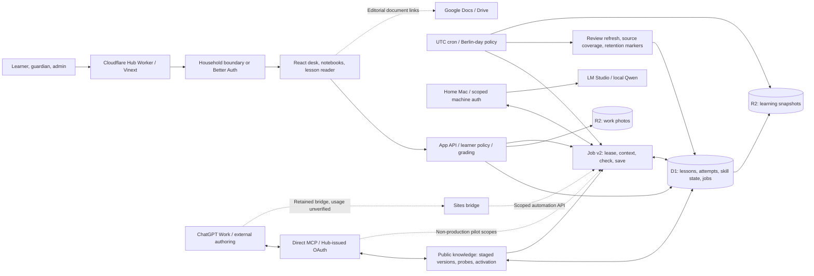

# Learning Hub current state

Audit date: 15 November 2026, Europe/Berlin. Repository evidence is frozen to the revisions below. In these reports, **implemented** means executable source with a reachable entry point in the stated snapshot. **Partial** means a limited path, an unintegrated component, or a missing acceptance gate. **Planned** means a design or a dependency without a complete path. **Retired** means demonstrably disabled or replaced in the named snapshot. Deployment, successful writeback, and pedagogical correctness each require separate evidence.

## Audit baseline and verification

| Evidence layer | Revision or observation | What it establishes |
|---|---|---|
| Checked-out main | `03902ed5fee4292991ed7e838fc9f20a349c61ad` | Clean before audit. 527 tracked files, including 54 API route files, 61 test files and 26 numbered SQL migrations. Baseline for local links and checks. |
| Recorded production | `0625f56`, called `prod-20261113-1` in the status log | Local Git tree is identical to the baseline (`git diff --quiet HEAD 0625f56`). The log records household production and a separately pinned Mac runner. The public health read was unavailable from this environment. Live Worker SHA, bindings, migration status, actual model settings and runner health remain unverified here. |
| Cached upstream main | `ffb6519`, four commits ahead of checkout | [PR #143](https://github.com/unhuman1289/learning-hub/pull/143) adds `docs/plan/HUB-NEXT.md`. Its environment, phone, migration and Qwen gates matter to this roadmap. |
| Recorded staging | `1e85ffdf921fda9799cd0e266eb1c9abf3e68f7c` | Status log dated 15 November 02:50 records both Worker SHAs, D1 through `0030` and smoke success. Later source merges and local browser checks require a new readback. |
| Integration and topic branches | `codex/hub-next-wip` at `2a02136`, plus L3, G2 and T1 topic refs | Per-notebook item kinds, one format for new saves, word comparison and text-grade evidence checks (G1/G2), listening UI/audio, phone work and RUM are in the integration tree. The L3 listening-evidence and T1 tutor slices inspected are separate refs. |
| Fresh isolated local verification | Archived baseline and integration trees, cached lockfile installs, Node 22.23.2 | Baseline 414/414 tests, contracts, typecheck, lint and Vinext build passed. Integration 437/437 tests, contracts, typecheck, lint and Vinext build passed. Its offline Qwen replay passed, including fixtures expected to remain invalid. The first in-place test attempt could not load packages from the empty dependency directory. Clean installs and subsequent checks used temporary copies. |

Coverage included tracked repository inventory and subsystem inspection across application, build, bindings, migration SQL and metadata, contracts, integrations, fixtures, CI, test and ops scripts, and documentation/current and historical plans. The pre-existing Graphify graph contained moved paths and obsolete plan material. Source and Git inspection governed findings. Private learner data, local credentials, and live databases were excluded. Local tests use fixtures and SQLite or fakes. Cloudflare failure modes, live traffic, physical devices and real inference were outside this turn's runtime verification. [Integration status at the audited ref](https://github.com/unhuman1289/learning-hub/blob/2a02136/docs/plan/HUB-NEXT-STATUS.md), [CI](../../.github/workflows/ci.yml), [production and staging configuration](../../wrangler.jsonc), [historical validation](../VALIDATION.md).

## Architecture

The normal browser path is `app/page.tsx` → `app/home-client.tsx` → desk, shelf, notebook and lesson hooks → framework API routes → domain services → D1/R2. There is no separate mandatory backend service between the browser and the Worker. MCP has a shared handler with a standalone staging Worker and production routing in the main Worker. Ambient weather/moon data are cached, use fixed location/date inputs, and sit outside learning decisions. [Worker dispatch](../../build/worker.ts#L35), [front page](../../app/page.tsx#L10), [client shell](../../app/home-client.tsx#L29), [DB entry point](../../db/index.ts#L5), [MCP entry point](../../build/direct-mcp-worker.ts#L24), [ambient API](../../app/api/ambient/route.ts).

## Implemented and partial capability

| Area | Evidence and assessment |
|---|---|
| Learner UX | Vietnamese Sổ Học, personal shelf, Today, primary and extra lessons, lesson drafts, feedback, disputes, summary, progress and guardian contact book. `skill` and `reading` share the lesson workflow. State spans workspace, desk, notebook and lesson queries with background refresh and route state. Integration has deferred panels, phone input/draft and page-turn work. Real device, Vietnam mobile and end-to-end request gates remain open. [Desk](../../app/hub/desk.tsx), [book](../../app/hub/notebook/book.tsx), [reader](../../app/hub/lesson-v2/reader.tsx), [refresh](../../app/hub/use-live-refresh.ts). |
| Authorization | Standalone guard and household boundary precede app requests. Production reference uses the passphrase plus signed selected-profile and management cookies. Optional Access mode validates an Access assertion. In account mode Better Auth owns signup/session/approval. Self edits work. Linked guardians and admins can read work and administer allowed settings, with learner-only submission/completion. The household intentionally trusts people inside its shared gate to select family profiles. This is the clearest blocker to independent tenant use. [Boundary](../../build/worker-boundary.ts), [household](../../lib/household.ts#L119), [session resolution](../../lib/auth/session.ts), [permission matrix](../../lib/access.ts#L27), [profiles route](../../app/api/profiles/route.ts). |
| Machine and connector identity | Automation uses separate machine authentication with bearer, Access policy/assertion and scopes, bounded by learner IDs, purpose, trigger and lease. Direct MCP validates Hub issuer, audience and live consent. Production advertises only `hub:knowledge`. Non-production planner is self-scoped, assessment further gated to the adult Deutsch text pilot. The Sites bridge is retained as another automation client path. WebMCP in supported browsers reads workspace counters and stages draft task completion for manual save. [Automation auth](../../lib/auth/automation.ts), [lease policy](../../lib/ai-jobs/lease.ts#L11), [MCP scopes](../../lib/mcp/metadata.ts), [MCP auth](../../lib/mcp/http.ts#L12), [bridge](../../integrations/sites-bridge/README.md), [WebMCP](../../app/home-client.tsx#L183). |
| Storage and recovery | D1/SQLite SQL migrations govern actual schema. Drizzle declarations/snapshots cover a subset. D1 holds notebook ownership, workspace revisions, lesson packages and materialized items, drafts, evidence, skill/roadmap state, authoring jobs and source versions. R2 separates uploads from backup snapshots. A private auth export is a separate recovery step. Reading an expired photo is blocked by app logic. Nightly code marks rows, and physical deletion depends on bucket lifecycle. Nightly snapshot code reads whole tables and makes a JSON snapshot, which merits measurement as history grows. [Migrations](../../drizzle), [schema](../../db/schema.ts), [photo read](../../lib/uploads/service.ts#L43), [expiry marker](../../lib/learner-model/nightly.ts#L37), [backup implementation](../../lib/backup-store.ts#L15), [backup runbook](../ops/BACKUP.md). |
| Scheduling and assignment | Berlin time derives from UTC cron and an explicit TZ policy. Eligible custom notebooks can queue at most one daily primary after the prior primary was completed before cutoff. Extra requests and legacy tracks have distinct paths. Server writes check the expected state again. A job can succeed with a legitimate no-op. A claimed assignment must be supported by saved lesson IDs. Context snapshot/hash, CAS/apply guards and replay rules protect against stale or uncertain writes. [Cron](../../build/worker.ts#L35), [queue](../../lib/ai-jobs/queue.ts#L194), [daily rules](../../lib/daily-policy.ts), [plan apply](../../lib/ai-jobs/apply/plan.ts), [job result](../../lib/ai-jobs/result.ts). |
| Knowledge | Public-source topic links and notes can be staged and activated by a separate maintenance scope, with provenance, probes, replay, history, gaps and rollback. Bounded lexical retrieval supplies active excerpts to plan contexts. Source freshness and retrieval probes can detect missing coverage. They leave the teaching claim, quality and actual read scope subject to verification. Notes, attempts and feedback occupy separate tables. [Knowledge migration](../../drizzle/0023_knowledge.sql), [topic migration](../../drizzle/0025_knowledge_topics.sql), [search/activation](../../lib/knowledge/service.ts#L54), [MCP tools](../../lib/knowledge/tools.ts#L12). |
| Exercise and learner model | v2/v3 items are instantiated in lessons, with deterministic and rubric pathways. Attempts retain independent/support evidence; feedback/disputes and derived mastery/review are persisted. Progress is notebook-scoped. Study time tracks activity in learner × Berlin day × track counters. A reusable study-session entity, shared course enrollment, and cross-domain concept transfer are gaps. [Submission](../../lib/evidence/submit.ts#L105), [learner rules](../../lib/learner-model/rules.ts#L206), [study SQL](../../lib/study-sql.ts#L37), [learning engine report](03_LEARNING_ENGINE.md). |
| Cloudflare and operations | Worker cron handles queueing, source checks, nightly refresh, maintenance, backup and optional MCP Events. Staging has optional Queue/dispatch infrastructure. The baseline and integration use D1 for durable job ownership. Worker health, logs, runner presence, alerts and job/admin panels help diagnosis. Integration RUM records aggregate timings with bounded payloads. Local and staging commands exist for migration, preservation, restore, auth and CPU. No production saturation or learning SLO can be inferred from these. [Bindings](../../wrangler.jsonc), [MCP bindings](../../wrangler.mcp.jsonc), [alerts](../../lib/alerts.ts), [health](../../app/api/health/route.ts), [staging workflow](../../.github/workflows/deploy-staging.yml), [RUM evidence](https://github.com/unhuman1289/learning-hub/blob/1e85ffd/docs/plan/status/P3-rum.md). |

## Sources of truth

- **Operational release** comes from a named Worker version, source SHA, environment bindings, migration journal and runner revision read together. Health's application version is useful but can be a static label.
- **Learning history** lives in D1. Lesson package plus materialized item rows are written as a unit. Attempts and current grade pointers feed derived skill and roadmap state. Lesson IDs, outcome and persistent job readback establish actual delivery.
- **Editorial knowledge** starts with opened primary sources or editable Docs. The active version in D1 governs Hub retrieval. Docs are editorial links and runner mirror output can support inspection. The app's transactional progress belongs in D1.
- **Contracts and behavior** come from TypeScript validators, generated JSON schemas, SQL constraints and runtime handlers. `LESSON-DESIGN.md` governs pedagogy and sources, `PLAN.md` §6/gates govern the supplied audit baseline, and the merged HUB-NEXT plan and branch status specify newer work for owner reconciliation. [Lesson design](../hub2/LESSON-DESIGN.md), [AI API](../hub2/AI-API.md), [implementation plan](../plan/PLAN.md#6-thứ-tự-pr), [HUB-NEXT at upstream main](https://github.com/unhuman1289/learning-hub/blob/ffb6519/docs/plan/HUB-NEXT.md).

## Mismatches, duplication and operational debt

| Priority | Finding and evidence | Consequence |
|---|---|---|
| P0 | Environment drift creates false completion signals. `FEATURES.md` and `PLAN.md` include dated stages. README and older runner plans mention ChatGPT/Codex grading paths while the executable `runner.mjs` imports and constructs only Qwen. Production OAuth is Knowledge-only. | Use source, deployment receipts and real job outcomes before expanding. [Features](../FEATURES.md), [runner](../../integrations/home-runner/runner.mjs#L5), [MCP metadata](../../lib/mcp/metadata.ts). |
| P0 for independent users | Selected household profiles, email-account mode and machine/OAuth auth are different trust boundaries. Profile scoping protects route operations under the household contract. Shared gate access and profile switching are unsuitable for private histories among strangers. | Keep family use. Treat public launch as a separate identity, tenancy and permissions decision. |
| P0 verification | App expiry and storage deletion are distinct, public-source activation has global effects, and clinical/contact filters are heuristic. Source inventory emits bounded notebook goals/curriculum excerpts for coverage. D1 backup and job context snapshots can carry private evidence. | Verify physical expiry and recovery, audit minimization of source inventory and model context, and sample lifecycle access across environments. [Expiry](../../lib/learner-model/nightly.ts#L37), [knowledge inventory](../../lib/knowledge/service.ts#L233), [privacy filters](../../lib/automation/privacy.ts), [backup table contract](../../lib/backup-contract.mjs). |
| P1 | `/api/learning-run` is retired (410). That retirement differs from the still-present automation v1 run/result/context and legacy daily, slots and reader code. There are parallel v2/v3 ingestion formats and a legacy JSON versus relational roadmap representation. Integration removes old paths and consolidates new saves through `0026`–`0029`. | Finish preservation gates and confirm real callers/data before migrating production. Keep a compatibility reader and reversible release boundary while needed. [Retired route](../../app/api/learning-run/route.ts), [v1 run entry](../../app/api/automation/v1/runs/route.ts), [package union](../../lib/contracts/lesson-package-v3.ts#L85), [roadmap migrations](../../drizzle/0024_roadmap.sql), [integration status](https://github.com/unhuman1289/learning-hub/blob/2a02136/docs/plan/HUB-NEXT-STATUS.md). |
| P1 | `DESIGN.md` labels Docs sync as planned. Current import, links and local Drive mirror have separate purposes. Published source metadata, probe success and a saved grade still require factual or pedagogical review. | Keep factual capability and outcome evidence visible in documentation and UI. [Docs design](../../DESIGN.md#L114), [document links](../../app/google-docs.ts), [mirror](../../integrations/home-runner/mirror.mjs). |
| P1 | Limited run-time visibility. Per-job usage primarily captures the accepted round. Queue delay, cold starts, all retry usage, human correction rates and real mobile timing are separate variables. Scheduled refresh is bounded, so backlog size matters at higher learner counts. | Instrument before capacity or provider decisions. [Runner process](../../integrations/home-runner/job.mjs#L379), [result accounting](../../lib/ai-jobs/result.ts#L147), [nightly limit](../../lib/learner-model/nightly.ts#L11). |

A historical Wrangler-tail sample recorded 6 ms CPU for an ordinary plan lease and 48–122 ms for a much larger lease after truncation work. Those measurements predate the audited snapshot and are neither a percentile distribution nor a current production budget. The current scheduler still walks eligible notebooks and enqueues jobs sequentially. The global daily job cap defaults to 300 in source, and the home runner leases one job at a time. A 1,000-learner budget needs a release-specific row-write, queue-lag, and scheduler load test in addition to token estimates. [Historical CPU sample](../VALIDATION.md#h59-cpu-measurements-and-remaining-risk), [queue and budget](../../lib/ai-jobs/queue.ts), [runner lease request](../../integrations/home-runner/runner.mjs#L59).

The security observations are source-based defensive review findings. Unit coverage includes authorization, payload and data scoping, support and solutions, idempotency, completion/DST, backup and privacy. The audit did not run exploit validation or authenticated production tests. Cloudflare Free D1 limits are enforced when exceeded, so measure rows and Worker CPU at real workload and backup volume before budgeting a public rollout. [API security tests](../../tests/api-security.test.mjs), [Worker boundary tests](../../tests/worker-boundary.test.mjs), [D1 limit enforcement](https://developers.cloudflare.com/changelog/post/2026-09-01-d1-free-tier-limit-enforcement/).
