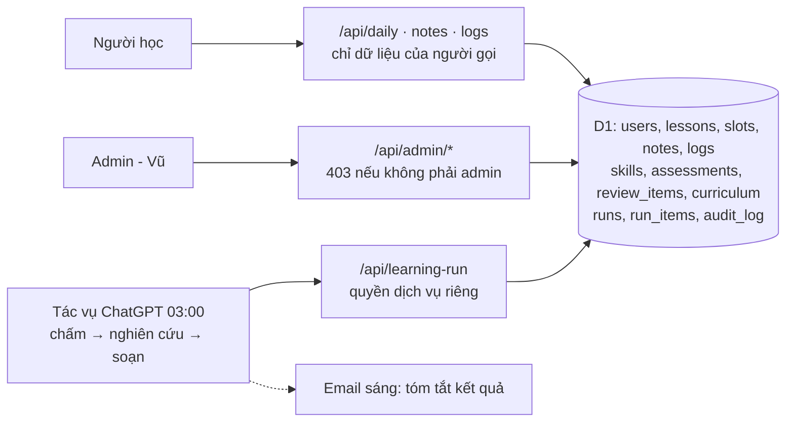
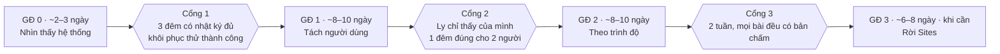

# Kế hoạch sửa Learning Hub — giai đoạn 0–3

Cập nhật: 07/10/2026 · Nguồn: audit repo tại commit `c85376b` (xem doc "Audit Learning Hub").

Cách dùng file này: đổi cột **Trạng thái** (`Chưa làm` → `Đang làm` → `Xong`) khi hoàn thành từng việc. Khi cả một giai đoạn xong và đã qua cổng, ghi ngày vào mục "Nhật ký" ở cuối, rồi chuyển giai đoạn đó sang `docs/plan/archive/`.

## Tóm tắt

Tác vụ 03:00 tiếp tục đọc và ghi qua API của Hub, không chuyển sang Drive/Docs hay email. Mỗi người học có tiến độ riêng; chỉ admin xem được toàn bộ. Năm mảng giữ nguyên: Deutsch, AI, MTB, Cardio, Bột.

1. **Kênh dữ liệu:** API có xác thực của Hub là nguồn dữ liệu duy nhất. Email chỉ dùng để báo kết quả, bằng tính năng thông báo có sẵn của tác vụ. Drive chỉ nhận bản đọc do Hub xuất ra, nếu cần.
2. **Người dùng:** thêm `user_id` cho mọi dữ liệu học. Hai vai trò: `learner` và `admin`. Người học chỉ thấy dữ liệu của mình. Admin có dashboard riêng.
3. **Một tác vụ cho tất cả người dùng.** Gói Plus chỉ cho 5 tác vụ hoạt động cùng lúc, nên mỗi đêm chỉ chạy một tác vụ. Tác vụ nghiên cứu nguồn một lần cho mỗi mảng, rồi soạn bài theo trình độ từng người.
4. **Thứ tự:** 0 nhìn thấy hệ thống đang chạy → 1 tách người dùng, dashboard và admin → 2 bài theo trình độ → 3 rời Sites, chỉ khi thật sự cần.
5. **Rời Sites cũng có nghĩa là đổi nơi chạy tác vụ.** Gói Plus không hỗ trợ MCP tùy chỉnh có quyền ghi. Khi không còn Sites, tác vụ ChatGPT Plus không có cách được hỗ trợ để ghi vào Hub.

## Kênh trao đổi với tác vụ ChatGPT

Câu hỏi thực chất: hôm sau ChatGPT nhận bài làm của người học bằng cách nào, rồi đưa bài mới ngược vào Hub bằng cách nào?

Nên giữ API của Hub. Ghi vào Drive hay gửi email đều bị ChatGPT xếp vào nhóm hành động rủi ro cao cần duyệt. Với tác vụ theo lịch, hành động cần duyệt có thể làm tác vụ dừng lại, mà lúc 03:00 không có ai để bấm duyệt.

| Tiêu chí | API của Hub (hiện tại) | Ghi vào Drive/Docs | Email đi và về |
| --- | --- | --- | --- |
| Đưa bài làm vào ChatGPT | Task gọi `GET /api/learning-run` | Hub xuất ra Doc, task đọc qua app Drive (Hub chưa có đăng nhập Google) | Hub gửi email, task đọc Gmail (Hub chưa gửi được email) |
| Đưa bài mới vào Hub | Task gọi `POST` | Task ghi vào Doc, Hub phải đọc lại Doc (chưa có) | Task trả lời email, Hub phải nhận và phân tích email (chưa có) |
| Cần duyệt lúc 03:00? | Không; dùng quyền dịch vụ có sẵn của Sites | Có thể có | Có thể có |
| Kiểm tra "chỉ thay khi đã xong" | Máy chủ kiểm tra trong một giao dịch | Không có; AI tự giữ quy tắc | Không có |
| Cấu trúc dữ liệu | JSON kiểm tra bằng zod | Văn bản tự do | Văn bản tự do, dễ lỗi định dạng |
| Chạy lại an toàn | Có (ID bài cố định + `expectedId`) | Dễ tạo file trùng | Dễ gửi trùng |
| Dùng tốt nhất cho | Dữ liệu bài học và tiến độ | Tài liệu dài, bản đọc | Thông báo kết quả cho người |

Cách dùng từng kênh:

- **API:** tác vụ gọi GET lấy ngữ cảnh, POST gửi bài, sau đó GET lại để kiểm tra. Giữ nguyên như hiện tại, chỉ bổ sung `user_id` và nhật ký lượt chạy.
- **Email:** bật thông báo Email cho tác vụ trong ChatGPT. Tác vụ kết thúc bằng một đoạn tóm tắt ngắn: mảng nào được thay, mảng nào giữ, lỗi nếu có. Không nhận câu trả lời bài học qua email.
- **Drive:** giữ 6 Google Docs hiện có cho ghi chú dài. Nếu muốn có bản lưu bài học trong Drive, Hub tự xuất bản đọc ra; tác vụ không ghi vào Drive.

Giới hạn của gói Plus cần biết:

- Tối đa 5 tác vụ theo lịch hoạt động cùng lúc; thông báo qua push, email hoặc cả hai.
- MCP tùy chỉnh có quyền ghi chỉ có trên Business, Enterprise và Edu. Pro chỉ được đọc. Tài liệu không nhắc tới Plus.
- Vì vậy, tác vụ chỉ ghi được vào Hub chừng nào Hub còn chạy trên Sites. Nếu rời Sites, cần chuyển tác vụ sang Claude Cowork (chạy trên cloud kể cả khi máy tính tắt, nhưng phải kiểm tra nó gọi được tới domain của Hub). Phương án còn lại là nâng lên gói ChatGPT Business.

**Chưa kiểm chứng:** tài liệu OpenAI không xác nhận tác vụ Plus gọi được HTTP tới Hub; hiện nó chạy nhờ quyền dịch vụ của Sites. Lượt chạy 03:00 ngày 08/10/2026 là phép thử đầu tiên (việc 0.1).

## Người dùng và phân quyền

Danh tính lấy từ đăng nhập. Khi còn chạy trên Sites, đó là `oai-authenticated-user-id`; sau giai đoạn 3 là email do Cloudflare Access xác thực. Vai trò lưu trong D1. Admin đầu tiên được tạo sẵn bằng email của Vũ. Mọi truy vấn lọc theo `user_id` lấy từ phiên đăng nhập, không bao giờ lấy từ nội dung request.

| Dữ liệu | Người học (của mình) | Người học khác | Admin |
| --- | --- | --- | --- |
| Bài đang học và lịch sử | Xem, làm bài | Không thấy | Xem |
| Câu trả lời, điểm, phản hồi | Xem, sửa câu trả lời | Không thấy | Xem |
| Ghi chú, nhật ký, giờ học | Xem, sửa | Không thấy | Xem |
| Mục tiêu và trình độ từng mảng | Xem | Không thấy | Sửa |
| Nhật ký lượt chạy 03:00 | Phần của mình | Không thấy | Toàn bộ, chạy lại cho một người |
| Quản lý người dùng | Không | Không | Mời, khóa, đổi vai trò, bật hoặc tắt từng mảng |

Mô hình dữ liệu:

- `users`: `id`, `email`, `display_name`, `role` (`learner` hoặc `admin`), `status`, `created_at`.
- `user_tracks`: một dòng cho mỗi người × mỗi mảng, gồm `enabled`, `level`, `goal` và `updated_at`. Năm mảng cố định; admin chỉ bật hoặc tắt, không thêm mảng mới.
- `learning_lessons` thêm `user_id`. ID bài đổi thành `daily-<ngày>-<user>-<mảng>`. `learning_slots` có khóa chính `(user_id, track)`.
- `runs` và `run_items` thay cho `learning_runs`. Mỗi lượt chạy có một dòng riêng. Mỗi cặp người × mảng ghi kết quả `updated`, `kept`, `skipped` hoặc `error`, kèm lý do.
- `notes` và `logs` có `user_id`, thay cho khối JSON chung.
- `audit_log`: ghi lại mọi thao tác của admin.

Chuyển dữ liệu cũ: 5 bài đang học và workspace chung hiện tại được gán cho Vũ. Người học mới bắt đầu với bài đầu tiên của cả 5 mảng, ở trình độ admin đặt.

## Kiến trúc đích

Sau giai đoạn 1–2, Hub vẫn chạy trên Sites nhưng chia thành ba cửa API, mỗi cửa có quyền riêng.

Tác vụ chỉ ghi vào Hub qua `/api/learning-run`; email chỉ dùng để báo kết quả, không mang dữ liệu ngược về Hub.

## Lộ trình

Tổng cộng khoảng 18–23 ngày làm việc cho giai đoạn 0–2; giai đoạn 3 là tùy chọn. Ngày làm việc tính cho một người lập trình có AI hỗ trợ, chưa tính thời gian chờ các đêm chạy thử.

Chỉ sang giai đoạn tiếp khi đã qua cổng.

## Giai đoạn 0 — nhìn thấy hệ thống đang chạy

Mục tiêu: biết chắc tác vụ 03:00 có chạy hay không, đã làm gì, lỗi ở đâu. Mọi thay đổi sau đó có CI bảo vệ. Ước lượng 2–3 ngày làm việc.

| # | Việc | File chính | Xong khi | Trạng thái |
| --- | --- | --- | --- | --- |
| 0.1 | Kiểm tra lượt chạy sáng 08/10 | (không code) | Mảng đã xong có bài mới, mảng chưa xong giữ nguyên, câu trả lời cũ còn, `learning_runs` có dòng ngày 08/10 | Chưa làm |
| 0.2 | Thêm CI: test và typecheck mỗi lần push | `.github/workflows/ci.yml` | Một PR có test sai thì báo đỏ | Xong |
| 0.3 | Nhật ký lượt chạy chỉ ghi thêm: bảng `runs`, `run_items`; tác vụ gửi `runId` | `drizzle/0002_*.sql`, `lib/daily-store.ts` | Hai lần POST trong một ngày tạo hai dòng `runs`; có test | Xong |
| 0.4 | GET `/api/learning-run` ghi `started`, POST ghi `finished` | `app/api/learning-run/route.ts` | Lượt chỉ có `started` quá 2 giờ thì hiện là lỗi | Xong |
| 0.5 | Banner cảnh báo và chi tiết lượt chạy trên trang Hôm nay | `app/daily-learning.tsx` | Quá 26 giờ không có lượt thành công thì hiện cảnh báo; mỗi mảng ghi rõ được thay hay giữ và lý do | Xong |
| 0.6 | Lỗi máy chủ trả 5xx, lỗi dữ liệu trả 400 | các API route | Tác vụ phân biệt được lúc nên thử lại và lúc nên dừng | Xong |
| 0.7 | Nút "Tải bản sao lưu" (JSON toàn bộ bảng) và lịch nhắc sao lưu hằng tuần | `app/api/export/route.ts` | Khôi phục được bản tải về vào D1 local bằng `npm run db:restore:local` | Đang làm |
| 0.8 | Cập nhật prompt tác vụ: gửi `runId`, kết thúc bằng tóm tắt ngắn; bật thông báo Email | `LEARNING-UPDATES.md`, cài đặt tác vụ ChatGPT | Mỗi sáng nhận một email: mảng nào được thay, mảng nào giữ, lỗi nếu có | Đang làm |

**Ghi nhận triển khai 07/10:** mục 0.3–0.6 xong trong source/local và có test, **chưa publish live** vì kết nối Sites không tìm thấy project. Mục 0.7 đã tải và restore đủ 7 bảng local, nhắc tuần trên Hub đã có; nhắc cloud chờ prompt live. Mục 0.8 mới chuẩn bị prompt, chưa bật Email. Mục 0.2 đã kiểm chứng PR đỏ đúng do test sai trên GitHub; test kiểm chứng tạm đã bỏ. Mục 0.1 chưa đến thời điểm chạy thật.

Sau migration 0002, dùng `runs`/`run_items` để kiểm chứng mục 0.1, thay nhật ký `learning_runs` ghi theo ngày; bảng cũ vẫn giữ nguyên dữ liệu export. Xem [vận hành phase 0](../PHASE-0-OPERATIONS.md).

**Chuyển giai đoạn khi:** bản mới đã publish, 3 đêm liên tiếp có nhật ký đầy đủ, và đã có một bản sao lưu khôi phục thử thành công. Chưa qua cổng; không bắt đầu giai đoạn 1.

## Giai đoạn 1 — tách người dùng, dashboard thật, trang admin

Mục tiêu: mỗi người có bài và tiến độ riêng; dashboard đếm từ D1; admin xem được ai học ra sao và mỗi đêm đã cập nhật gì. Ước lượng 8–10 ngày làm việc.

| # | Việc | File chính | Xong khi | Trạng thái |
| --- | --- | --- | --- | --- |
| 1.1 | Migration: `users`, `user_tracks`, `notes`, `logs`, `audit_log`; thêm `user_id` vào bài và slot; gán dữ liệu cũ cho Vũ | `drizzle/0003_*.sql`, `db/schema.ts` | Chạy trên bản khôi phục local, số dòng và ID khớp trước–sau | Chưa làm |
| 1.2 | Lớp xác thực `requireUser()` và `requireAdmin()`. Người chưa được mời nhận 403 | `lib/auth.ts` (thay `app/chatgpt-auth.ts`) | Mọi route gọi qua lớp này; không route nào đọc trực tiếp header | Chưa làm |
| 1.3 | Lọc theo người dùng cho `/api/daily`, `/api/notes`, `/api/logs`; bỏ `/api/state` sau một bản chuyển tiếp | `app/api/*` | Test: người A gọi ID của B nhận 404 | Chưa làm |
| 1.4 | `/api/learning-run` nhiều người: GET trả mảng đủ điều kiện theo từng người; POST có `userId`; tối đa 10 bài mỗi lượt, ưu tiên người chờ lâu nhất | `lib/daily-store.ts`, `lib/daily-sql.ts` | Bài vượt giới hạn được ghi `kept` kèm lý do; test thay bài độc lập giữa hai người | Chưa làm |
| 1.5 | Đưa bài khởi đầu và hai dự án từ `content.ts` vào D1 (`milestones` theo người) | `app/content.ts`, migration seed | Không còn số liệu nào trên trang đếm từ file tĩnh | Chưa làm |
| 1.6 | Dashboard người học: mỗi mảng hiện bài hiện tại, số ngày đang học, số bài xong trong 7 và 30 ngày, chuỗi ngày học, phút đã ghi so với 240 | `app/(learner)/today` | Số liệu khớp với truy vấn D1 trực tiếp | Chưa làm |
| 1.7 | Trang admin `/admin`: bảng người × mảng, nhật ký lượt chạy, xem bài và câu trả lời, mời/khóa người dùng, sửa trình độ và mục tiêu, đánh dấu "tạo lại bài" | `app/admin/*`, `app/api/admin/*` | Người học vào `/admin` nhận 403; mọi thao tác admin có trong `audit_log` | Chưa làm |
| 1.8 | Tự lưu ghi chú và nhật ký (sau 1,5 giây ngừng gõ); lịch sử có phân trang, lọc theo mảng; API danh sách chỉ trả tiêu đề | `app/journal`, `app/history` | Không còn nút "Lưu thay đổi"; response danh sách dưới 50 KB | Chưa làm |
| 1.9 | Tách `page.tsx` thành component theo trang; chữ tối thiểu 12px; màu phụ đạt 4,5:1; sửa nút tiêu đề thẻ; xoá component và thư viện thừa | `app/*`, `app/globals.css`, `package.json` | Lighthouse Accessibility từ 90 trở lên | Chưa làm |
| 1.10 | Test: phân quyền, migration, lượt chạy nhiều người | `tests/*` | CI xanh | Chưa làm |

Trang admin cần hiển thị:

- Mỗi người × mảng: bài hiện tại, số ngày kẹt, số bài xong trong 7 và 30 ngày, lần hoạt động cuối, trình độ hiện tại.
- Nhật ký lượt chạy: thời điểm, trạng thái, từng cặp người × mảng được thay, giữ hay lỗi, kèm lý do và nguồn đã dùng.
- Mở từng bài: nội dung, câu trả lời, (giai đoạn 2) điểm và phản hồi.

**Chuyển giai đoạn khi:** Ly đăng nhập chỉ thấy dữ liệu của mình; Vũ với vai trò admin thấy cả hai; một đêm chạy tạo đúng bài cho cả hai người.

## Giai đoạn 2 — bài học theo trình độ

Mục tiêu: mỗi bài đã xong đều được chấm và có phản hồi. Bài tiếp theo nhắm vào đúng chỗ còn yếu, kèm câu ôn tập đến hạn. Ước lượng 8–10 ngày làm việc.

Vòng lặp mỗi đêm, cho từng người × mảng đủ điều kiện:

1. Chấm bài vừa xong theo rubric: điểm từng câu, phản hồi, lỗi hiểu sai.
2. Cập nhật mức nắm vững của các kỹ năng liên quan. Biến câu sai hoặc chưa chắc thành câu ôn tập.
3. Chọn chủ đề tiếp theo: kỹ năng yếu nhất trong giáo trình mà đã học đủ bài tiên quyết.
4. Nghiên cứu nguồn một lần cho mỗi mảng, rồi soạn bài theo trình độ của từng người.

| # | Việc | File chính | Xong khi | Trạng thái |
| --- | --- | --- | --- | --- |
| 2.1 | Bảng `skills` (mức nắm vững theo người × kỹ năng), `assessments` (điểm, phản hồi theo bài), `review_items` (câu ôn, ngày đến hạn) | `drizzle/0004_*.sql` | Migration và test qua | Chưa làm |
| 2.2 | Bảng `curriculum`: danh sách kỹ năng và bài tiên quyết cho 5 mảng, có phiên bản; admin sửa được | `app/admin/curriculum` | `UPDATE_INSTRUCTIONS` không còn chứa mục tiêu hay trình độ viết cứng | Chưa làm |
| 2.3 | Payload POST có thêm `assessments` và `reviewItems`; máy chủ kiểm tra bài được chấm đã xong và thuộc đúng người | `lib/daily-store.ts` | Không ghi được điểm cho bài chưa xong hoặc bài của người khác | Chưa làm |
| 2.4 | GET trả ngữ cảnh gọn: bảng kỹ năng, 3 lần chấm gần nhất mỗi mảng, câu trả lời trong 14 ngày | `learningContext` | Dưới 50 KB mỗi người | Chưa làm |
| 2.5 | Giao diện: phản hồi hiện trên bài đã xong; mục "Ôn hôm nay" tự chấm (lại / khó / tốt); trình độ theo mảng; nút "Cần giải thích thêm" | `app/today`, `app/review` | Câu ôn đến hạn hiện đúng ngày theo khoảng 1, 3, 7, 14, 30 ngày | Chưa làm |
| 2.6 | Mảng kẹt quá 3 ngày: nhắc trong email sáng và trên dashboard; cờ "ưu tiên" cho lượt 03:00 kế tiếp | `lib/daily-policy.ts` | Admin thấy danh sách mảng kẹt | Chưa làm |
| 2.7 | Hiển thị markdown an toàn (không cho HTML thô) và sơ đồ Mermaid | `app/lesson-view.tsx` | Bài có bảng, danh sách, sơ đồ hiển thị đúng | Chưa làm |
| 2.8 | Kiểm tra nguồn khi nhận bài: định dạng DOI/PMID; URL truy cập được; `retrievedAt` trong 48 giờ | `lib/source-check.ts` | Nguồn không hợp lệ bị đánh dấu trên bài và trong nhật ký | Chưa làm |

Ví dụ bộ kỹ năng khởi đầu (admin duyệt trước khi dùng):

- Deutsch: Sprechen, Schreiben, Hören, Lesen, Grammatik, Wortschatz — đo theo CEFR.
- MTB: đọc VCF, phân loại biến thể, mức bằng chứng điều trị, PGx, pathology cơ bản.
- AI: thiết kế multiagent, đánh giá hồi cứu, quản lý bằng chứng, triển khai và vận hành.
- Cardio: giải phẫu và sinh lý van hai lá, phân loại MR, thiết kế nghiên cứu, viết protocol.
- Bột: ăn và ngủ, vận động, giao tiếp, tương tác và tự tin — theo dõi bằng quan sát, không chấm điểm.

**Chuyển giai đoạn khi:** sau 2 tuần, mọi bài đã xong đều có bản chấm, và trình độ của bài mới thay đổi theo điểm.

## Giai đoạn 3 — rời Sites (chỉ khi cần)

Chỉ làm khi có lý do cụ thể: cần quyền kiểm soát hosting, Sites giới hạn, hoặc muốn mời người không dùng ChatGPT. Việc đầu tiên là thử nơi chạy tác vụ mới, vì tác vụ ChatGPT Plus sẽ không ghi được vào Hub khi Hub không còn trên Sites. Ước lượng 6–8 ngày làm việc.

| # | Việc | File chính | Xong khi | Trạng thái |
| --- | --- | --- | --- | --- |
| 3.1 | Chạy thử nơi chạy tác vụ mới: Claude Cowork (gọi HTTP tới domain của Hub) hoặc ChatGPT Business | (thử nghiệm) | Một lượt chạy thử đọc và ghi được staging khi máy tính tắt | Chưa làm |
| 3.2 | Tạo D1 thật và cấu hình production trên tài khoản Cloudflare riêng, dùng Workers Free | `wrangler.toml` | Migration chạy sạch trên DB trống | Chưa làm |
| 3.3 | Cloudflare Access chắn trước learn.unhuman.cc; app kiểm tra JWT `Cf-Access-Jwt-Assertion` rồi ánh xạ email sang `users` | `lib/auth.ts` | Gửi header giả không có JWT hợp lệ nhận 401 | Chưa làm |
| 3.4 | Xác thực cho tác vụ: service token riêng, quyền đọc và ghi tách biệt, lưu trong Worker secret, có quy trình đổi token | `app/api/learning-run/route.ts` | Token đọc không POST được; token cũ bị từ chối sau khi đổi | Chưa làm |
| 3.5 | Bỏ code riêng của Sites (`chatgpt-auth`, `connector-*`, `sites-vite-plugin`); cân nhắc chuyển khỏi `vinext` bản beta | `build/*`, `lib/connector*` | Build và test qua không cần Sites | Chưa làm |
| 3.6 | Chuyển dữ liệu: tạm khoá ghi, export từ Sites, import, so sánh số dòng và ID | `scripts/migrate-from-sites.mjs` | Mọi bảng khớp 100% | Chưa làm |
| 3.7 | Chạy trên domain staging, đo CPU và D1; tác vụ mới chạy thử không ghi một đêm; chuyển DNS; tắt lịch cũ của Sites | DNS, cài đặt tác vụ | Không có đêm nào hai tác vụ cùng ghi | Chưa làm |
| 3.8 | Sao lưu tự động: D1 Time Travel và GitHub Action chạy `wrangler d1 export` hằng tuần | `.github/workflows/backup.yml` | Khôi phục thử thành công từ bản tuần trước | Chưa làm |

**Xong khi:** một tuần chạy ổn trên hosting mới, không mất dữ liệu, nhật ký lượt chạy đủ 7 đêm.

## Rủi ro và câu hỏi mở

| Rủi ro | Ảnh hưởng | Cách giảm |
| --- | --- | --- |
| Tác vụ Plus không đủ sức soạn nhiều bài trong một lượt | Một số người hoặc mảng không có bài mới | Giới hạn 10 bài mỗi lượt, ưu tiên người chờ lâu nhất, nghiên cứu nguồn chung cho mỗi mảng |
| Sites thay đổi hoặc ngừng cung cấp quyền dịch vụ | Tác vụ không ghi được nữa | Có nhật ký và cảnh báo từ giai đoạn 0; giai đoạn 3 là phương án dự phòng |
| Migration sang nhiều người làm hỏng dữ liệu đang học | Mất câu trả lời | Sao lưu trước; chạy thử trên bản khôi phục local; so sánh số dòng |
| AI chấm bài sai | Trình độ bị đẩy sai hướng | Hiện điểm và phản hồi cho người học; cho phép báo "chấm sai"; admin sửa được trình độ |
| Dữ liệu gia đình và ý tưởng chưa công bố đi qua ChatGPT mỗi đêm | Lộ thông tin riêng tư | Chỉ gửi ngữ cảnh gọn (mục 2.4); không gửi ghi chú riêng trừ khi người học đánh dấu |

Câu hỏi mở:

- Admin đọc được toàn văn câu trả lời và nhật ký của người khác, hay chỉ thấy số liệu và phản hồi?
- Mảng Bột: mỗi phụ huynh một tiến độ riêng, hay hai người cùng ghi vào một nhật ký quan sát chung?
- Ly có tài khoản ChatGPT để đăng nhập Sites không? Nếu không, giai đoạn 3 phải làm sớm hơn.
- ChatGPT có cho chạy tác vụ theo lịch bằng tay không? Nếu có, có thể làm nút "Tạo bài tiếp ngay" một cách thủ công.

## Nhật ký

| Ngày | Việc | Ghi chú |
| --- | --- | --- |
| 07/10/2026 | Lập kế hoạch | Trạng thái ban đầu trước triển khai; chưa có kế hoạch cũ để lưu trữ. |
| 07/10/2026 | Triển khai source giai đoạn 0 | 8 test qua; typecheck, lint, build qua. Chrome desktop/mobile không tràn ngang; 5 bài/câu trả lời không đổi; replay không sinh lượt trùng. |
| 07/10/2026 | Restore backup tải bằng nút Hub local | Bảy bảng: workspace 1, lessons 5, slots 5, learning_runs 1, runs 1, run_items 5, backup_events 1; mọi giá trị khớp. Lượt manual local không tính vào cổng ba đêm. |
| 07/10/2026 | CI từ chối PR có test sai | [Lượt PR đỏ](https://github.com/unhuman1289/learning-hub/actions/runs/37633696510); 8 test sản phẩm qua, 1 assertion cố ý sai. Probe đã bỏ khỏi source cuối. |
| 07/10/2026 | Chờ kết nối Sites | Project trả NOT_FOUND, danh sách Sites rỗng; chưa publish, chưa đổi tác vụ cloud, chưa bật Email. |

## Nguồn

- [Scheduled tasks in ChatGPT](https://help.openai.com/en/articles/10291617-scheduled-tasks-in-chatgpt): giới hạn 5 tác vụ trên Plus, thông báo push/email, hành động cần duyệt có thể làm tác vụ dừng
- [Managing app permissions in ChatGPT](https://help.openai.com/articles/20001495): gửi email và tạo, sửa file là hành động rủi ro cao
- [Google Drive app and setup](https://help.openai.com/articles/10929079): Drive đọc và ghi được, nhưng có thể hỏi xác nhận
- [Developer mode and full MCP connectors](https://help.openai.com/en/articles/12584461-developer-mode-apps-and-full-mcp-connectors-in-chatgpt-beta): MCP có quyền ghi chỉ trên Business, Enterprise, Edu
- [Schedule recurring tasks in Claude Cowork](https://support.claude.com/en/articles/13854387-schedule-recurring-tasks-in-claude-cowork): chạy trên cloud khi máy tính tắt
- Repo Learning Hub, commit `c85376b`: `docs/AUTOMATION.md`, `LEARNING-UPDATES.md`, `lib/daily-store.ts`
