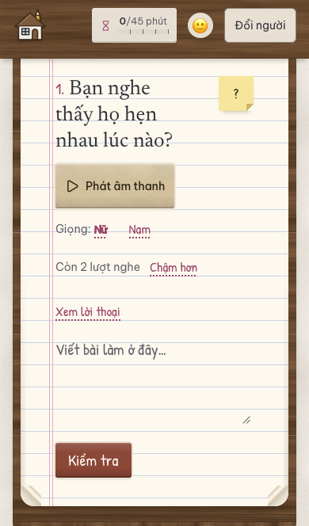
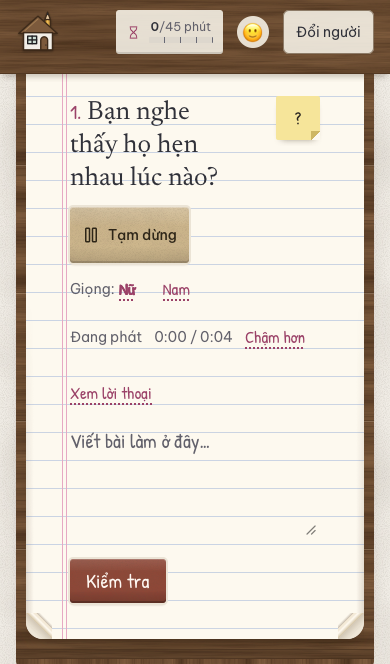
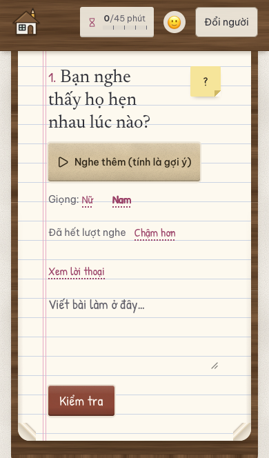
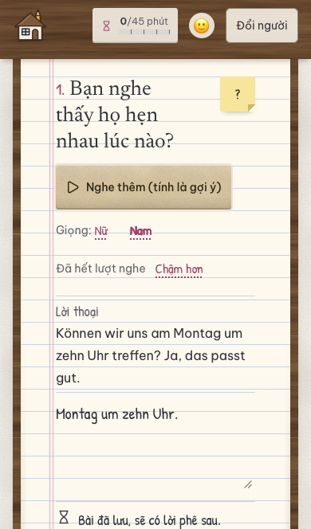

# L5 · Giao diện nghe

15/11/2026 · `codex/l5-listening-ui` → `codex/hub-next-wip` · Kiểm local với hồ sơ demo. [PR #163](https://github.com/unhuman1289/learning-hub/pull/163).

- Trang bài có nút nghe 56 px, lượt nghe, hai giọng, nghe chậm giữ cao độ, phát lại khi gián đoạn, phím Space/R và lời thoại theo trạng thái nộp câu. Câu vẫn làm được khi chưa có âm thanh. Màn bài tải trước âm thanh của câu đang thấy và câu kế tiếp.
- Hồ sơ lưu `listeningVoice` và `replaceAudioWithText` qua API cài đặt. Quyền hiện tại trả 403 khi hồ sơ trẻ em tự sửa cài đặt. Nếu bị từ chối, lựa chọn giọng áp dụng cho bài đang mở và Hub báo chưa lưu vào hồ sơ.
- Dải mở bằng Safari/Chrome chỉ xuất hiện trong Zalo hoặc Messenger khi bài có câu nghe. Nút sao chép dùng liên kết của bài hiện tại.
- Lượt nghe ở giao diện tính khi phát hết đoạn và được giữ khi lật trang trong cùng một phiên bài. Phát lại sau lỗi không trừ lượt. Client gửi `plays` và `reveal` theo L3, bỏ qua 404. L3 cần trả lời thoại qua `{ transcript: string }` và cung cấp số lượt đã lưu để khôi phục sau khi mở lại bài.
- Tệp AAC mono demo 31.636 byte được tạo bằng `say -v Anna -r 145` rồi mã hóa sang m4a. E2e dùng bài demo local, chèn metadata L2 vào phản hồi đọc bài và mô phỏng endpoint L3. Phản hồi Range 206, phát media, đếm lượt, lỗi phát, đổi giọng, phát 0,8×, lời thoại sau khi nộp, cài đặt chữ và nhận diện Zalo được kiểm trong Playwright.

## Kiểm tra

- `npm run test` (431 test), `npm run typecheck`, `npm run lint`, `npm run build` đạt.
- `npm run test:e2e:listening` đạt trên iPhone 13 / WebKit và Pixel 7 / Chromium trên macOS. Cả hai đều chạy media thật trong trình duyệt. Nhánh Linux WebKit trong test kiểm giao diện và Range bằng sự kiện media mô phỏng.
- Hồi quy U5/U6 đạt 4/4 trên hai cấu hình.
- Bàn học tải 176.656 byte JS gzip trên cả hai cấu hình (ngưỡng 180.000 byte). Chuỗi giao diện audio nằm trong chunk tải động của màn bài.

## Ảnh 390 px

| Chưa nghe | Đang phát | Hết lượt | Lời thoại |
| --- | --- | --- | --- |
|  |  |  |  |

## Còn lại

- Kiểm với URL âm thanh L2 và phản hồi L3 thật, kể cả chứng cứ nghe, quyền lưu cài đặt của hồ sơ trẻ em và khôi phục lượt đã ghi.
- L6 thử máy thật, gồm iPhone gạt im lặng, Bluetooth và trình duyệt trong ứng dụng. Chưa deploy staging hay production.

## 16/11/2026 · Nghiệm thu sau khi gộp L3

SHA tích hợp đã kiểm `384c1331b6df217fa07ec5cd1db750c77cbd9392` (`codex/hub-next-wip`), có L2 [#164](https://github.com/unhuman1289/learning-hub/pull/164), L3 [#167](https://github.com/unhuman1289/learning-hub/pull/167) (merge `4e4a04c`) và bản sửa ngân sách bàn học [#169](https://github.com/unhuman1289/learning-hub/pull/169). Ghi nhận trên nhánh riêng `codex/l5-integrated-verification`.

`npm run test:e2e:listening` đạt **8/8** trên macOS, gồm 4 ca cho iPhone 13 / WebKit và 4 ca cho Pixel 7 / Chromium. Qua Worker, D1 và R2 local:

| Kiểm tra | Kết quả trên cả hai cấu hình |
| --- | --- |
| Hai giọng | Hai tệp AAC Đức nữ/nam riêng trong R2, truy vấn Range trả 206 và byte khác nhau |
| Đổi giọng, phát lại sau lỗi | Sau lượt đầu, đổi giọng và phát lại sau lỗi mạng vẫn đọc lại đúng 1 lượt đã lưu |
| Chậm hơn | Playback 0,8× giữ cao độ. Lượt thứ hai lưu vào D1 và bài nộp mang `hint1`, kể cả khi nộp trong lúc phát |
| Mở lời thoại sau khi nộp | Không hỏi xác nhận. API trả lời thoại và giữ nguyên `hint1` đã có |
| Mở lời thoại trước khi nộp | Có hộp xác nhận. Sau khi đồng ý, API trả `hint2` và bài nộp câu đó ghi `hint2` |
| Mở lại bài | API trả 2 lượt đã lưu. Giao diện hiện “Nghe thêm (tính là gợi ý)” và giữ giọng Nam |
| JS gzip bàn học | 176.805 B, dưới giới hạn 180.000 B |

Luồng chính phát media thật. Ca lỗi chỉ chặn request âm thanh để giả lập gián đoạn, và hai ca nộp trong lúc phát giữ sự kiện kết thúc có chủ đích. API nghe, lời thoại và nộp bài đều gọi Worker local thật. Build, typecheck và lint đạt. Loa, gạt im lặng, Bluetooth và Zalo trên máy thật thuộc L6. Không deploy trong lượt này.
